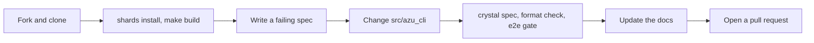

# Contributing to Azu CLI

## Overview & visual demo

Azu CLI is a Crystal program. Commands live in `src/azu_cli/commands/`, generators in `src/azu_cli/generators/` with their templates beside them, and specs in `spec/`. A change is ready when `crystal spec`, the format check and the generated-app gate pass, and the docs describe what the command really prints.

<figure><figcaption><p>Check a generator change here first. The preview lists every file the generator would write, with a diff for each edit.</p></figcaption></figure>



## Quickstart & command syntax

### Set up and build

Fork the repository on GitHub, then clone your fork. Crystal 1.22.1 is the version the repository is pinned to (`.tool-versions`). CI also builds with the latest Crystal release.

```bash
git clone https://github.com/<your-user>/azu_cli
cd azu_cli
shards install
make build          # builds bin/azu, which the integration specs run
crystal spec
```

| Task                    | Command                                                                       |
| ----------------------- | ----------------------------------------------------------------------------- |
| Install shards          | `shards install`                                                              |
| Build `bin/azu`         | `make build`, or `crystal build -o bin/azu src/azu_cli.cr -p --no-debug`      |
| Install on your `PATH`  | `make install` (copies to `/usr/local/bin/azu`, may need sudo)                |
| Run from source         | `crystal run src/azu_cli.cr -- doctor`                                        |
| All specs               | `crystal spec`                                                                |
| One spec file           | `crystal spec spec/azu_cli/integration/joobq_generator_spec.cr`               |
| Format check (CI)       | `crystal tool format --check ./src`                                           |
| Docs check              | `python3 scripts/check_docs.py`                                               |

### End-to-end gates

The gates generate a real project with the built `bin/azu`, install its shards, compile it, boot it and drive it with `curl`: scaffold CRUD, a chat channel, session authentication, CSRF and cookies. Run them after `make build`.

```bash
scripts/e2e_generated_app.sh web      # or: api
E2E_DB=postgresql scripts/e2e_generated_app.sh web   # boots only, no database server
scripts/e2e_docker.sh web             # needs a docker daemon, so CI does not run it
```

| Variable          | Effect                                                                                  |
| ----------------- | --------------------------------------------------------------------------------------- |
| `E2E_DB`          | Database for `azu new`. Unset means SQLite. `postgresql` only boots the app             |
| `E2E_SKIP_DEV`    | `1` skips the `azu dev` check, which adds two compiles                                   |
| `E2E_REDIS_URL`   | A Redis to run a generated JoobQ job through. Unset skips that check                    |
| `E2E_AZU_BRANCH`  | Pins the generated project's azu dependency to a branch, for example `master`           |
| `AZU_BIN`         | The azu binary to test. Defaults to `bin/azu` in the repository                         |
| `KEEP_TMP`        | `1` keeps the temporary project for debugging                                           |

Without Crystal on the host, run the web gate in the official image. This is the command from the project's `CLAUDE.md`:

```bash
docker run --rm -v "$PWD":/work -w /work crystallang/crystal:1.22.1 \
  sh -c 'apt-get update && apt-get install -y libreadline-dev libevent-dev libssl-dev libxml2-dev libyaml-dev libgmp-dev libsqlite3-dev sqlite3 curl \
         && shards install && shards build && scripts/e2e_generated_app.sh web'
```

### Adding a command

1. Create the file in `src/azu_cli/commands/`. A subdirectory such as `commands/jobs/` is fine. `azu_cli.cr` loads `commands/**` with a glob, so no `require` is needed.

   ```crystal
   module AzuCLI
     module Commands
       class Hello < Base
         def initialize
           super("hello", "Say hello from the project")
         end

         def execute : Result
           stdout.puts "hello"
           success("hello printed")
         end

         def show_examples
           stdout.puts "  azu hello"
         end
       end
     end
   end
   ```

2. Register it in `CLI#setup_commands` in `src/azu_cli/cli.cr`: `register_command("hello", Commands::Hello)`. Add aliases the same way.
3. `show_help` prints the usage from the description. Override `show_examples` for the examples.
4. If the command writes data to stdout, as `azu doctor` does, override `machine_output?` so the CLI adds no log lines to it. Write to `stdout`, not `STDOUT`, so specs can capture it.
5. Add a spec in `spec/azu_cli/commands/`. `version_spec.cr` and `doctor_spec.cr` are short examples.
6. Document it: a page under `docs/commands/`, listed in `docs/SUMMARY.md`.

### Adding a generator

1. Copy the closest generator. `src/azu_cli/generators/middleware.cr` is a small one. It is a `Teeplate::FileTree` whose `directory` points at its template folder, with an `OUTPUT_DIR` constant. Templates are ECR files that read instance variables such as `<%= @name %>`.

   ```crystal
   require "teeplate"

   module AzuCLI
     module Generate
       class Hello < Teeplate::FileTree
         directory "#{__DIR__}/../templates/hello"
         OUTPUT_DIR = "./src/hellos"

         property name : String

         def initialize(@name : String)
         end
       end
     end
   end
   ```

2. Validate the name before it reaches generated code. `Generate::Channel.name_error` and `Generate::Resource.name_error` return the message to show.
3. Wire it into `src/azu_cli/commands/generate.cr`: a `when "hello"` branch in the `case @generator_type.downcase` of `execute`, and a `generate_hello` method that calls `render_generator(generator, Generate::Hello::OUTPUT_DIR)`.
4. Add an integration spec in `spec/azu_cli/integration/`. Use `with_temp_project` and `run_generator`: they run `bin/azu` in a temporary directory, so rebuild first.

### Pull requests

1. Create a branch: `git checkout -b my-new-feature`.
2. Commit and push: `git push origin my-new-feature`.
3. Open a pull request against `master`. The CI matrix (Crystal 1.22.1 and latest) and the generated-app gates must pass.

## Realistic output

`azu version` writes plain text when its output is not a terminal, such as a pipe. The text comes straight from the version command:


```text
Azu CLI v0.1.46
Crystal 1.22.1
Topia CLI Framework

Plugins:
  - Generator Plugin v1.0.0
  - Database Plugin v1.0.0
  - Development Plugin v1.0.0
```


*The version comes from `shard.yml`, and the Crystal line is the compiler that built the binary.*

## Do's and don'ts

Quality rules from the PR reviews. Every change is held to them:

- Validate every name a generator turns into an identifier or a path. Never interpolate raw input into generated Crystal.
- No hard-coded secrets. Generated code reads them with `Azu::Env.secret("NAME")`, and a random value goes in the git-ignored `.env`.
- Escape template output with `| e` on user values. HTML you build yourself is printed with `| safe`.
- Redirects after a write answer `303`.
- Check what a generator would overwrite and refuse it, as `Generate::Auth.conflict` does. Migration class names must be unique.
- Document only commands and flags that are registered. `azu help` lists what exists.


Write the failing assertion first. A spec that cannot fail proves nothing, so watch it fail before you write the fix.



**Pro tip:** `azu generate <type> <name> --dry-run` shows the files a generator would write. Use it to check a template change without touching the project.



The integration specs run `bin/azu`, not the code in `src/`. After you change the CLI, run `make build` before `crystal spec`, or those specs test the old binary.



Don't write generated test projects into the repository. The integration helpers create them in the system temp directory. Don't commit `.env` or a secret value, even in a fixture.


For the documentation rules, see [Writing documentation](design/writing-docs.md), and run `python3 scripts/check_docs.py` before you push.

How the CLI works inside, for contributors, is in [`design/`](design): the [command lifecycle](design/cli-lifecycle.md), the [generator system](design/generator-system.md), the [template engine](design/template-engine.md) and the [terminal UI design](design/terminal-ui.md). These are not part of the published docs.
