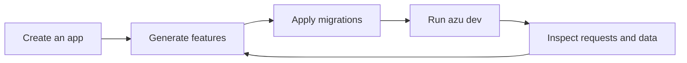

# Azu CLI

Azu CLI takes you from an empty directory to a running Crystal application, then keeps the tools you need close by: generators, migrations, live diagnostics, background jobs, and a console.

## Overview & visual demo

The development dashboard shares its metrics with Azu's browser dashboard. Start with health and traffic, then follow a slow request into SQL, an exception, or a background job. Missing telemetry stays visible as unavailable; an empty counter is never presented as proof that a service is healthy.

<figure><figcaption><p>The actual Crystal renderer, using clearly labeled sample data.</p></figcaption></figure>



## Quickstart & command syntax



```bash
azu new blog --type web --db sqlite
cd blog
azu generate scaffold Post title:string body:text
azu db:setup
azu dev
```
Use `--yes` with `azu new` to accept defaults in a noninteractive workflow.


```bash
azu doctor
azu db:migrate
azu dev
```
Load `azu/dev` for shared dashboard telemetry. Applications using CQL should also load `azu/cql` and attach their schema.


```bash
azu generate scaffold Product name:string price_cents:int32 active:bool --spark
azu db:migrate
azu dev
```
The Spark scaffold provides database-backed live CRUD. See the [Spark guide](generators/spark.md) for configuration and generated files.



| Task | Command | Guide |
| --- | --- | --- |
| Create an application | `azu new blog` | [New projects](command-reference/azu-new.md) |
| Generate a feature | `azu generate` | [Generators](generators/README.md) |
| Run and inspect | `azu dev` | [Development workspace](command-reference/azu-dev.md) |
| Apply schema changes | `azu db:migrate` | [Database commands](command-reference/azu-db.md) |
| Run background workers | `azu jobs:worker` | [Job commands](command-reference/azu-jobs.md) |
| Inspect a remote deployment | `azu connect` | [Read-only SSH monitoring](command-reference/azu-connect.md) |

## Realistic output


```text
blog / Observe / Overview  |  ● running  pid 53628 :4000

Observe          Overview · Errors · Tracing · Logs · Profiler
Data & Access    Sessions · Database · Cache
Jobs             JoobQ · Queues & Activity
Develop          Components · Mailers

Ctrl-P navigate   [ / ] page   Tab focus   Enter inspect   h help
```


*Example identity and process values; your workspace displays the running application.*

## Do's and don'ts


**Stay in the terminal.** Ctrl-P opens navigation and commands. Use `g` to compose a generator and review the command before running it. Console, build output, and configuration remain in the palette.



**Start small.** SQLite and the generated UI make a useful first prototype. Add Redis, background jobs, and other integrations when the application needs them.



**Telemetry depends on your Azu version.** Existing v1 apps retain SQL, request, and error inspectors. The full card grid requires Azu's additive dashboard snapshot support; unavailable fields remain labeled until it is installed.



**Run project commands only in trusted checkouts.** Generators, the console, and application adapters compile or execute project code. Production SSH monitoring remains read-only and does not expose these actions.



[quickstart.md](getting-started/quickstart.md)



[terminal-ui.md](getting-started/terminal-ui.md)

