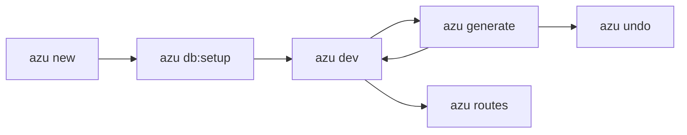

# Azu CLI

Scaffold, run and ship [Azu](https://github.com/azutoolkit/azu) apps from your terminal. Azu CLI is the command-line
companion of the Azu Toolkit for Crystal: it creates projects, generates code you would have written anyway, rebuilds
your app when you save, and tells you what is wrong with your setup.

<figure><figcaption><p><code>azu new blog</code>: a reviewed plan, a live progress card, and the three commands to run next.</p></figcaption></figure>



## 60 seconds

```bash
azu new blog && cd blog     # wizard on a terminal, defaults with --yes
azu db:setup                # SQLite: no server needed
azu dev                     # build, run, rebuild on save
```

In a second terminal:

```bash
azu g scaffold post title:string body:text
```


Every screen has a plain form. Pipes, CI, `NO_COLOR` and `--ui plain` get the same information without the animation.


## What you get

| You want to...                  | Run                                | Page                                                |
| ------------------------------- | ---------------------------------- | --------------------------------------------------- |
| Start a project                 | `azu new <name>`                   | [azu new](command-reference/azu-new.md)             |
| Develop with rebuild on save    | `azu dev`                          | [azu dev](command-reference/azu-dev.md)             |
| Generate models, endpoints, CRUD | `azu generate <type> <name> ...`  | [azu generate](command-reference/azu-generate.md)   |
| See every route                 | `azu routes`                       | [azu routes](command-reference/azu-routes.md)       |
| Ship a build                    | `shards build --production`, `azu new --docker` | [Production builds](command-reference/building-for-production.md) |
| Check your environment          | `azu doctor`                       | [azu doctor](commands/doctor.md)                    |

## Where to go next


[installation.md](getting-started/installation.md)



[quickstart.md](getting-started/quickstart.md)



[overview.md](cli-architecture/overview.md)


## Built on

| Piece                                                    | Role                                             |
| -------------------------------------------------------- | ------------------------------------------------ |
| [Azu](https://github.com/azutoolkit/azu)                 | The web framework your app runs on               |
| [CQL](https://github.com/azutoolkit/cql)                 | ORM and migrations                               |
| [JoobQ](https://github.com/azutoolkit/joobq)             | Background jobs                                  |
| [Topia](https://github.com/azutoolkit/topia)             | Command parsing in the CLI itself                |


Requires Crystal **1.22.1 or newer**. The CLI and the projects it generates share that floor.

