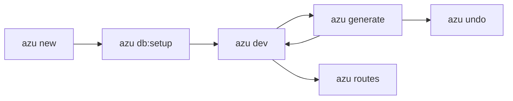

# Azu CLI

Azu CLI is the command line for the [Azu Toolkit](https://github.com/azutoolkit/azu). It creates projects, generates the
code you would have written anyway, rebuilds your app when you save, and tells you what's wrong with your setup.

## Overview



<figure><figcaption><p>A reviewed plan, a live progress card, and the commands to run next. 63 files, git, shards and a type-check in 18 seconds.</p></figcaption></figure>



<figure><figcaption><p>Build time, memory, request rate and percentiles, SQL timings and the live log, in one screen.</p></figcaption></figure>



<figure><figcaption><p>See every file and diff before anything is written. Enter writes, Esc doesn't.</p></figcaption></figure>





## Quickstart & command syntax

```bash
azu new blog && cd blog     # a wizard on a terminal, defaults with --yes
azu db:setup                # SQLite, no server needed
azu dev                     # build, run, rebuild on save
```

In a second terminal:

```bash
azu g scaffold post title:string body:text
azu db:migrate
```

| You want to...                   | Run                                              | Guide                                                              |
| -------------------------------- | ------------------------------------------------ | ------------------------------------------------------------------ |
| Start a project                  | `azu new <name>`                                 | [azu new](command-reference/azu-new.md)                            |
| Develop with rebuild on save     | `azu dev`                                        | [azu dev](command-reference/azu-dev.md)                            |
| Generate models, endpoints, CRUD | `azu generate <type> <name> [fields]`            | [azu generate](command-reference/azu-generate.md)                  |
| See every route                  | `azu routes`                                     | [azu routes](command-reference/azu-routes.md)                      |
| Ship a build                     | `shards build --production`, `azu new --docker`  | [Production builds](command-reference/building-for-production.md)  |
| Check your environment           | `azu doctor`                                     | [azu doctor](command-reference/azu-doctor.md)                                   |

## Realistic output


```text
$ azu doctor --ui plain
ok    crystal        Crystal 1.22.1 (the project needs 1.22.1 or newer)
ok    shards         Shards 0.20.0
ok    dependencies   installed and in sync with shard.lock
ok    database       SQLite file ./db/blog_development.db is writable
...

9 ok, 0 warnings, 0 failures
```


*Every rich screen has a plain twin, so this is what CI and pipes see.*

## Do's and don'ts


**Pro tip:** `azu g` is short for `azu generate`, and `azu g` with no arguments opens a menu.



Run `azu doctor` first when something feels off. It checks Crystal, shards, the database, secrets and the port, and
changes nothing.



Requires Crystal **1.22.1 or newer**, for the CLI and for the projects it generates.



Don't run the CLI in a checkout you don't trust. It loads the project's `.env*` files and compiles and runs the
project's own code.


## Where next


[installation.md](getting-started/installation.md)



[quickstart.md](getting-started/quickstart.md)



[README.md](command-reference/README.md)

