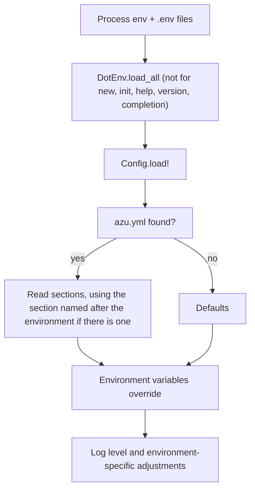

# Configuration

How the CLI finds its settings, what `azu.yml` can hold and which environment variables win.

## Overview

The CLI reads an optional `azu.yml`, then applies environment variables on top. Your **app** is configured separately,
through `.env` files that Azu loads itself. This page is about the CLI's side; the app's `.env` rules are at the end.



## Quickstart

The file is searched in this order, first hit wins:

1. `./config/azu.yml` (what `azu new` generates)
2. `./azu.yml`
3. `~/.config/azu/config.yml`
4. `~/.azu.yml`


```yaml
global:
  debug_mode: false
  verbose: false
  quiet: false

general:
  project_name: "blog"
  database_adapter: "sqlite"
  colored_output: true

database:
  host: "localhost"
  port: 5432
  user: "postgres"
  name: "blog_development"

server:
  host: "localhost"
  port: 4000
  watch: true
  rebuild: true

logging:
  level: "info"          # debug, info, warn, error, fatal
```


| Section      | Keys read                                                                        |
| ------------ | -------------------------------------------------------------------------------- |
| `global`     | `debug_mode`, `verbose`, `quiet`, `show_help_on_empty`                           |
| `general`    | `project_name`, `project_path`, `database_adapter`, `template_engine`, `colored_output` |
| `filesystem` | `templates_path`, `output_path`                                                  |
| `database`   | `url`, `name`, `host`, `port`, `user`, `password`                                |
| `server`     | `host`, `port`, `watch`, `rebuild`                                               |
| `logging`    | `level`, `format`                                                                |
| `project`    | `type` (used to tell web, api and cli projects apart)                            |

Keys that are not listed are ignored.

### Environment overrides

| Variable                                  | Overrides                      |
| ----------------------------------------- | ------------------------------ |
| `AZU_ENV`, else `CRYSTAL_ENV`             | Environment (default `development`) |
| `AZU_DEBUG` (or `DEBUG`), `AZU_VERBOSE`, `AZU_QUIET` | `global.*` (presence turns it on) |
| `DATABASE_URL`                            | `database.url`                 |
| `AZU_DB_HOST`, `AZU_DB_PORT`, `AZU_DB_USER`, `AZU_DB_PASSWORD`, `AZU_DB_NAME` | `database.*` |
| `AZU_HOST`, `AZU_PORT`                    | `server.host`, `server.port`   |
| `AZU_TEMPLATES_PATH`, `AZU_OUTPUT_PATH`   | `filesystem.*`                 |
| `AZU_UI`, `NO_COLOR`, `FORCE_COLOR`       | Terminal UI, see [Terminal UI](../cli-architecture/terminal-ui.md) |



```bash
azu dev --env development
azu config:show --section server
```



```bash
CRYSTAL_ENV=production azu config:show
```
In production the CLI turns debug mode off and stops watching and rebuilding.



## Output

```bash
azu config:show --section database --format json
azu config:validate
azu config:env --list
```

`config:show` prints the settings the CLI actually resolved (`--format yaml|json|table`, `--section`, `--env`),
`config:validate` checks them, and `config:env` lists, sets and unsets the Azu environment variables.

## Do's and don'ts


If the file has a top-level section named after the current environment (for example `production:`), the CLI reads
**only** that section and ignores the rest of the file. It does not merge it over the base.



The environment step runs after the file and always assigns. In practice `global.debug_mode`, `verbose`, `quiet`,
`database.url` and `database.name` in the file are replaced when the matching variable is unset. Set those through
the environment.



Keep secrets out of `azu.yml`. Use `DATABASE_URL` and the app's `.env`.



Do not put a real password in a committed `azu.yml`.


<details>

<summary>The app's own <code>.env</code> files</summary>

Precedence: process environment, then `.env.local`, then `.env.<CRYSTAL_ENV>`, then `.env`. A file never overrides a
variable the process already has. `azu new` writes `.env` (git-ignored, mode 0600, random secrets),
`.env.development` and `.env.test` (committed, no secrets), `.env.example` (committed, secrets blank) and a git-ignored
`.env.local`.

For safety the CLI skips names such as `PATH`, `HOME`, `LD_*`, `GIT_*` and compiler flags, and applies any other name
only if it looks like an app setting (`DATABASE_URL`, `PORT`, `*_SECRET`, `*_URL`, ...) or is listed in `.env.example`.
This is best effort, not a sandbox.

More: [Environment variables](../configuration/environment.md), [Configuration overview](../configuration/README.md).

</details>
