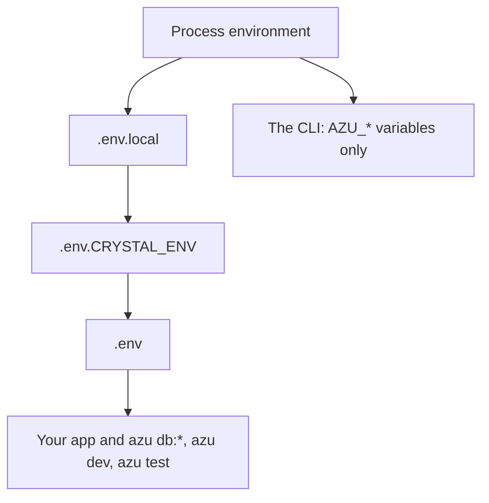

# Configuration

Your app is configured by environment variables, loaded from `.env` files. There is no configuration file: the CLI itself reads a handful of environment variables and nothing else.

## Overview & visual demo

<figure><figcaption><p><code>azu doctor</code> reads the same environment your app does: the database URL, every variable <code>.env.example</code> lists, the secrets and the port.</p></figcaption></figure>



## Quickstart & command syntax

### The app: `.env` files

Precedence, highest first: the process environment, `.env.local`, `.env.<CRYSTAL_ENV>`, `.env`. A file never overrides a variable the process already has.

| File                     | Committed | Holds                                                        |
| ------------------------ | --------- | ------------------------------------------------------------ |
| `.env`                   | no        | Random secrets, written with mode 0600 by `azu new`          |
| `.env.development`       | yes       | `DATABASE_URL`, `PERFORMANCE_MONITORING=true`                |
| `.env.test`              | yes       | `DATABASE_URL` for tests                                     |
| `.env.example`           | yes       | Every name the app uses, secrets blank                       |
| `.env.local`             | no        | Your machine's overrides                                     |

| Variable                 | Used for                                                              |
| ------------------------ | --------------------------------------------------------------------- |
| `CRYSTAL_ENV`            | `development`, `test` or `production`                                 |
| `PORT`, `HOST`           | Where the app listens (default port 4000). `azu dev --port` sets `PORT` |
| `DATABASE_URL`           | The database for the app and every `azu db:*` command                 |
| `CSRF_SECRET`            | Required in production; at least 32 characters                        |
| `SESSION_SECRET`         | Required in production once you generate authentication               |
| `PERFORMANCE_MONITORING` | `true` feeds the request stats in the `azu dev` dashboard             |
| `TEMPLATE_HOT_RELOAD`    | `false` turns off template reloading in development                   |




```bash
DATABASE_URL=sqlite3://./db/blog_development.db
PERFORMANCE_MONITORING=true
```




```bash
CRYSTAL_ENV=production \
CSRF_SECRET="$(openssl rand -hex 32)" \
SESSION_SECRET="$(openssl rand -hex 32)" \
DATABASE_URL=postgres://user@db/blog ./bin/blog
```
Real environment variables win over any `.env` file, so set production secrets in your platform, not in a file.



### The CLI itself

The CLI has no config file. It reads these variables, from the process or from the project's `.env` files:

| Variable                      | Effect                                                                  |
| ----------------------------- | ----------------------------------------------------------------------- |
| `AZU_ENV`, else `CRYSTAL_ENV` | The environment, `development` by default                               |
| `AZU_DEBUG`                   | Debug logging, and a backtrace on errors                                |
| `AZU_VERBOSE`, `AZU_QUIET`    | More or less output                                                     |
| `AZU_UI`                      | `rich`, `plain` or `json`; the same as `--ui`                           |
| `NO_COLOR`, `FORCE_COLOR`     | Turn color off, or keep it on in a pipe                                 |

## Realistic output


```text
ok    database       SQLite file ./db/blog_development.db is writable
ok    env            every variable .env.example leaves blank is set
ok    secrets        no weak or hard-coded secrets found
ok    port           port 4000 is free
```


*Four of the nine checks. With `CRYSTAL_ENV=production`, a missing variable or a weak secret is a failure instead of a warning.*

## Do's and don'ts


**Pro tip:** `azu doctor` is the quickest way to see what your environment looks like to the app. It never prints a secret or a password.



Commit `.env.example` with every name your app reads, and keep real values in `.env` or your platform's secret store.



`azu dev` and `azu serve` read `PORT` and `HOST`, and `azu db:*` reads `DATABASE_URL`, from the environment or the `.env` files. Settings don't go anywhere else.



Don't keep production secrets in a committed file. Set them in your platform's environment, where they win over any `.env` file.


<details>

<summary>How the CLI keeps <code>.env</code> files safe</summary>

The CLI loads the `.env*` files of whatever project it runs in, for every command except `new`, `init`, `help`, `version` and `completion`. It always skips names such as `PATH`, `HOME`, `LD_*`, `GIT_*` and compiler flags, and applies any other name only if it looks like an app setting (`DATABASE_URL`, `PORT`, `*_SECRET`, `*_URL`, ...) or is listed in `.env.example`. This is best effort, not a sandbox: the CLI still compiles and runs the project's own code.

</details>
