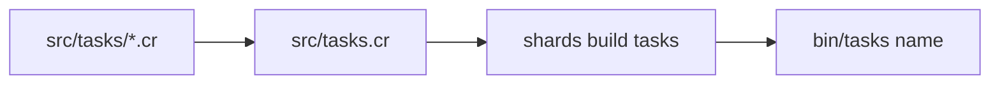

# Custom tasks

Projects made with `azu new` (example code on, the default) include a small task runner built on [Topia](https://github.com/azutoolkit/topia). Use it for the scripts your project needs: cleaning, seeding, exporting, anything you'd otherwise keep in a shell file.

## Overview & visual demo

Keep repeatable project work in named tasks. Use the supported task interface for scripts your team runs often, and inspect the command before executing it in a trusted checkout.

<figure><figcaption><p>Part of what <code>azu new</code> writes: <code>src/tasks.cr</code> and a <code>tasks</code> target in <code>shard.yml</code>.</p></figcaption></figure>



## Quickstart & command syntax


```crystal
require "topia"
require "./blog"
require "./tasks/**"

Topia.task("hello")
  .command("echo 'Hello from Topia!'")

Topia.cli(ARGV)
```


Add your own in `src/tasks/`; every file there is loaded.


```crystal
Topia.task("cleanup")
  .command("rm -rf tmp/*")
```


```bash
shards build tasks
bin/tasks --list
bin/tasks hello
bin/tasks cleanup
```

| Command                | What it does                      |
| ---------------------- | --------------------------------- |
| `bin/tasks --list`     | List the tasks                    |
| `bin/tasks <name>`     | Run one task                      |
| `bin/tasks --help`     | The runner's own options          |

## Realistic output


```text
$ bin/tasks --list
hello
cleanup
```


*Illustrative: the exact listing format comes from Topia and may include dependencies and descriptions.*

## Do's and don'ts


**Pro tip:** a task can depend on others and chain several commands. See the [Topia README](https://github.com/azutoolkit/topia) for `depends_on`, `src`, `watch` and parallel runs.



Rebuild after you edit a task: `shards build tasks`. The runner is a compiled binary.



The `tasks` target exists only when the project was created with the example code. With `--no-example` add it to `shard.yml` yourself.



Don't put secrets in a task's command line. Read them from the environment, which `.env` files fill in for the app.

