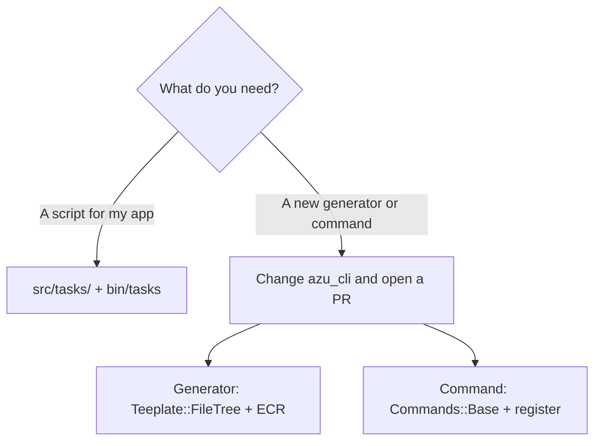

# Custom tasks and extensions

Two different things share this name: tasks your project runs, and changes to the CLI itself.

## Overview

Generated projects (with the example code) include a [Topia](https://github.com/azutoolkit/topia) task runner you can
extend freely. The CLI has no plugin installer, so a new generator or command means a change to `azu_cli` itself.



## Quickstart

### Project tasks

A project made with `azu new` (example code on) has a `tasks` build target and `src/tasks.cr`:


```crystal
require "topia"
require "./blog"
require "./tasks/**"

Topia.task("hello")
  .command("echo 'Hello from Topia!'")

Topia.cli(ARGV)
```


Add your own in `src/tasks/`:


```crystal
Topia.task("cleanup")
  .command("rm -rf tmp/*")
```


```bash
shards build tasks
bin/tasks --list
bin/tasks hello
bin/tasks cleanup
```

### A new generator in azu_cli

| Step | Do                                                                                         |
| ---- | ------------------------------------------------------------------------------------------ |
| 1    | `src/azu_cli/generators/<name>.cr`: a `Teeplate::FileTree` with `directory` and the instance variables the templates use |
| 2    | ECR templates under `src/azu_cli/templates/<name>/`                                        |
| 3    | A `when "<name>"` branch in `Commands::Generate#execute`                                   |
| 4    | Validate every name you turn into code, and refuse to overwrite existing files             |
| 5    | A spec under `spec/azu_cli/`, written to fail first                                        |

```crystal
module AzuCLI
  module Generate
    class Greeter < Teeplate::FileTree
      directory "#{__DIR__}/../templates/greeter"

      property name : String
      property snake_case_name : String

      def initialize(@name : String)
        @snake_case_name = @name.underscore
      end
    end
  end
end
```

### A new command in azu_cli

1. `src/azu_cli/commands/<name>.cr`, a subclass of `Commands::Base` with `execute : Result`.
2. `register_command("<name>", Commands::<Name>)` in `CLI#setup_commands`.
3. Help text, a line in `azu help` and in `CLI_REFERENCE.md`, and the name in `Commands::Completion::COMMANDS`.

```bash
crystal run src/azu_cli.cr -- <name> --help     # run it without installing
crystal spec spec/azu_cli/integration/
```

## Output

```text
$ bin/tasks --list
hello
cleanup
```

The exact listing format comes from Topia and may include dependencies and descriptions.

## Do's and don'ts


Give a new command `--ui` support through `UI::Reporter` and keep a plain output, so it works in pipes and CI.



Generated code is the product. Never interpolate raw input into generated Crystal: validate names first.



Do not document a flag or command that is not registered. `azu plugin` and external plugin loading do not exist.


<details>

<summary>Internal hook plugins</summary>

`Plugins::Base` offers `before_command`, `after_command` and `on_error` hooks for cross-cutting behavior around every
command. Register one in `CLI#load_builtin_plugins`. It is for the CLI's own code, not an extension point for users.
See [Plugin system](../architecture/plugins.md) and [Generator system](../architecture/generator-system.md).

</details>
