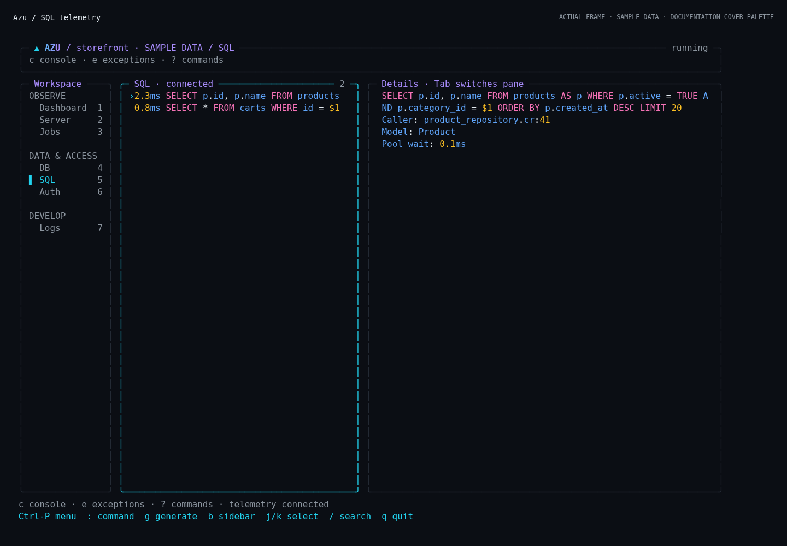
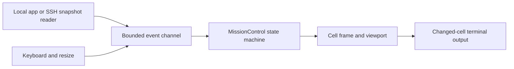

# Azu mission control

## Overview

An opt-in native terminal workspace built on the CLI's existing renderer.


The HUD owns the terminal; adapters deliver typed events to its bounded mailbox.


## Quickstart

```sh
azu dev --ui mission
# Existing dashboards remain available:
azu dev --ui rich
azu joobq
```

The design preview uses illustrative data. The implementation is a working shell,
not a claim that every ecosystem service now emits every metric shown in the concept.

## Realistic output

<figure><figcaption><p>The native SQL inspector, rendered with sample data using the documentation cover palette.</p></figcaption></figure>



## Do's and don'ts

Keep adapters separate from rendering; use viewport bounds for dense data and
the command runner for subprocesses. Do not let adapter fibers write stdout or
mutate screen state.


Development telemetry can contain sensitive application data. Production uses the
separate read-only connection and metrics allowlist, not the development socket.


## Visual direction

Match the [Azu documentation](https://azutopia.gitbook.io/azu) cover artwork:
near-black `#0B0E14`, silver `#E6EDF3`, cyan `#22D3EE`, violet `#A78BFA`,
blue `#60A5FA`, mint `#34D399`, and pink `#F472B6`. These values come from the
page's Azu cover image, rather than GitBook's surrounding light/dark chrome.
The terminal retains amber `#FBBF24` and coral `#F87171` for warnings and errors.
Borders stay quiet (`#2A313C`); the Azu wordmark runs cyan to violet, with cyan
navigation focus. SQL keywords are pink, identifiers blue, strings mint and
placeholders/numbers amber. Logs distinguish timestamps, severity, HTTP status,
methods and durations.
Color is supplementary: severity names, status codes and a selection marker remain
visible with `NO_COLOR`.

Navigation groups are Observe, Data & Access, and Develop; shorter windows omit
group labels to preserve the navigation items. The prototype has seven sections,
a collapsible rail with numbered shortcuts, breadcrumbs, and a searchable
Ctrl-P palette. Console, exceptions and the command center reuse the classic HUD.
At less than 104 columns, the rail collapses into a breadcrumb. Below 48x14 the
screen displays a resize message. `azu dev` itself retains its existing 60x16
interactive-mode threshold and plain-output fallback.

```text
╭─ ▲ AZU / storefront / Dashboard ───────────────────── running ─╮
│ development · localhost:4000                       sample data │
╰───────────────────────────────────────────────────────────────╯
╭─ Workspace ─╮ ╭─ Requests/s ─╮ ╭─ P95 ─╮ ╭─ Jobs ─╮ ╭─ Pool ─╮
│ ▌ Dashboard │ │ 1,284       │ │ 8.4ms │ │ 10     │ │ 6/20   │
│   Server    │ ╰─────────────╯ ╰───────╯ ╰────────╯ ╰────────╯
│   Jobs      │ ╭─ Server / traces ──────╮ ╭─ JoobQ / queues ────╮
│   DB        │ │ GET /products 200     │ │ default 24 / busy 8 │
│   SQL       │ │ POST /checkout 200    │ │ mailers  7 / fail 1 │
│   Auth      │ ╰───────────────────────╯ ╰─────────────────────╯
│   Logs      │ ╭─ SQL ─────────────────╮ ╭─ Auth ──────────────╮
│             │ │ SELECT p.id, p.name   │ │ sign-in accepted    │
│             │ │ FROM products AS p   │ │ rate-limit applied  │
╰─────────────╯ ╰───────────────────────╯ ╰─────────────────────╯
 Ctrl-P menu · b sidebar · j/k select · Tab pane · / filter · q quit

                    ╭─ Navigate ─────────────────────╮
                    │ > sql▏                         │
                    │ › Open SQL                     │
                    │ ↑↓ choose · Enter open · Esc    │
                    ╰────────────────────────────────╯
```

Actual text/ANSI frames generated from the code live in
`docs/assets/terminal-ui/mission-control/`. Regenerate or try the interactive fixture:

```sh
crystal run scripts/render_mission_control.cr
crystal run scripts/render_mission_control.cr -- --interactive
```

## Native architecture

| Component | Ownership and responsibility |
| --- | --- |
| `UI::Cell`, `Rect`, `Seg`, `Style` structs | Value objects for cells, geometry and styled text; no terminal IO. |
| `UI::Frame`, `StyleTable` classes | Cell buffer and interned palette/style codes. Existing renderer handles clipping and display widths. |
| `UI::Terminal` | TTY detection, alternate screen, raw input, cursor visibility, bracketed paste and restoration in `ensure`. |
| `UI::Program` | Sole owner of screen updates and writes; bounded channel, bounded batches and frame pacing. |
| `UI::FullScreenRenderer` | Compares current/previous cells and batches changed runs into one output write, with synchronized-output escape sequences. |
| `MissionControl` | State machine: active section, palette/search state, freshness, bounded samples and legacy-panel focus. |
| `UI::Inspector`, `Viewport` | Selection, independent list/detail scrolling, resize clamping and block-character scroll indicators. |
| `UI::Highlight` | Bounded visual lexer returning styled segments; never executes SQL or forwards application ANSI escapes. |
| Existing `Hud` / `Console::Evaluator` | Compiler lifecycle, command execution, exceptions, history and compiled console fallback. |
| Adapter fibers | Read application telemetry or agent snapshots; emit messages, never mutate the screen or write stdout. |

The reducer handles `Key`, `Resize`, `Tick`, and typed application messages.
Ctrl-P opens a navigation palette; its query is separate from `/` filtering.
Enter changes section, Esc closes the palette or returns from a classic panel.
`j/k`, arrows, PageUp/PageDown and Tab reuse the viewport manager. `l` opens logs;
logs follow new records until navigation pauses them, and `f` resumes following.
The palette also opens the local command composer: `g` starts a generator and `:`
accepts a supported Azu command. Enter reviews the argv and directory; `y` submits
to the serialized runner. See [command behavior](../command-reference/azu-dev.md).
The separate `azu connect` entrypoint creates a read-only screen with no runner,
console or app lifecycle; [production setup](../command-reference/azu-connect.md)
requires a restricted SSH identity and allowlisted snapshot publisher.
Mouse hit-testing is a follow-up, not implemented here.

## Rendering loop and performance

The implementation is in `src/azu_cli/ui/program.cr`. Its loop is conceptually:

```text
wait for event, or next frame deadline if dirty
apply at most 128 queued events to the state machine
if dirty and deadline reached:
    draw a bounded Frame
    emit changed cells in one synchronized write
    next deadline = monotonic now + 33 ms
yield after a full event batch
```

This fixes an unbounded-drain condition: a producer that kept the channel nonempty
could previously postpone rendering indefinitely. Dirty frames are now coalesced
to at most about 30 Hz. Animation ticks run at the existing 80 ms cadence; only the
UI owner reads animation state. Reduced-motion mode freezes the busy spinner while
freshness checks remain active. Normal tab changes are immediate state changes
presented on the next frame, not animated scrolling of the entire terminal.

The event channel holds 1,024 messages; lists keep at most 200 rows, searches 64
characters, and the highlighter scans at most 4,096 characters per call. Existing
styles use a finite palette. The implementation allocates a frame per redraw and
token arrays for visible lines; it is not allocation-free. A next optimization is
ingestion-time token caching and reusable cell buffers, measured with real traces.

Do not send a message for every job at 35k jobs/s. Sample worker counters at 2–5 Hz
and coalesce snapshots at the adapter; a blocked UI must never block application
execution. Lossless audit events belong in a durable audit store, not a HUD ring
buffer. A future keyed mailbox should count dropped/coalesced telemetry explicitly.
During console handoff the existing Program drops messages that cannot fit, then
resumes snapshots on return. Never share one terminal between the renderer and a
child process that writes arbitrary output.

## Ecosystem integration contracts

| Source | Available now | Additional work |
| --- | --- | --- |
| Azu | Existing `AZU_TELEMETRY_SOCKET` snapshots: requests, latency, recent requests, SQL and errors; process/build lifecycle and logs. | Versioned per-endpoint rate buckets and distributed trace IDs; do not infer true rates from a bounded recent list. |
| JoobQ | Existing dev queue sampler; standalone `azu joobq` process agent for workers, workflows and DLQ. | Share `ProcessSource` behind a controller with this shell; expose exact engine/lease counters and replay capabilities. Processing counts are not global Crystal-fiber counts. |
| CQL | Existing SQL snapshots with normalized statements, duration, caller/model and pool data. | Application-side, dialect-aware schema snapshot and migration history; expose the optional `database` contract below. |
| Authly/session | A view for an optional redacted `auth` snapshot. | Instrument application authentication/session lifecycle callbacks, aggregate counters and emit events. Cookie sessions and bearer tokens do not inherently provide an enumerable list of active sessions. |

Optional snapshot fields accepted by the prototype:

```json
{
  "database": {
    "migration_version": "202610291200",
    "tables": [{"name":"products","columns":[{"name":"id","type":"bigint"}]}]
  },
  "auth": {
    "recent": [{"id":"opaque-event-id","at":"14:32:08","event":"sign-in","outcome":"accepted"}]
  }
}
```

These fields are extension contracts, not existing Authly/CQL APIs. The CLI
allowlists fields for display and tolerates missing/incorrect types. The producer
must redact credentials, cookies, tokens, SQL bind values and personal data before
writing to the socket. Generic app logs can still contain sensitive data; display
sanitization is not secret redaction. Use a private local socket, restrictive file
permissions, bounded payloads and deadlines. Remote access uses the separate
`azu connect` capability and a stricter metrics-only allowlist; it does not forward
this local development socket or its raw payloads.

Use JoobQ's supported operator APIs for DLQ replay, not guessed Redis writes. The
agent already supports timeout handling and capability checks. A timeout is an
unknown mutation outcome: refresh and reconcile before retrying. Migration actions
must use the app's CQL migrator, its lock and transaction semantics, with environment,
pending versions and confirmation visible before execution.

## Crystal interpreter and console

The implementation retains the existing Console panel (`c`) and its compiled
evaluator. Its declarations/local assignments can be replayed in a fresh process;
that is **not** a persistent heap REPL and replay can repeat side effects.

The interpreter path probes `crystal i --help` and runs a generated boot script
containing the app require and `debugger`. Program's handoff closes the key-reader
duplicate, restores cooked mode/main screen, grants inherited terminal IO to the
interpreter, then restores raw mode/alternate screen and invalidates the frame on
return. Build the application's boot entrypoint so requiring it does not launch a
server or worker. Interpreter availability does not prove that every dependency
can load: the current CLI documents Azu/CQL interpreter limitations on Crystal
1.22.1. Keep the compiled evaluator fallback and show probe/load errors explicitly.

## Delivery roadmap

1. **Implemented:** opt-in shell, responsive rail, command palette, SQL/log colors,
   bounded views, bounded event draining, paced frames, console reuse, local command
   composer, read-only SSH snapshot transport and fixtures.
2. **Integration:** unify the JoobQ agent controller with this shell; add versioned
   schema/migration and Authly/session producers with freshness/capability states.
3. **Input:** stateful fragmented UTF-8/CSI decoding, SGR mouse hit-testing and
   capability-aware terminal tests. Current input parsing retains the existing CLI
   parser, including its assumptions about escape-sequence read boundaries.
4. **Polish and release gates:** per-section retained filters, log pause counters,
   cached highlighting, actual build progress, terminal
   matrix coverage, and sustained telemetry-overload tests. The richer concept's
   per-route sparklines, selected-query pretty formatting and contextual
   command actions are the design target, not all present in this initial shell.
