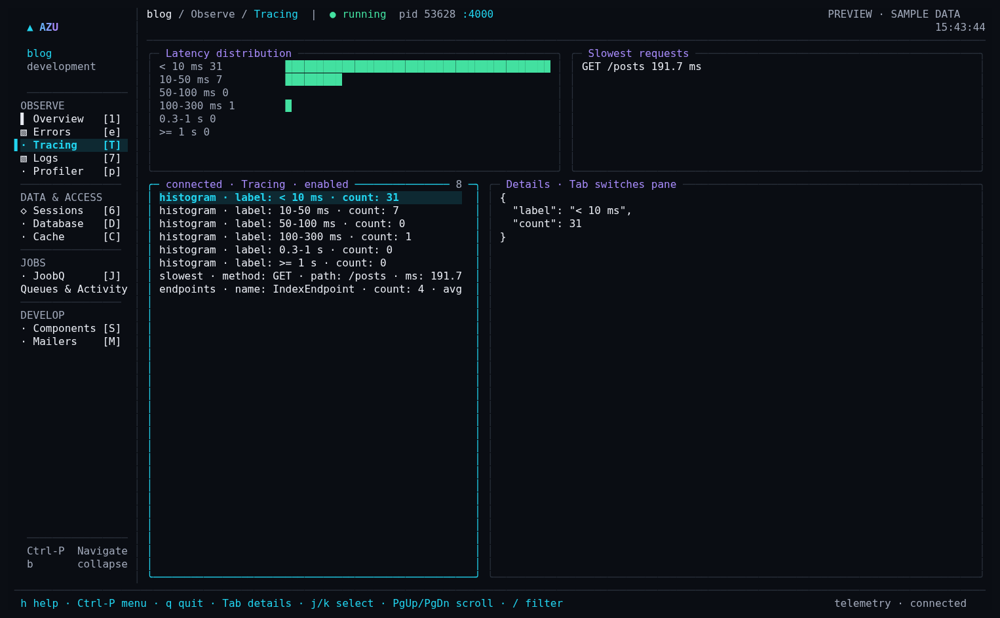
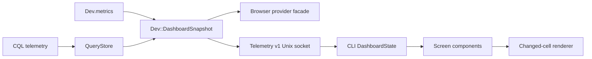

# Dashboard architecture

## Overview & visual demo

The application owns measurements. The CLI receives bounded snapshots, updates its state, and paints terminal cells. Neither card rendering nor keyboard navigation queries a database or blocks on an application adapter.

<figure><figcaption><p>Actual terminal rendering with a labeled sample fixture.</p></figcaption></figure>



## Quickstart & command syntax

### Application telemetry

```crystal
require "azu/dev"
require "azu/cql"

# AppDB is your existing CQL schema; keep its normal ownership and migration setup.
Azu::CQL.attach { AppDB }
```

Run `azu dev`. The CLI supplies `AZU_TELEMETRY_SOCKET`; the application publishes in development. Request metrics require the performance monitor. Do not expose the development dashboard as a production administration endpoint.

The additive `dashboard` field shares the browser provider's health formula, retained windows, p50/p99 calculation, cache/component statistics, and graph series. Existing v1 fields remain available. The `database` extension supplies declared schema metadata when its adapter supports it; missing migration history is labeled unavailable rather than inferred.

The CLI accepts older snapshots without this extension. Its `DashboardState` bounds graph series to 120 points and resets when the process identity changes. Explicitly disabled features disappear; unknown features remain discoverable with an unavailable state.

### Auth integration

Generated authentication keeps its existing `AzuAuthTelemetry` stream for older applications and forwards lifecycle outcomes to Azu's optional integration adapter when available. HTTP redirects alone do not establish authentication success.

```crystal
# These optional APIs require Azu's dashboard snapshot extension.
Azu::Dev::IntegrationEvents.sessions("cookie")
Azu::Dev::IntegrationEvents.session("sign-in", "accepted")
```

Supported session backends are `cookie`, `redis`, and `memory`. Applications with an authoritative server-side inventory may supply `active: count.to_i64` to `sessions`. Cookie backends always export an unavailable count. Events accept only defined lifecycle names/outcomes and never accept session values or credentials.

### Mailers

Generated Carbon mailers report successful delivery or failure and register static example text. Existing mailers can use the same optional seam:

```crystal
Azu::Dev::IntegrationEvents.mailer("WelcomeMailer", "Welcome to the example app")
Azu::Dev::IntegrationEvents.delivery("WelcomeMailer", "delivered")
```

Call `delivery` after the transport result is known. Register static preview text, never a customer's message. The terminal does not send email.

### JoobQ

The JoobQ view lazily compiles the existing project adapter from `src/initializers/joobq.cr`. One controller owns polling and replay requests, avoiding overlapping protocol responses. Its Queues, Workflows, and DLQ subviews reuse `azu joobq` components. Replay requires confirmation and a backend that advertises atomic replay support.

### Rendering and production compatibility

`UI::Program` owns screen state on one fiber, batches events, and limits drawing with its frame interval. `FullScreenRenderer` compares cells and flushes one synchronized output buffer. Resize invalidates the previous frame. Terminal restoration also applies when handing control to the console interpreter.

`azu connect` continues reading sanitized snapshots through verified SSH. New local-only fields are unavailable there. The CLI does not enable commands, session management, mail delivery, or JoobQ replay over a production connection.

## Realistic output

```text
Application has no new snapshot:  n/a · Dashboard telemetry unavailable
Cache enabled, no reads:          Hit rate n/a · No cache reads recorded
Cookie sessions:                 Backend cookie · Active sessions n/a
Lost application connection:     Stale sample · waiting for application
```

*Availability is explicit; missing values are not fabricated zeroes.*

## Do's and don'ts


**Reuse the producer.** Attach the schema once. Azu's CQL subscriber already retains request correlation, SQL shapes, pool waits, and transaction events; the CLI does not install another subscriber.



**Keep snapshots bounded.** The local receiver limits each line to 1 MiB. Lists, strings, and histories have tighter producer limits. Remote snapshots retain their separate 128 KiB contract.



**Check parity with fixtures.** Tests compare browser and terminal calculations and exercise old telemetry, missing integrations, resize, paging, control-character handling, and production restrictions.

