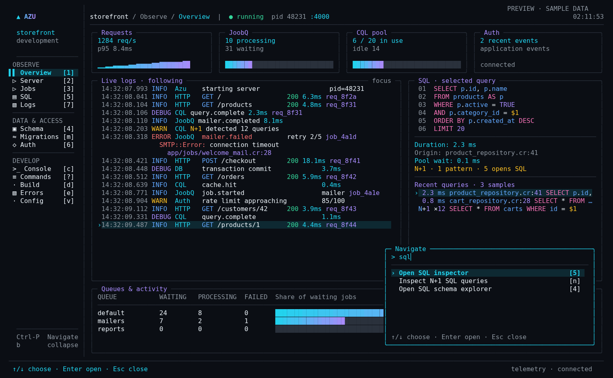
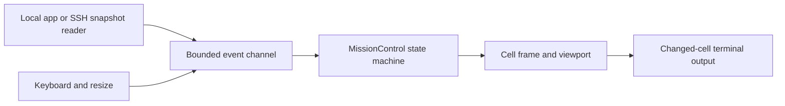

# Azu mission control

## Overview

The native terminal workspace used by `azu dev`, built on the CLI's renderer.


The HUD owns the terminal; adapters deliver typed events to its bounded mailbox.


## Quickstart

```sh
azu dev
# Explicit aliases for the same workspace:
azu dev --ui rich
azu dev --ui mission
azu joobq
```

The design preview uses illustrative data. The implementation is a working shell,
not a claim that every ecosystem service now emits every metric shown in the concept.

## Realistic output

<figure><figcaption><p>The native overview and command launcher, rendered with sample data using the Azu reference palette.</p></figcaption></figure>



## Do's and don'ts

Keep adapters separate from rendering; use viewport bounds for dense data and
the command runner for subprocesses. Do not let adapter fibers write stdout or
mutate screen state.


Development telemetry can contain sensitive application data. Production uses the
separate read-only connection and metrics allowlist, not the development socket.


## Visual direction

The palette follows the cover artwork linked from the
[Azu documentation](https://azutopia.gitbook.io/azu): charcoal `#0B0E14`, silver
`#E6EDF3`, cyan `#22D3EE`, violet `#A78BFA`, blue `#60A5FA`, mint `#34D399`,
pink `#F472B6`, and muted gray `#8B949E`. Borders use the cover's quiet slate
`#2A313C`; selection bands use its dark cyan tint `#0E2932`.
The wordmark and charts retain the cyan-to-violet gradient. SQL keywords are
pink, identifiers blue, strings mint and numeric/boolean literals violet;
bind placeholders and warnings remain amber. Errors retain semantic coral.
Logs distinguish timestamps, severity, status, sources, timings and trace IDs.
The full-height brand rail sits beside a breadcrumb/status header. Four compact
metric cards lead into live logs and selected SQL, with a queue table below;
the command launcher opens at the bottom right. Auth counts are captured events,
not estimated sessions. Charts use received request samples, pool occupancy,
processing versus waiting jobs, and each queue's share of waiting jobs. Missing
telemetry stays explicitly unavailable; no throughput or capacity is invented.
Color is supplementary: severity names, status codes and a selection marker remain
visible with `NO_COLOR`.

Navigation groups are Observe, Data & Access, and Develop. The workspace has
thirteen sections, a collapsible scrollable rail with shortcut labels, breadcrumbs, and a searchable
Ctrl-P palette. Build, Errors, Commands, Console and Config reuse stateful
components inside the workspace; they do not switch to a separate dashboard.
The navigation viewport keeps the active section visible in short terminals.
At less than 104 columns, the rail collapses into a breadcrumb. Below 48x14 the
screen displays a resize message. `azu dev` itself retains its existing 60x16
interactive-mode threshold and plain-output fallback.

```text
 ▲ AZU       │ storefront / Observe / Overview  ● running  :4000
 storefront  ├──────────────────────────────────────────────────────
 development │ ╭─ Requests ─╮ ╭─ JoobQ ─╮ ╭─ CQL pool ─╮ ╭─ Auth ─╮
             │ │ 1284 req/s│ │10 busy  │ │ 6 / 20     │ │2 events│
 OBSERVE     │ ╰───────────╯ ╰─────────╯ ╰────────────╯ ╰────────╯
 ▌ Overview  │ ╭─ Live logs · following ────╮ ╭─ SQL · selected ─╮
 ▷ Server    │ │ INFO HTTP GET /products   │ │ SELECT p.id       │
 ▷ Jobs      │ │ DEBUG CQL query.complete  │ │ FROM products p   │
 ▤ SQL       │ │ WARN CQL N+1 detected     │ │ WHERE active=TRUE │
 ▧ Logs      │ │ ERROR JoobQ mailer.failed │ │ Duration: 2.3 ms  │
             │ ╰──────────────────────────╯ ╰───────────────────╯
 DATA & ACCESS│╭─ Queues & activity ─────────────────────────────╮
 ▣ Schema    │ │ default   24 waiting   8 processing              │
 ≈ Migrations│ │ mailers    7 waiting   2 processing              │
 ◇ Auth      │ ╰─────────────────────────╭─ Navigate ────────────╮
             │                           │ > sql                 │
 DEVELOP     │                           │ › Open SQL inspector  │
 >_ Console  │                           │ Inspect N+1 SQL queries│
 ≡ Commands  │                           ╰───────────────────────╯
 Ctrl-P navigate · Tab pane · j/k select · f follow logs · q quit
```

Actual text/ANSI frames generated from the code live in
`docs/assets/terminal-ui/mission-control/`. Regenerate or try the interactive fixture:

```sh
crystal run scripts/render_mission_control.cr
crystal run scripts/render_mission_control.cr -- --interactive
# With Playwright and Chromium installed for Node:
node scripts/render_mission_control_preview.js
```

## Native architecture

| Component | Ownership and responsibility |
| --- | --- |
| `UI::Cell`, `Rect`, `Seg`, `Style` structs | Value objects for cells, geometry and styled text; no terminal IO. |
| `UI::Frame`, `StyleTable` classes | Cell buffer and interned palette/style codes. Existing renderer handles clipping and display widths. |
| `UI::Terminal` | TTY detection, alternate screen, raw input, cursor visibility, bracketed paste and restoration in `ensure`. |
| `UI::Program` | Sole owner of screen updates and writes; bounded channel, bounded batches and frame pacing. |
| `UI::FullScreenRenderer` | Compares current/previous cells and batches changed runs into one output write, with synchronized-output escape sequences. |
| `MissionControl` | State machine: active section, palette/search state, freshness, bounded samples and component focus. |
| `UI::Inspector`, `Viewport` | Selection, independent list/detail scrolling, resize clamping and block-character scroll indicators. |
| `UI::Highlight` | Bounded visual lexer returning styled segments; never executes SQL or forwards application ANSI escapes. |
| Existing `Hud` / `Console::Evaluator` | Compiler lifecycle, command execution, exceptions, history and compiled console fallback. |
| Adapter fibers | Read application telemetry or agent snapshots; emit messages, never mutate the screen or write stdout. |

The reducer handles `Key`, `Resize`, `Tick`, and typed application messages.
Press `h` for scrollable context-specific keyboard hints; Esc closes them. In Console
or search, letters remain input; the Ctrl-P palette also offers Keyboard hints.
Ctrl-P opens a navigation palette; its query is separate from `/` filtering.
Enter changes section; Esc closes the palette or returns from the console.
`j/k`, arrows, PageUp/PageDown and Tab reuse the viewport manager. `l` opens logs;
logs follow new records until navigation pauses them, and `f` resumes following.
`t` toggles application output and shared `azu/dev` request samples. Without
stdout/stderr, the live log pane uses shared requests automatically; these are
retained samples, not a complete access log. The header shows exported GC metrics.
In Overview, Tab cycles logs, SQL and queues; Enter opens the focused inspector.
PageUp/PageDown scroll long SQL and j/k selects recent queries. The Schema view
accepts `database.tables`; Migrations (`m`) accepts optional `database.migrations`
rows with `version`, `name`, `status` and `applied_at`. It shows an unavailable
state without this adapter and performs no database mutations.
The palette also opens the local command composer: `g` starts a generator and `:`
accepts a supported Azu command. Enter reviews the argv and directory; `y` submits
to the serialized runner. See [command behavior](../command-reference/azu-dev.md).
The separate `azu connect` entrypoint creates a read-only screen with no runner,
console or app lifecycle; [production setup](../command-reference/azu-connect.md)
requires a restricted SSH identity and allowlisted snapshot publisher.
Mouse hit-testing is a follow-up, not implemented here.

## Rendering loop and performance

The implementation is in `src/azu_cli/ui/program.cr`. Its loop is conceptually:

```text
wait for event, or next frame deadline if dirty
apply at most 128 queued events to the state machine
if dirty and deadline reached:
    draw a bounded Frame
    emit changed cells in one synchronized write
    next deadline = monotonic now + 33 ms
yield after a full event batch
```

This fixes an unbounded-drain condition: a producer that kept the channel nonempty
could previously postpone rendering indefinitely. Dirty frames are now coalesced
to at most about 30 Hz. Animation ticks run at the existing 80 ms cadence; only the
UI owner reads animation state. Reduced-motion mode freezes the busy spinner while
freshness checks remain active. Normal tab changes are immediate state changes
presented on the next frame, not animated scrolling of the entire terminal.

The event channel holds 1,024 messages; lists keep at most 200 rows, searches 64
characters, and the highlighter scans at most 4,096 characters per call. Existing
styles use a finite palette. The implementation allocates a frame per redraw and
token arrays for visible lines; it is not allocation-free. A next optimization is
ingestion-time token caching and reusable cell buffers, measured with real traces.

Do not send a message for every job at 35k jobs/s. Sample worker counters at 2–5 Hz
and coalesce snapshots at the adapter; a blocked UI must never block application
execution. Lossless audit events belong in a durable audit store, not a HUD ring
buffer. A future keyed mailbox should count dropped/coalesced telemetry explicitly.
During console handoff the existing Program drops messages that cannot fit, then
resumes snapshots on return. Never share one terminal between the renderer and a
child process that writes arbitrary output.

## Ecosystem integration contracts

The CLI consumes `Azu::Dev::Telemetry` v1 over `AZU_TELEMETRY_SOCKET`, sharing the
framework's `Azu::Dev.metrics`, QueryStore and ErrorStore with the web dashboard.
`Dev.metrics` returns the current configuration's performance monitor metrics,
or nil when monitoring is disabled. It is an in-process accessor: the CLI reads
its request metrics through the framework's telemetry socket, not a second
PerformanceMetrics instance. Cache/component metrics are available on this
accessor but are not exported by the current v1 socket snapshot; SQL and errors
come from QueryStore and ErrorStore, and authentication needs explicit hooks.
Its transport and UI are tested against a real snapshot from Azu master
`505fff47272bc1d96edda6ede6f91061ea7e441a` (v1.0.4). The exporter probe and fixture
provenance live in `scripts/export_azu_dev_telemetry.cr` and
`spec/fixtures/telemetry/README.md`. Old `sql.slowest` producers remain supported.
The current exporter supplies requests, SQL, errors and runtime only; it does not
supply Auth, schema or migration history. Those remain explicit adapter contracts.

### CQL bridge

`require "azu/cql"` supplies the integration; the CLI does not add a competing SQL
subscriber or profiler. `Azu::CQL.configure`, `schema` and `attach` install the
named, synchronous Instrumentor subscriber. Query and transaction events retain
the issuing fiber's RequestContext and call site in QueryStore. `SchemaAdapter`
provides the attached schema's pool stats for both crystal-db and the native
PostgreSQL engine. The generated initializer already calls `Azu::CQL.attach { AppDB }`
(with the application's actual schema constant).

The route is `CQL::Telemetry -> Azu::CQL::Instrumentor -> Azu::QueryStore ->
Azu::Dev::Telemetry -> azu dev`. `Dev.metrics` is the separate request/cache/component
metrics accessor. The socket exports normalized SQL, timing, caller/model,
endpoint, pool wait, pool counts, histograms and N+1 warnings. It does not export
the full transaction history, query plans, table definitions or migration history
available through other APIs. Bound SQL values never enter this socket snapshot.

`scripts/export_azu_cql_telemetry.cr` validates the actual bridge with Azu v1.0.4
and CQL v1.0.1 using a disposable SQLite database: real queries, request correlation,
transaction capture, pool statistics, N+1 and parameter redaction. This does not
constitute a PostgreSQL load test. A crystal-db pool with `max: 0` is displayed as
**unlimited**, rather than a pool with zero capacity.


| Source | Available now | Additional work |
| --- | --- | --- |
| Azu | Existing `AZU_TELEMETRY_SOCKET` snapshots: requests, latency, recent requests, SQL and errors; process/build lifecycle and logs. | Versioned per-endpoint rate buckets and distributed trace IDs; do not infer true rates from a bounded recent list. |
| JoobQ | Existing dev queue sampler; standalone `azu joobq` process agent for workers, workflows and DLQ. | Share `ProcessSource` behind a controller with this shell; expose exact engine/lease counters and replay capabilities. Processing counts are not global Crystal-fiber counts. |
| CQL | Existing SQL snapshots with normalized statements, duration, caller/model and pool data. | Application-side, dialect-aware schema snapshot and migration history; expose the optional `database` contract below. |
| Authly/session | Generated session auth emits bounded, explicit outcomes; older apps show common login/logout HTTP activity with unknown outcomes. | Custom Authly flows need explicit callbacks (below). Cookie sessions and bearer tokens do not inherently provide an enumerable list of active sessions. |

Optional snapshot fields accepted by the prototype:

```json
{
  "database": {
    "migration_version": "202610291200",
    "tables": [{"name":"products","columns":[{"name":"id","type":"bigint"}]}]
  },
  "auth": {
    "recent": [{"id":"opaque-event-id","at":"14:32:08","event":"sign-in","outcome":"accepted"}]
  }
}
```

These fields are extension contracts, not existing Authly/CQL APIs. Generated
authentication implements the `auth` contract using the helper below. The CLI
allowlists fields for display and tolerates missing/incorrect types. The producer
must redact credentials, cookies, tokens, SQL bind values and personal data before
writing to the socket. Generic app logs can still contain sensitive data; display
sanitization is not secret redaction. Use a private local socket, restrictive file
permissions, bounded payloads and deadlines. Remote access uses the separate
`azu connect` capability and a stricter metrics-only allowlist; it does not forward
this local development socket or its raw payloads.

### Auth integration

`azu generate auth` now writes `src/services/auth_telemetry.cr` and records
`sign-in`, `sign-out` and `sign-up` with `accepted`, `rejected` or `throttled`
outcomes at the relevant authentication boundary. It does not label a successful
HTTP response as a successful login. “Accepted” means the application accepted
the operation; it cannot prove that a browser received or retained its cookie.

Existing apps are not overwritten. Copy
[`src/azu_cli/integrations/auth_telemetry.cr`](https://github.com/azutoolkit/azu_cli/blob/codex/mission-control-hud/src/azu_cli/integrations/auth_telemetry.cr)
from this CLI version into your app as `src/services/auth_telemetry.cr`. Require
it from your session endpoints and add these calls at the indicated boundaries:

```crystal
require "../../services/auth_telemetry" # from src/endpoints/sessions/

# Only after validating credentials AND creating/regenerating the session:
AzuAuthTelemetry.record("sign-in", "accepted")
# On an invalid-credentials branch, before returning its response:
AzuAuthTelemetry.record("sign-in", "rejected")
# After deleting the session:
AzuAuthTelemetry.record("sign-out", "accepted")
```

For custom Authly/token flows, invoke the same callbacks after authentication
succeeds or fails. No route-name guessing is used to determine an accepted
outcome. The helper accepts only the fixed event/outcome names above, never users,
emails, passwords, tokens, cookies or request parameters.

Restart `azu dev`, sign in, and open **Auth** (`6`). The helper activates only
when `AZU_TELEMETRY_SOCKET` is supplied and `CRYSTAL_ENV` is not `production`.
It sends an independent `{v: 1, stream: "auth", auth: {...}}` snapshot every
second over the private socket; ordinary request/SQL snapshots cannot erase it.
Both a missing adapter and a connected adapter awaiting its first event have
distinct empty states. Auth freshness is independent of request traffic.

Request fibers append to a mutex-protected ring of 200 events; one reporter
fiber handles I/O with a 250 ms write timeout and reconnects after disconnection.
Only the latest 200 events are retained, and restarting the app clears the view.
This is development telemetry, not a durable security audit trail. There is no
active-session estimate: cookie stores cannot enumerate active sessions reliably.
The production monitor continues to exclude this stream entirely.

Use JoobQ's supported operator APIs for DLQ replay, not guessed Redis writes. The
agent already supports timeout handling and capability checks. A timeout is an
unknown mutation outcome: refresh and reconcile before retrying. Migration actions
must use the app's CQL migrator, its lock and transaction semantics, with environment,
pending versions and confirmation visible before execution.

## Crystal interpreter and console

The implementation retains the existing Console panel (`c`) and its compiled
evaluator. Its declarations/local assignments can be replayed in a fresh process;
that is **not** a persistent heap REPL and replay can repeat side effects.

The interpreter path probes `crystal i --help` and runs a generated boot script
containing the app require and `debugger`. Program's handoff closes the key-reader
duplicate, restores cooked mode/main screen, grants inherited terminal IO to the
interpreter, then restores raw mode/alternate screen and invalidates the frame on
return. Build the application's boot entrypoint so requiring it does not launch a
server or worker. Interpreter availability does not prove that every dependency
can load: the current CLI documents Azu/CQL interpreter limitations on Crystal
1.22.1. Keep the compiled evaluator fallback and show probe/load errors explicitly.

## Delivery roadmap

1. **Implemented:** default workspace, responsive rail, command palette, SQL/log colors,
   bounded views, bounded event draining, paced frames, console reuse, local command
   composer, read-only SSH snapshot transport and fixtures.
2. **Integration:** unify the JoobQ agent controller with this shell; add versioned
   schema/migration and Authly/session producers with freshness/capability states.
3. **Input:** stateful fragmented UTF-8/CSI decoding, SGR mouse hit-testing and
   capability-aware terminal tests. Current input parsing retains the existing CLI
   parser, including its assumptions about escape-sequence read boundaries.
4. **Polish and release gates:** per-section retained filters, log pause counters,
   cached highlighting, actual build progress, terminal
   matrix coverage, and sustained telemetry-overload tests. The richer concept's
   per-route sparklines, selected-query pretty formatting and contextual
   command actions are the design target, not all present in this initial shell.
