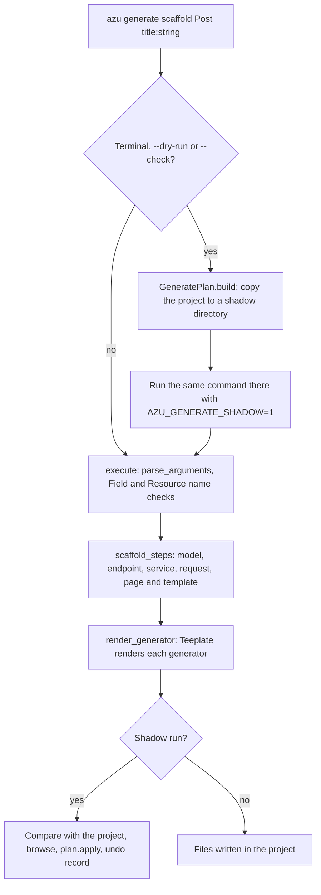

# Generator system

`azu generate` is one command that dispatches on the generator type and hands the work to a Teeplate generator per
layer. Each generator is a `Teeplate::FileTree` in `src/azu_cli/generators/`, rendered from ECR templates in
`src/azu_cli/templates/`. A scaffold runs the layers in a fixed order. On an interactive terminal, the same command
first runs in a shadow copy of the project so you can see what it would write.

## Overview & visual demo

<figure><figcaption><p>The preview lists every file the generators would write. Nothing is in the project until you confirm.</p></figcaption></figure>



## Quickstart & command syntax

Where to look:

| Part                | Path                                               | What it holds                                                          |
| ------------------- | -------------------------------------------------- | ---------------------------------------------------------------------- |
| Dispatch            | `src/azu_cli/commands/generate.cr`                 | `execute` (a `case` on the type), `scaffold_steps`, `render_generator` |
| Preview and flow    | `src/azu_cli/commands/generate_flow.cr`            | `preview_flow`, `run_plan`: when the shadow copy is used               |
| Plan and undo       | `src/azu_cli/generate_plan.cr`                     | `GeneratePlan.build`, `apply`, `Undo` (records outside the project)    |
| Shared base         | `src/azu_cli/generators/resource.cr`               | `Generate::Resource` and `Generate::Field`: names and attributes       |
| Generators          | `src/azu_cli/generators/*.cr`                      | One class per layer, all in `AzuCLI::Generate`                         |
| Templates           | `src/azu_cli/templates/`                           | ECR files, see [Template engine](template-engine.md)                   |

`Commands::Generate` declares `alias Generators = AzuCLI::Generate`, so `Generators::Model` in the command is the
class in `generators/model.cr`.

Commands to try the generators without writing anything:

```bash
azu generate model post title:string body:text --dry-run
azu generate scaffold Post title:string body:text --skip template,page
azu undo
```

Flags the generators read:

| Flag                 | Effect                                                                                       |
| -------------------- | -------------------------------------------------------------------------------------------- |
| `--dry-run`          | Show the files and diffs, write nothing                                                      |
| `--yes`              | Write without the file browser (after the preview on a terminal)                             |
| `--check`            | Type-check the project with the new files first (`crystal build --no-codegen`), write nothing if it fails |
| `--force`            | Overwrite existing files; Teeplate receives it as `force:`                                   |
| `--skip a,b`         | Leave scaffold components out: `model,endpoint,request,response,template,migration,page,service` |
| `--api-only`         | Scaffold JSON endpoints and responses, with no `new` and `edit` actions                       |
| `--web-only`         | Keeps a scaffold in web mode in a project detected as API-only                               |

`GENERATOR_TYPES` in `commands/generate.cr` lists every type `execute` routes, and the generator plugin validates
against it. Run the specs for the layer you change:

```bash
crystal spec spec/azu_cli/generators/model_generator_spec.cr spec/azu_cli/generators/resource_spec.cr spec/azu_cli/generate_plan_spec.cr
```

The generators and the directories they render into:

| Type             | Class                    | Template directory (`src/azu_cli/templates/`) | Writes to                                                   |
| ---------------- | ------------------------ | --------------------------------------------- | ----------------------------------------------------------- |
| `model`          | `Generate::Model`        | `scaffold/src/models/`                        | `src/models/`, and its migration in `src/db/migrations/`    |
| `endpoint`       | `Generate::Endpoint`     | `scaffold/src/endpoints/`                     | `src/endpoints/<resources>/`, one file per action           |
| `service`        | `Generate::Service`      | `scaffold/src/services/`                      | `src/services/<resources>/` (create, update, destroy)       |
| `request`        | `Generate::Request`      | `scaffold/src/requests/`                      | `src/requests/<resources>/`                                 |
| `page`           | `Generate::Page`         | `scaffold/src/pages/`                         | `src/pages/<resources>/`                                    |
| `response`       | `Generate::Response`     | `scaffold/src/responses/`                     | `src/responses/<resources>/` (API)                          |
| `template`       | `Generate::Template`     | `scaffold/public/templates/`                  | `public/templates/<app>/<resources>/`                       |
| `migration`      | `Generate::Migration`    | `scaffold/src/migrations/`                    | `src/db/migrations/`                                        |
| `component`      | `Generate::Component`    | `scaffold/src/components/`                    | `src/components/`                                           |
| `validator`      | `Generate::Validator`    | `scaffold/src/validators/`                    | `src/validators/`                                           |
| `middleware`     | `Generate::Middleware`   | `scaffold/src/middleware/`                    | `src/middleware/`                                           |
| `job`            | `Generate::Job`          | `scaffold/src/jobs/`                          | `src/jobs/`                                                 |
| `data:migration` | `Generate::DataMigration`| `data_migration/`                             | `src/db/data_migrations/`                                   |
| `channel`, `mailer`, `auth`, `session` | `Generate::Channel`, `Mailer`, `Auth`, `Session` | `channel/`, `mailer/`, `auth/`, `session/` | the project root; the templates set the paths |

`scaffold` runs `model`, `endpoint`, `service` and `request`, then `page` and `template` for a web app or `response`
for an API. See `scaffold_steps` in `commands/generate.cr`.

<details>

<summary>Attribute syntax and the column types it maps to</summary>

An attribute is `name:type[?][:modifier...]`. A trailing `?` on the type makes the column nullable (`age:int32?`).
Modifiers are `unique`, `index` and `required`; columns are `NOT NULL` unless the type ends in `?`. `ref:<table>`
declares a foreign key. `Generate::Field` reads them (`src/azu_cli/generators/resource.cr`).

| Attribute kind                       | Crystal type |
| ------------------------------------ | ------------ |
| `string`, `text`, `email`, `url`, anything unknown | `String` |
| `int32`, `integer`                   | `Int32`      |
| `int64`, `references`, `belongs_to`  | `Int64`      |
| `float32`                            | `Float32`    |
| `float64`, `float`                   | `Float64`    |
| `bool`, `boolean`                    | `Bool`       |
| `time`, `datetime`                   | `Time`       |
| `date`                               | `Date`       |
| `json`                               | `JSON::Any`  |
| `uuid`                               | `UUID`       |

A `String` column is written with the `text` DSL, a `Bool` with `boolean :name, default: false`, and every other type
with `column :name, <Type>` (`Field#column` in `resource.cr`). A trailing `?` adds `null: true`.

`id`, `created_at` and `updated_at` are provided by the model; the generators leave them out and warn.

</details>

## Realistic output

The dispatch for a scaffold registers its types in one list:


```crystal
      GENERATOR_TYPES = %w(
        model endpoint service request contract page job joobq middleware migration data:migration data_migration
        seed component validator response template scaffold mailer channel auth authentication api_resource
        api-resource validate
      )
```


*The list the generator plugin checks types against. `contract` is deprecated and forwards to `request`.*

Each generator's files are written by one Teeplate render call, made from `render_generator`:


```crystal
      private def render_generator(generator : Teeplate::FileTree, output_dir : String)
        # Ensure the output directory exists
        Dir.mkdir_p(output_dir) unless Dir.exists?(output_dir)

        # Determine the actual output path
        target_path = File.expand_path(output_dir, Dir.current)

        Logger.info("Generating files in: #{target_path}")

        # Render the generator
        generator.render(target_path, force: @force, interactive: false, list: false, color: true)
        # ... the rest logs the result and re-raises a failure
```


*`--force` reaches Teeplate as `force:`, and `interactive: false` keeps it from prompting.*

A model renders its own migration, so one generator call writes two layers:


```crystal
      # Renders the model, then its create-table migration next to it (`src/db/migrations`).
      def render(output_path : String, force : Bool = false, interactive : Bool = true, list : Bool = false, color : Bool = false)
        super(output_path, force: force, interactive: interactive, list: list, color: color)
        return unless @generate_migration

        migrations_dir = File.join(File.dirname(output_path), "db", "migrations")
        migration = Migration.new(create_migration_name, @attributes, @timestamps, @id_type, table_name)
        migration.render(migrations_dir, force: force, interactive: interactive, list: list, color: color)
      end
```


*The model's `render` calls `super` and then renders the migration. A scaffold with `--skip migration` builds the model with `generate_migration: false`.*

## Do's and don'ts


**Pro tip:** run `--dry-run` before a scaffold. It prints the file list and the diff of every changed file, and writes
nothing. `--check` adds a type-check of the project with the new files.



Check names before you generate. `Generate::Resource.name_error` rejects names that are not Crystal identifiers, names
whose singular and plural are the same, and names that would hide a constant the generated code uses, such as
`Status`, `Request` or `Response`.



A scaffold checks every attribute type against `SCAFFOLD_TYPES` and stops with `Unsupported attribute type` on
anything else. Modifiers outside `unique`, `index`, `required` and `ref:<table>` are refused the same way.



Don't use `--force` to merge. It overwrites the files. `azu undo` reverts the files of the last run that you have not
edited since. The undo records live outside the project, in `$XDG_STATE_HOME/azu` (or `~/.local/state/azu`).


<details>

<summary>There is no template override</summary>

Each generator's `directory` is a constant path into `src/azu_cli/templates/`, and nothing in the CLI reads a
project-level template. To change what a generator writes, edit the ECR template in the CLI's source tree and rebuild
the CLI. See [Template engine](template-engine.md).

</details>
