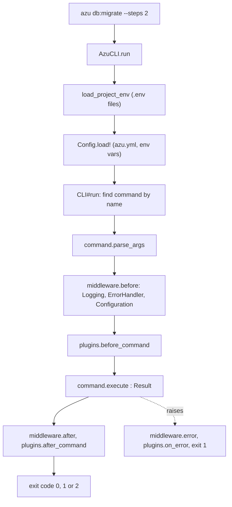

# CLI architecture

Every command is a class that returns a `Result`. The CLI finds it by name, parses its arguments, runs it through
middleware and plugin hooks, and turns the result into an exit code.

## Overview & visual demo

<figure><figcaption><p>One command, three layers: the wizard and review (UI), the steps it runs (command), and the files it writes (generator).</p></figcaption></figure>



`load_project_env` runs for every command except `new`, `init`, `help`, `version` and `completion`.

## Quickstart & command syntax

Where to look:

| Part       | Path                      | What it does                                                           |
| ---------- | ------------------------- | ---------------------------------------------------------------------- |
| Registry   | `src/azu_cli/cli.cr`      | `CLI#setup_commands` registers every command and alias                 |
| Commands   | `src/azu_cli/commands/`   | `Commands::Base` subclasses; `db/`, `jobs/`, `config/` are subfolders  |
| Generators | `src/azu_cli/generators/` | `Teeplate::FileTree` subclasses, one per generator                     |
| Templates  | `src/azu_cli/templates/`  | ECR files: `project/`, `scaffold/`, `auth/`, `joobq/`, ...             |
| Middleware | `src/azu_cli/middleware/` | Logging, error handling, configuration                                 |
| Plugins    | `src/azu_cli/plugins/`    | Three built-in hook sets: generator, database, development             |
| UI engine  | `src/azu_cli/ui/`         | See [Terminal UI](terminal-ui.md)                                      |


```crystal
register_command("generate", Commands::Generate)
register_command("g", Commands::Generate) # alias
```


| Exit code | Meaning        |
| --------- | -------------- |
| `0`       | Success        |
| `1`       | Failure        |
| `2`       | Invalid usage  |

Aliases: `g` for `generate`, `s` and `server` for `serve`, `t` for `test`.

## Realistic output


```text
$ azu nope
Unknown command: nope
Run 'azu help' to see available commands
$ echo $?
1
```


*An unknown command exits 1 and points at `azu help`.*

## Do's and don'ts


**Pro tip:** commands whose output is data (`routes`, `doctor`) keep the CLI's own log lines off stdout, so
`azu routes --format json | jq` just works.



Add a command by subclassing `Commands::Base`, returning a `Result`, and registering it. The wiring is automatic from there.



The plugin system is internal. There's no `azu plugin` command, no plugin installation and no external plugin loading.
See [Custom tasks](../advanced/custom-tasks.md) for how to extend the CLI.



Don't document or register a flag or command you didn't implement. `azu help` and `CLI_REFERENCE.md` list exactly what exists.


<details>

<summary>Plugin hooks</summary>

`Plugins::Base` defines `on_load` (once at start), `before_command(cmd, args)`, `after_command(cmd, result)` and
`on_error(cmd, error)`. A plugin can reject arguments by raising in `before_command`. `on_unload` is defined but never
called. Registered in `CLI#load_builtin_plugins`: `GeneratorPlugin`, `DatabasePlugin`, `DevelopmentPlugin`.

More: [Generator system](generator-system.md) and [Template engine](template-engine.md).

</details>
