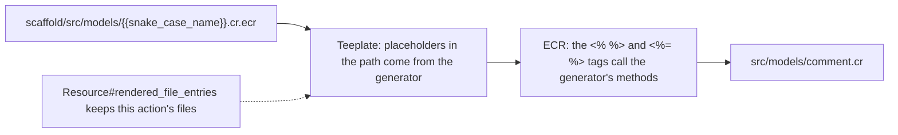

# Template engine

The templates are ECR files in `src/azu_cli/templates/`, rendered by Teeplate, the library behind every generator. The
file name holds the placeholders, the ECR tags call methods on the generator, and whatever is not an ECR tag is
copied as written. That is why one template file can produce Crystal source and a Jinja page at once.

## Overview & visual demo

<figure><figcaption><p>Each line is one rendered template. <code>public/templates/...jinja</code> comes from the same scaffold as <code>src/models/comment.cr</code>.</p></figcaption></figure>



## Quickstart & command syntax

Where to look:

| Part                  | Path                                                   | What it does                                                         |
| --------------------- | ------------------------------------------------------ | -------------------------------------------------------------------- |
| Templates             | `src/azu_cli/templates/`                               | ECR files, one tree per generator (`scaffold/`, `project/`, `auth/`, `joobq/`, ...) |
| Base class            | `src/azu_cli/generators/resource.cr`                   | `Generate::Resource`: the getters every layer shares, and `rendered_file_entries` |
| Per-layer methods     | `src/azu_cli/generators/endpoint.cr`, `model.cr`, ...  | The methods the templates call (`api?`, `route`, `fields`, ...)      |
| Jinja check           | `src/azu_cli/validators/jinja_validator.cr`            | Line checks for the `.jinja` pages, run by `azu generate validate`   |

Check the Jinja pages of a project, and run the specs for the template-facing code:

```bash
azu generate validate
crystal spec spec/azu_cli/validators/jinja_validator_spec.cr spec/azu_cli/generators/endpoint_generator_spec.cr
```

Teeplate's rules, as the generators use them:

- A file is rendered when `rendered_file_entries` keeps it. `Resource` keeps only the files that start with the
  generator's action (`create_endpoint.cr.ecr` for `create`). The template generator also keeps `_form.jinja.ecr` for
  `new` and `edit`.
- A `{{name}}` in a file or directory name is replaced by the generator's getter of that name. `{{snake_case_name}}`
  becomes `comment`, `{{resource_plural}}` becomes `comments`.
- The `.ecr` suffix is dropped from the output name.
- `<% %>` runs Crystal code, `<%= %>` writes its value, `-%>` trims the line break. Any other text is copied as it is.

The names templates can use. They are methods on the generator, not a context hash:

| Name                                             | Defined in                  | Value for `Post` in project `blog`              |
| ------------------------------------------------ | --------------------------- | ----------------------------------------------- |
| `resource_singular`, `snake_case_name`           | `Resource` (getters)        | `post`                                          |
| `resource_plural`                                | `Resource` (getter)         | `posts`                                         |
| `namespace`                                      | `Resource` (getter)         | `Posts`, the module of the layer                |
| `app_module`, `app_dir`                          | `Resource` (getters)        | `Blog`, `blog`                                  |
| `model_name`, `action`, `action_class`           | `Resource`                  | `Post`, `create`, `Create`                      |
| `attributes`, `fields`                           | `Resource`                  | the `name:type` pairs; `fields` as `Field` records |
| `request_type`, `response_type`, `route`, `verb`, `api?`, `find_record` | `Endpoint` | `Posts::CreateRequest`, `"/posts"`, `"post"`, `api?` is `false` for web |
| `table_name`, `associations`, `constructor_params`, `include_statement`, `db_context_declaration` | `Model` | `posts`, the association lines, `db_context <schema>, :posts` |

The `Field` record exposes `name`, `crystal_type`, `column`, `foreign_key`, `input`, `label` and `nilable?`. The full
rules are in [Generator system](generator-system.md).

## Realistic output

The model template is the whole file, placeholders and all:


```erb
require "cql"

class <%= model_name %>
  <%= include_statement %>
  <%= db_context_declaration %>

<% fields.each do |field| -%>
  property <%= field.name %> : <%= field.crystal_type %>
<% end -%>
<% if @timestamps -%>
  property created_at : Time?
  property updated_at : Time?
<% end -%>
<% unless associations.empty? -%>

<% associations.each do |association| -%>
  <%= association %>
<% end -%>
<% end -%>

  def initialize(<%= constructor_params %>)
  end
end
```


*`<%= model_name %>` and `fields` are methods on the generator. The `-%>` tags keep the generated file free of blank lines.*

Endpoints branch on the generator's `api?` method, so one template serves both the web and the API scaffold:


```erb
module <%= app_module %>
  struct <%= namespace %>::CreateEndpoint
    include Azu::Endpoint(<%= request_type %>, <%= response_type %>)

    post "<%= route %>"

    def call : <%= response_type %>
      record = <%= namespace %>::CreateService.new.call(create_request)
<% if api? -%>
      status 201
      <%= response_type %>.new(record)
<% else -%>
      redirect to: "<%= route %>/#{record.id}", status: 303
<% end -%>
    end
  end
end
```


*The web branch redirects with 303; the API branch answers 201 with the record.*

A Jinja page is an ECR file too. The ECR tags run first, and the `{{ }}` and `` lines are copied through for Jinja
to render at runtime:


```erb
<form action="{{ form_action }}" method="post" class="stack">
  {{ csrf_tag | safe }}
  <input type="hidden" name="_method" value="{{ form_method }}">
<% fields.each do |field| -%>
<% if field.input == "checkbox" -%>
  <label class="field field--check">
    <input type="hidden" name="<%= field.name %>" value="false">
    <input type="checkbox" name="<%= field.name %>" value="true"{% if <%= resource_singular %>.<%= field.name %> %} checked>
    <%= field.label %>
  </label>
```


*Lines with `<%= %>` become Crystal values in the generated page; `{{ csrf_tag | safe }}` is Jinja and survives the generator.*

Which templates a generator renders is decided by `rendered_file_entries` in the shared base:


```crystal
      # Only the template of this generator's action: `<action>_<layer>.cr` (or `.jinja`).
      def rendered_file_entries
        file_entries.select { |entry| File.basename(entry.path).starts_with?("#{@action}_") }
      end
```


*A `create` endpoint renders `create_endpoint.cr.ecr` only, so the scaffold makes one file per action.*

## Do's and don'ts


**Pro tip:** call the generator's methods from a template (`<%= model_name %>`, `fields.each`) rather than building
strings in Crystal first. The methods are the shared API every layer's templates use, and a spec can call them.



Trim the lines your loops produce with `-%>`, as the model and the form templates do. Generated files then read like
hand-written code, with no blank lines where the tags were.



Only `<% %>` and `<%= %>` run in these files. Jinja's `{{ }}` and `` pass through ECR unchanged, so a Jinja
expression can sit on the same line as an ECR tag, as the form template does.



`azu generate validate` checks only `.jinja` files under `./public/templates`, `./src/templates` and `./templates`. It
catches line-level problems such as a ternary operator or a function call inside `{{ }}`. It does not compile the ECR
templates or the Crystal they generate. `--check` on a generator type-checks the project with the new files.



Don't put raw user input into generated Crystal. Names reach the templates only after `Generate::Field.name_error` and
`Generate::Resource.name_error` accept them. Keep that order when you add a template variable.

