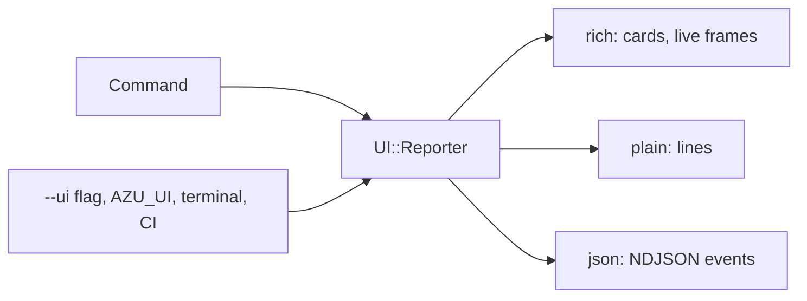

# Terminal UI

Cards, a wizard, a full-screen dashboard and a live preview, all with a plain-text twin.

## Overview

The UI engine (`src/azu_cli/ui/`) uses only the Crystal standard library plus one `ioctl` binding. Screens are pure
`update(event) -> Action` and `view(frame)` functions, so specs drive them with keys and compare the frame as text. The
same command always has three forms: `rich`, `plain` and `json`.

<figure><figcaption><p>A rich screen: the review step of <code>azu new</code>, with the equivalent command line under it.</p></figcaption></figure>



## Quickstart

Choosing a mode, in order of precedence:

| Setting             | Effect                                                                                  |
| ------------------- | --------------------------------------------------------------------------------------- |
| `--ui rich\|plain\|json` | Per command                                                                         |
| `AZU_UI=...`        | Same, for the session                                                                   |
| (neither)           | `rich` on a terminal with color and not in CI, otherwise `plain`                         |
| `NO_COLOR`          | Keeps the glyphs, drops the color; wins over everything                                 |
| `FORCE_COLOR`       | Keeps color on a pipe                                                                    |

```bash
azu doctor --ui plain
AZU_UI=json azu new blog --yes     # NDJSON events for an editor or CI
```

Screens:

| Screen             | Command                | Keys                                                                      |
| ------------------ | ---------------------- | ------------------------------------------------------------------------- |
| Wizard, review, progress, done | `azu new`  | arrows or `j`/`k`, Space toggles, Enter continues, Shift-Tab back, Esc cancels (nothing written) |
| Dashboard          | `azu dev`              | `1`-`5` panels, `r` rebuild, `l` log, `c` clear log, `q` quit             |
| File browser and diff | `azu generate`      | Up/Down file, Enter writes, Esc cancels                                    |
| Cards              | `doctor`, `routes`, `version`, `db:*` | none (printed, not interactive)                            |

## Output

<figure><figcaption><p>A live card: one row per step with its count and time.</p></figcaption></figure>

<figure><figcaption><p>A failed build covers the dashboard with the error location. The previous build keeps serving; Esc goes back.</p></figcaption></figure>

<figure><figcaption><p><code>azu doctor</code>: <code>✔</code> ok, <code>▲</code> warning, <code>✖</code> failure; the border turns amber or red.</p></figcaption></figure>

<figure><figcaption><p><code>azu undo</code> restoring what a generate wrote.</p></figcaption></figure>

The same `doctor` result in plain mode:

```text
ok    crystal        Crystal 1.22.1 (the project needs 1.22.1 or newer)
warn  database       SQLite file ./db/blog_development.db does not exist yet
                     hint: run 'azu db:setup'

8 ok, 1 warnings, 0 failures
```

## Do's and don'ts


Commands that print data accept `--ui plain` or `--format json` and are safe in scripts. Pipes and `--yes` never need a
terminal.



Building a screen? Keep it a pure `Screen` and test it with `Terminal.fake` and `frame.to_text`.



Never put a two-column glyph (emoji, CJK) inside a frame. `Frame#text` replaces it with `?` so borders keep lining up.


<details>

<summary>Design reference</summary>

Color tokens, glyph rules, the renderer and the screen mockups are in [Terminal UI (design)](../architecture/terminal-ui.md).
Some mockups there are proposals; that page lists which parts are built.

</details>
