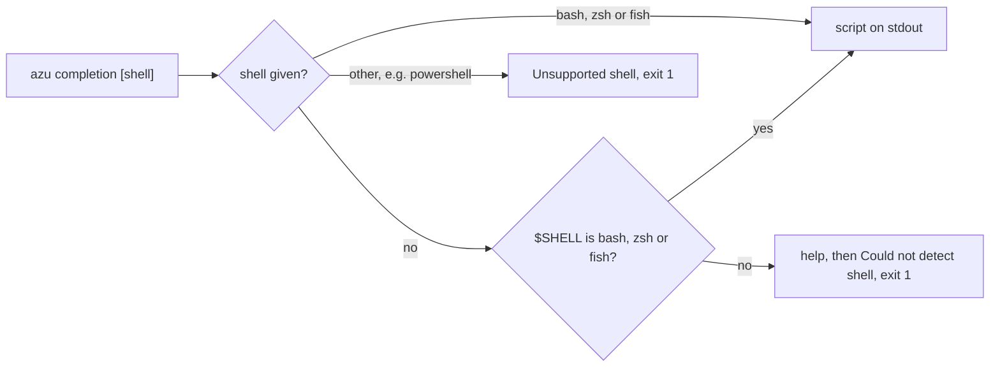

# azu completion

`azu completion` prints a shell completion script to stdout. Load it with `eval` in your shell's startup file, or save it into your shell's completions directory.

## Overview & visual demo

Tab completion saves typing the 40-odd command names and the generator types. The script is static: it lists the commands and generators of the build that printed it.

<figure><figcaption><p>Not <code>azu completion</code>'s output. This is the generator menu <code>azu g</code> shows. Completion offers the same generator names on Tab.</p></figcaption></figure>



## Quickstart & command syntax

```bash
azu completion bash
azu completion zsh
azu completion --shell fish > ~/.config/fish/completions/azu.fish
```

Load it in the current shell or in your startup file:



```bash
echo 'eval "$(azu completion bash)"' >> ~/.bashrc
source ~/.bashrc
```



```bash
echo 'eval "$(azu completion zsh)"' >> ~/.zshrc
source ~/.zshrc
```



```bash
azu completion fish > ~/.config/fish/completions/azu.fish
```
Fish loads the file in new shells.



| Option            | Short | Meaning                                       | Default                                  |
| ----------------- | ----- | --------------------------------------------- | ---------------------------------------- |
| `[shell]`         |       | `bash`, `zsh` or `fish`, as a word           | from `$SHELL`                            |
| `--shell SHELL`   | `-s`  | The same, as an option                        | from `$SHELL`                            |
| `--help`          | `-h`  | Print the usage and exit `0`                  | off                                      |

Without a shell argument, the command reads `$SHELL` and accepts it when it names bash, zsh or fish. Any other value exits with code `1` and `Unsupported shell`.

## Realistic output


```text
Usage: azu completion [shell]

Generate shell completion scripts for Azu CLI.

Options:
  --shell, -s SHELL   Shell type (bash, zsh, fish)
  --help, -h          Show this help message

Shells:
  bash    Bash completion script
  zsh     Zsh completion script
  fish    Fish completion script

Installation:

  Bash (add to ~/.bashrc):
    eval "$(azu completion bash)"

  Zsh (add to ~/.zshrc):
    eval "$(azu completion zsh)"

  Fish (save to completions):
    azu completion fish > ~/.config/fish/completions/azu.fish

Examples:
  azu completion bash
  azu completion --shell zsh
  azu completion fish > ~/.config/fish/completions/azu.fish
```


*The usage text, printed as written in the command.*


```text
# Azu CLI Bash Completion
# Add to ~/.bashrc or ~/.bash_profile:
# eval "$(azu completion bash)"

_azu_completions() {
    local cur prev opts
...
```


*The script is printed in full, so pipe it to a file if you want to read the rest.*

## Do's and don'ts


**Pro tip:** name the shell when you write a setup script: `azu completion --shell zsh` gives the same result on every machine, while detection depends on `$SHELL`.



Regenerate the script after you upgrade azu. The command list is written into the script when it is generated.



The zsh script ends with `compdef`, which exists only after `compinit` has run. If you see `command not found: compdef`, put the `eval` line after `compinit` in `~/.zshrc`.



Don't expect every flag to complete. Bash completes values for `--shell`, `--format`, `--env`, `--db` and `--type`, and other flags complete only `--help`, `--verbose`, `--quiet` and `--force`. Fish completes the flags of `new`, `config:show`, `config:validate`, `config:env` and `completion`.

