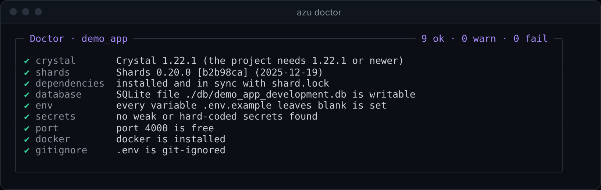
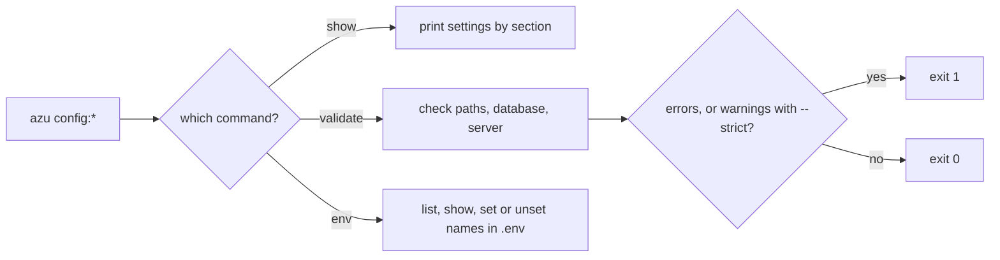

# Configuration commands

Three commands look after the configuration: `azu config:show` prints the settings the CLI resolved, `azu config:validate` checks them, and `azu config:env` lists the known environment variables or edits `.env`.

## Overview & visual demo

Run `config:validate --strict` in CI before a deploy, and `config:show` when a value is not what you expected. Secrets are masked in `config:show`; `config:env --show` is the exception, as the danger note below explains.

<figure><figcaption><p>Not a config command's output. <code>azu doctor</code> is the environment check to run next to <code>config:validate</code>. The <code>config:*</code> commands print plain text.</p></figcaption></figure>



## Quickstart & command syntax

```bash
azu config:show
azu config:show --format json --section database
azu config:validate --strict
azu config:env --list
azu config:env --set AZU_PORT=4000
azu config:env --unset AZU_PORT
```

### azu config:show

| Option                    | Meaning                                                          | Default    |
| ------------------------- | ---------------------------------------------------------------- | ---------- |
| `--format FORMAT`, `-f`   | `yaml` (also `yml`), `json` or `table`                           | `yaml`     |
| `--section NAME`, `-s`    | One section: `global`, `project`, `server`, `database`, `paths`, `logging` | all |
| `--env NAME`, `-e`        | Changes the heading only. The values are the ones the command resolved | current |

The password and `DATABASE_URL` print as `********` when they are set.

### azu config:validate

| Option               | Meaning                                                              | Default |
| -------------------- | -------------------------------------------------------------------- | ------- |
| `--strict`, `-s`     | Treat warnings as errors                                             | off     |
| `--config PATH`, `-c`| The configuration file to read                                       | the one the CLI finds |
| `--env NAME`, `-e`   | Accepted, but not used: the check reads the current configuration   | current |

It checks the YAML syntax of the configuration file, whether the templates and output paths exist, and in a project whether `src/`, `spec/` and `config/` exist. It also checks the database adapter (`postgresql`, `mysql`, `sqlite`, `sqlite3`), that the database and server ports are 1 to 65535, that a server port below 1024 is flagged as privileged, and whether the server host is a standard one. Errors exit `1`. Warnings alone exit `0`, unless `--strict` is set.

### azu config:env

| Option            | Meaning                                                                              | Default |
| ----------------- | ------------------------------------------------------------------------------------ | ------- |
| `--list`, `-l`    | List the known variables and what they do                                            | the default when no other flag is given |
| `--show`, `-s`    | List the known variables with their current values                                   | off     |
| `--set VAR=VALUE` | Write `VAR=VALUE` into `.env` in the current directory, replacing an existing line    | off     |
| `--unset VAR`     | Remove `VAR` from `.env`                                                             | off     |

The known variables are the ones `--list` prints:

| Variable             | Description                                       |
| -------------------- | ------------------------------------------------- |
| `AZU_ENV`            | Environment name (development, test, production)  |
| `AZU_DEBUG`          | Enable debug mode                                 |
| `AZU_VERBOSE`        | Enable verbose output                             |
| `AZU_QUIET`          | Suppress non-error output                         |
| `AZU_HOST`           | Development server host                           |
| `AZU_PORT`           | Development server port                           |
| `AZU_DB_HOST`        | Database host                                     |
| `AZU_DB_PORT`        | Database port                                     |
| `AZU_DB_USER`        | Database user                                     |
| `AZU_DB_PASSWORD`    | Database password                                 |
| `AZU_DB_NAME`        | Database name                                     |
| `DATABASE_URL`       | Full database connection URL                      |
| `AZU_TEMPLATES_PATH` | Path to template files                            |
| `AZU_OUTPUT_PATH`    | Default output directory                          |

## Realistic output


```text
Variable                 Description
------------------------------------------------------------
AZU_ENV                  Environment name (development, test, production)
AZU_DEBUG                Enable debug mode
AZU_VERBOSE              Enable verbose output
AZU_QUIET                Suppress non-error output
AZU_HOST                 Development server host
AZU_PORT                 Development server port
AZU_DB_HOST              Database host
AZU_DB_PORT              Database port
AZU_DB_USER              Database user
AZU_DB_PASSWORD          Database password
AZU_DB_NAME              Database name
DATABASE_URL             Full database connection URL
AZU_TEMPLATES_PATH       Path to template files
AZU_OUTPUT_PATH          Default output directory

Use --show to see current values
Use --set VAR=VALUE to set a variable
Use --unset VAR to unset a variable
```


*The table as the command prints it. Its heading line is a log line with a timestamp in plain mode, and it is left out here.*


```text
WARNING: 'AZU_FOO' is not a known Azu environment variable
```


*A name outside the list is still written to `.env`; the warning is the only sign.*

## Do's and don'ts


**Pro tip:** `azu config:show --section database --format json` gives one section for a bug report, with the password already masked.



Run `azu config:validate --strict` in CI before a deploy. With `--strict` a warning fails the job, so a missing directory or a port below 1024 stops the pipeline.



`--env` on `config:show` changes only the heading. The values come from the environment the command runs in.



`config:env --set` writes to `.env` in the current directory, as given, with no quoting, and it does not touch `.env.local`. Check the file after you set a value with spaces in it.



`config:env --show` prints `DATABASE_URL` in full, password included. Only names that contain `PASSWORD` or `SECRET` are masked. Don't run it in a shared terminal or paste its output into a ticket.

