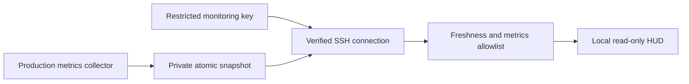
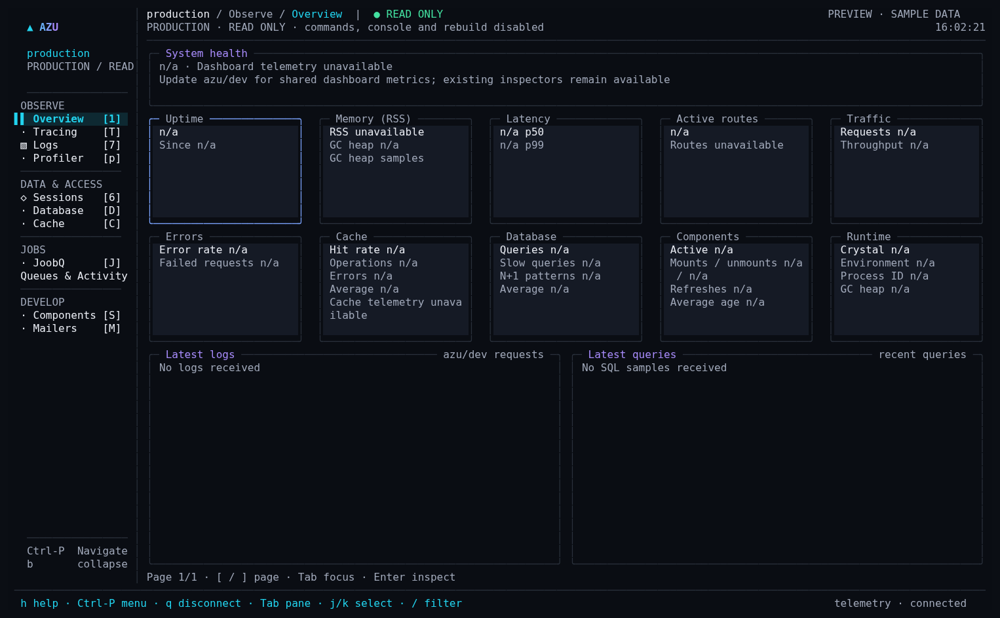

# azu connect

## Overview

Inspect a deployment from your machine through verified SSH and a bounded snapshot file. This view is read-only: local generators, the console, session mutations, mail delivery, and job replay stay unavailable.


Provision the restricted SSH identity and publisher described below before
connecting. The CLI does not install or discover a production agent.




## Quickstart

Run the HUD on your own machine and read production metrics over authenticated SSH:

```sh
azu connect --ssh azu-production --snapshot /run/azu/monitor.json
```

This is a **read-only production monitor**. It does not deploy, generate code,
run migrations, replay jobs, execute SQL, open a remote shell, or load a production
Crystal interpreter. Local development commands remain available in
`azu dev --ui mission`. The production header is always marked `READ ONLY`, and
the command/console shortcuts and menu entries are disabled.

## Realistic output

<figure><figcaption><p>Actual read-only screen with illustrative metrics; this is not a capture of your production deployment.</p></figcaption></figure>

When connected, the status reads `SSH verified · snapshot current`. If verification,
access or freshness fails, it changes to `unavailable` and displays the retry delay.

## Do's and don'ts

Use a dedicated, server-restricted key and verify host fingerprints through your
infrastructure channel. Do not reuse an unrestricted deployment key or disable
host verification to make a connection succeed.


The server-side forced command is the authorization boundary. A general SSH key
can have privileges beyond those exercised by this read-only client.


## Provision a monitoring identity

Use your normal infrastructure management process to provision a monitoring
identity and an aggregate-metrics collector. The collector must publish the
snapshot as the monitoring identity, in a directory that untrusted users cannot
write. Directory mode `0700` and file mode `0600` are sufficient when both use the
same identity. Do not grant the account access to database credentials or the
application's environment just to obtain metrics.

Install a dedicated public key in this identity's `authorized_keys`. Enforce the
capability on the server, not only in the CLI:

```text
restrict,command="/usr/bin/cat -- /run/azu/monitor.json" ssh-ed25519 <public-key> azu-monitor
```

Use the actual absolute `cat` path on your server. Keep `authorized_keys` and its
parent directory protected from other users; use a root-managed
`AuthorizedKeysFile` when the collector should not be able to change authorization.
The forced command means this key can only read that one file, even from a
modified CLI. `restrict` disables PTY allocation and port, agent and X11 forwarding.
This requires a recent OpenSSH server supporting `restrict`. Also disable password
and keyboard-interactive authentication for this identity at the SSH server and
apply your organization's access logging, revocation and network restrictions.
The host/account and metrics source remain part of your trust boundary.

Configure your local SSH alias, using a dedicated key or an agent-backed,
passphrase-protected key:

```sshconfig
Host azu-production
  HostName production.internal.example
  User azumonitor
  IdentityFile ~/.ssh/azu_monitor_ed25519
  IdentitiesOnly yes
  StrictHostKeyChecking yes
  # ProxyJump bastion.example     # optional, per your infrastructure policy
```

Obtain and verify the server host-key fingerprint through your trusted deployment
or infrastructure channel before adding it to `known_hosts`. Merely downloading
a key with `ssh-keyscan` does not authenticate it. Unknown or changed keys fail
closed. Load an encrypted private key into your local agent before connecting;
the HUD does not prompt for passwords or passphrases and never forwards the agent.
Certificate-based identities and jump hosts use your OpenSSH configuration.

Rotate the dedicated client key by installing the replacement public key,
verifying access, then revoking the old key. Rotate host keys through your verified
infrastructure process and update `known_hosts`; never bypass host verification
to restore connectivity. No private key or access token is stored by azu_cli.

## Publish a sanitized snapshot

The production application/collector must provide fresh metrics. `azu connect`
does not discover a deployment or install an agent automatically. Copy the small,
standard-library-only helper
[`monitor_snapshot.cr`](../../src/azu_cli/integrations/monitor_snapshot.cr)
into your collector and call it from an existing supervised sampling loop:

```crystal
require "./monitor_snapshot"

# Replace these sample values with measurements from your existing metrics
# collector. Do not publish hard-coded values in production.
metrics = JSON.parse(%({
  "v": 1,
  "requests": {"total": 1200, "rps": 20, "p95_ms": 8.4},
  "sql": {"pool": {"in_flight": 3, "max": 20},
          "recent": [{"ms": 2.1, "pool_wait_ms": 0.2}]},
  "queues": [{"name": "default", "pending": 8, "processing": 3, "failed": 0}]
}))
AzuMonitor::Snapshot.publish("/run/azu/monitor.json", metrics)
```

Publish measured values every two to five seconds. Collect and publish a new
sample together; repeatedly timestamping cached data would disguise a stale
collector. The helper adds `captured_at` in UTC, allowlists numeric metrics,
redacts query statements and paths, writes a private temporary file in the same
directory, and atomically replaces the previous snapshot. Publisher failures
should be logged by your collector and retried with backoff; readers will reject
the old file after 30 seconds. Keep host clocks synchronized.

The client applies the allowlist again. It accepts request/SQL counts and latency
metrics, pool counters, redacted recent timings/status codes, and named queues
with pending/processing/failed counts. Negative and invalid numeric values are
discarded. Raw SQL, parameters, full URLs, account identifiers, headers, errors,
stack traces, arbitrary auth events and logs are excluded. Auth and DB schema
panes therefore remain unavailable in this first production transport.
Queue names must contain only letters, digits, `_`, `.`, `:`, or `-` and must not
encode personal information. Metrics themselves can be commercially sensitive;
the restricted account and host-key trust still matter.

The snapshot is monitoring data, not a durable audit log. Do not enable `azu/dev`
or expose a debug/console HTTP endpoint in production to feed this reader.

## Connection behavior and limits

* OpenSSH verifies and encrypts every connection. The CLI passes argv directly;
  the only remote command is a validated, quoted `cat -- /absolute/path`.
* Forwarding, local SSH commands, TTY allocation and connection-master reuse are
  disabled. Inherited environment forwarding is cleared. There is no insecure
  host-key override or plaintext fallback.
* Reads have a 10-second deadline, a 128 KiB capture cap and a maximum of 100
  recent rows/queues. Each snapshot opens a new connection, normally every two
  seconds; consider collector load when many operators connect.
* Snapshots older than 30 seconds or more than five seconds in the future are
  rejected. Failed connections clear the connected state and retry with bounded
  backoff up to 30 seconds. Old displayed values are marked disconnected/stale.
* **q** disconnects and terminates the active SSH process. There are no local
  listeners or tunnels to clean up. The CLI does not read the working directory's
  `.env` for `connect`.

If the screen says unavailable, verify the alias and dedicated key, trusted host
fingerprint, server-side forced command, file ownership/permissions and
`captured_at`. Raw SSH stderr and snapshot payloads are not shown in the HUD.
Use your SSH/server logs for detailed diagnosis without weakening these controls.

## Validation

Unit tests cover argument injection, review-before-execution, the read-only UI
boundary, payload redaction, snapshot freshness/size, and atomic publishing.
The opt-in loopback harness tests the real OpenSSH client/server without touching
your SSH configuration:

```sh
crystal build scripts/check_remote_monitor.cr -o /tmp/azu-monitor-check
python3 scripts/check_remote_monitor.py /tmp/azu-monitor-check
# Also exercise the actual connect command in a PTY, if bin/azu is built:
python3 scripts/check_remote_monitor.py /tmp/azu-monitor-check ./bin/azu
```

This validates the transport locally. Your production identity, authorization,
host keys, collector and network access must be provisioned and verified in your
actual deployment before connecting.
