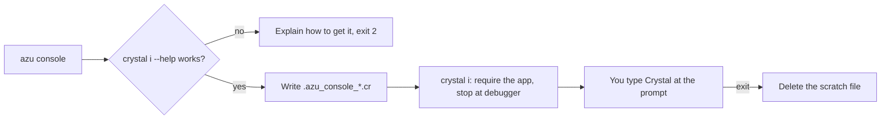

# azu console

## Overview & visual demo

Evaluate Crystal against your project in a local console. Use it to investigate application behavior; evaluated code has the same privileges and database access as the application.

<figure><figcaption><p><code>azu doctor</code> on a project. It reports the Crystal toolchain that <code>azu console</code> runs on. The console also needs the interpreter, which doctor's version line does not show.</p></figcaption></figure>



## Quickstart & command syntax

```bash
cd blog
azu console
```

At the prompt, type Crystal code against the loaded app. `exit` leaves.

| Option | Meaning | Default |
| --- | --- | --- |
| none | The command takes no options | |

Exit codes: `0` the session ended, `1` this is not a project or the interpreter failed (its exit code is used), `2` this Crystal has no interpreter, or invalid usage.

## Realistic output


```text
[hh:mm:ss] [INFO ] Install a Crystal that includes it (the packages from crystal-lang.org/install and Homebrew do; the official Docker images do not),
[hh:mm:ss] [INFO ] check with 'crystal i --help', then run 'azu console' again.
[hh:mm:ss] [INFO ] Meanwhile 'azu routes' lists the routes and 'crystal run' of a script that requires ./src/blog runs code with the app loaded.
ERROR: this Crystal has no interpreter (crystal i), so 'azu console' cannot open a REPL
```


*The three hints go to stdout and the error to stderr; the exit code is 2.*


```crystal
require "./src/blog.cr"

puts "Azu console: Blog is loaded. Type Crystal code; `exit` leaves."
debugger
```


*The script `azu console` runs with `crystal i`; it is deleted when the command ends.*


```text
ERROR: ./src/blog.cr not found: run 'azu console' in the root of an Azu project
```


*The command needs `src/<project>.cr` in the current directory; the exit code is 1.*

## Do's and don'ts


**Pro tip:** for a quick look at the routes, `azu routes` compiles the app and prints the table without opening a prompt.



Restart the console after you change code. Nothing reloads while it runs.



The console has no `--env` option, and an unknown option is a usage error. Set `CRYSTAL_ENV` in your shell, and check which `.env` files apply, before you open it.



Don't use it against production by accident. Loading the app runs its top-level code, and what you type runs against whatever database the environment points to.


<details>

<summary>Limits</summary>

- It needs a Crystal built with the interpreter: `crystal i --help` must work. The packages from crystal-lang.org/install and Homebrew include it. The official Docker images do not, and the command then exits with 2.
- Code that links native libraries (SQLite, OpenSSL, libpq) runs only if the shared libraries are installed.
- The interpreter is slower than compiled code and does not support every Crystal feature, so some apps do not load in it. With Crystal 1.22.1 no Azu app does: the interpreter stops with compiler bugs in Crinja (azu's templates) and in CQL's PostgreSQL session. The Console panel of [azu dev](azu-dev.md) runs Crystal with your app loaded without the interpreter.
- Nothing is reloaded. Restart the console after you change code.
- Ctrl-C goes to the interpreter, not to the CLI.

</details>

<details>

<summary>Scratch file and .gitignore</summary>

The scratch file is deleted when the command ends. After a crash or SIGKILL it can remain; delete it. Generated projects git-ignore `/.azu_console_*.cr`. In an older project, add that line to `.gitignore`.

</details>
