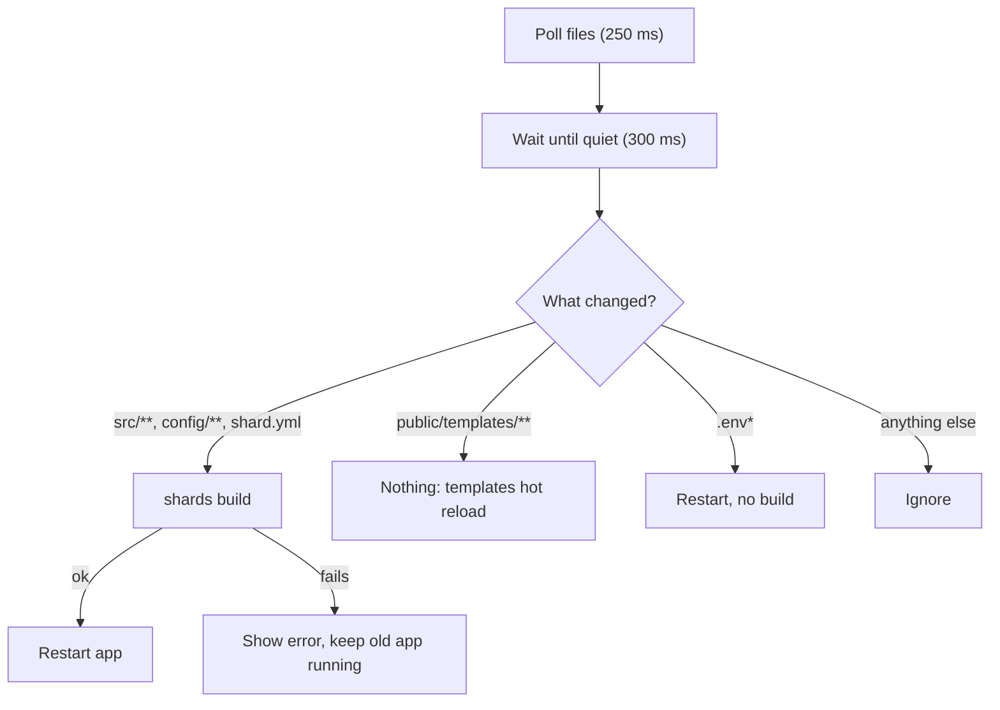
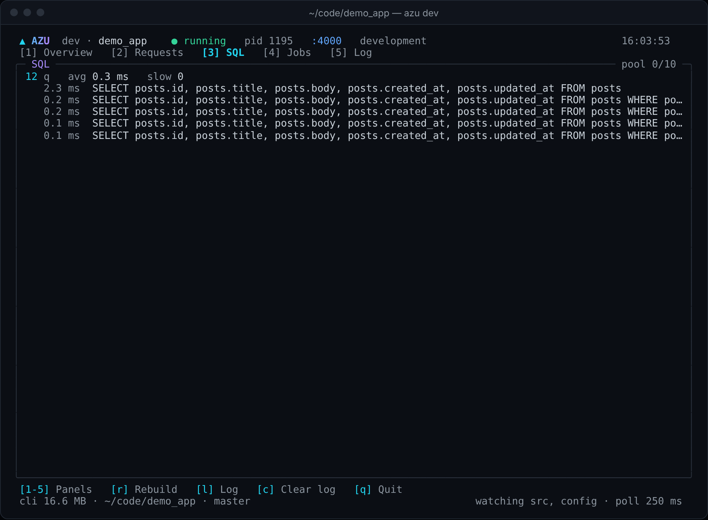

# azu dev

Run the app and keep it current while you edit.

## Overview

`azu dev` builds your app (`shards build`, not a release build), starts it, watches your files and rebuilds and restarts
when code changes. On a terminal of at least 60x16 it shows a dashboard for the build, the app, requests, SQL, jobs and
the log.

<figure><figcaption><p>The first build: compiler stage and elapsed time.</p></figcaption></figure>



## Quickstart

```bash
azu dev
azu dev --port 4001 --env development
azu dev --ui plain               # lines instead of the dashboard
```

| Option          | Meaning                                                              | Default                      |
| --------------- | -------------------------------------------------------------------- | ---------------------------- |
| `--port PORT`   | `PORT` for the app                                                   | from env or `.env`, else 4000 |
| `--host HOST`   | `HOST` for the app                                                   | same rule                    |
| `--env NAME`    | `CRYSTAL_ENV` for the app                                            | same rule                    |
| `--debounce MS` | Quiet time before acting on a change                                 | 300                          |
| `--interval MS` | Polling interval                                                     | 250                          |
| `--ui MODE`     | `rich` (dashboard) or `plain`                                        | auto                         |

Dashboard keys: `1`-`5` panels, `r` rebuild now, `l` log, `c` clear log, `q` or Ctrl-C quit.

## Output

<figure><figcaption><p>Build time, uptime and memory, request rate and percentiles, SQL timings and the live log.</p></figcaption></figure>

<figure><figcaption><p>The SQL panel: query count, average, slow queries, pool and N+1 alerts.</p></figcaption></figure>

<figure><figcaption><p>A failed build shows the compiler's error. The previous build keeps serving.</p></figcaption></figure>

Quitting prints a one-line summary of the session. Exit codes: `0` stopped by Ctrl-C or SIGTERM, `1` not an Azu project,
`2` invalid usage.

## Do's and don'ts


Requests and SQL come from the app over a Unix socket (`AZU_TELEMETRY_SOCKET`, mode 0600). The app must `require
"azu/dev"` and run in development; request stats need `PERFORMANCE_MONITORING=true`, which `.env.development` sets.



Edit templates freely. Saving a `.jinja` file triggers no build and no restart.



Files are polled, not watched through the OS. On a very large tree raise `--interval`. Symlinked directories are not followed.



Do not use `azu serve` for day-to-day work. It builds with `--production`, which is slow, and rebuilds for template
changes too. `kill -9` on `azu dev` leaves the app running and holding its port.


<details>

<summary>Full reference</summary>

Panels, the change table, stopping behavior and the manual checklist: [commands/dev.md](../commands/dev.md).

</details>
