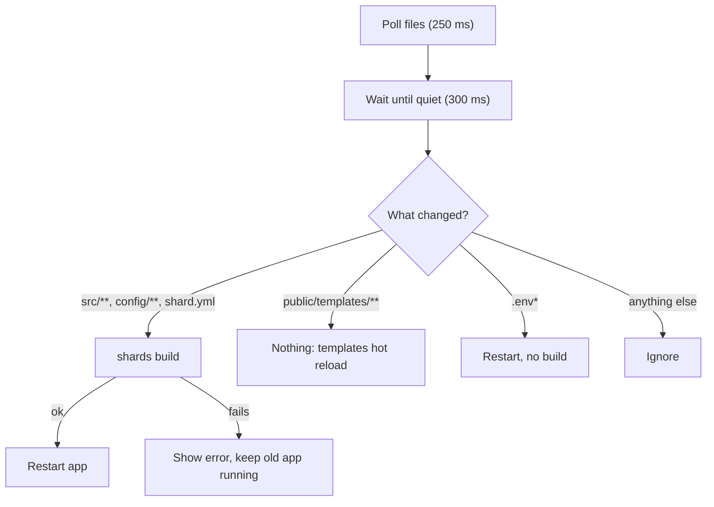

# azu dev

`azu dev` builds your app (`shards build`, not a release build), runs it, watches your files, and rebuilds and restarts when code
changes. On a terminal of at least 60x16 it shows a dashboard.

## Overview & visual demo

<figure><figcaption><p>The first build: a spinner and timer in the Build panel, <code>building</code> in the header, and the other panels waiting for the app.</p></figcaption></figure>



## Quickstart & command syntax



```bash
azu dev
```



```bash
azu dev --port 4001
```



```bash
azu dev --ui plain
```



```bash
azu dev --interval 1000 --debounce 500
```



| Option          | Meaning                                | Default                        |
| --------------- | -------------------------------------- | ------------------------------ |
| `--port PORT`   | `PORT` for the app                     | from env or `.env`, else 4000  |
| `--host HOST`   | `HOST` for the app                     | same rule                      |
| `--env NAME`    | `CRYSTAL_ENV` for the app              | same rule                      |
| `--debounce MS` | Quiet time before acting on a change   | 300                            |
| `--interval MS` | Polling interval                       | 250                            |
| `--ui MODE`     | `rich` (dashboard) or `plain` (lines)  | auto                           |

Keys: `1`-`5` panels, `r` rebuild now, `l` log, `c` clear log, `q` or Ctrl-C quit.

## Realistic output

<figure><figcaption><p>Running: built in 50.1 s, 37 MB resident, 2.2 req/s with p95 4.1 ms, 12 queries averaging 0.3 ms. Jobs warns because Redis isn't running.</p></figcaption></figure>

<figure><figcaption><p>Press <code>3</code> for the SQL panel: query count, average, slow count, pool use, and the slowest statements.</p></figcaption></figure>

<figure><figcaption><p>A failed build: file, line and the compiler's message. The old app (pid 1195) keeps serving until you save a fix.</p></figcaption></figure>

*Quitting prints a one-line summary. Exit codes: `0` stopped by Ctrl-C or SIGTERM, `1` not an Azu project, `2` invalid usage.*

## Do's and don'ts


**Pro tip:** requests and SQL come from the app over a Unix socket (`AZU_TELEMETRY_SOCKET`, mode 0600). The app must
`require "azu/dev"` and run in development; request stats need `PERFORMANCE_MONITORING=true`, which `.env.development` sets.



Edit templates freely. Saving a `.jinja` file triggers no build and no restart.



Files are polled, not watched through the OS, and symlinked directories aren't followed. On a very large tree raise `--interval`.



Don't use `azu serve` for day-to-day work: it builds with `--production`, which is slow, and rebuilds for template changes
too. And don't `kill -9` `azu dev`: the app keeps running and holding its port.


<details>

<summary>Full reference</summary>

Panels, the change table, stopping behavior and the manual checklist: [commands/dev.md](../commands/dev.md).

</details>
