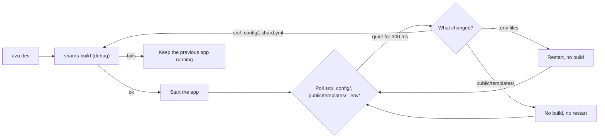

# azu dev

## Overview & visual demo

`azu dev` builds the app with `shards build` (a debug build, not a release), runs it, and keeps it current: source and config changes rebuild and restart it, a failed build keeps the previous app running, and template changes need no build at all. On a terminal it draws a dashboard with the build, the app, requests, SQL, jobs and the log.

<figure><figcaption><p>The dashboard of a running app. The Requests and SQL panels come from the app, so they need <code>require "azu/dev"</code> and <code>PERFORMANCE_MONITORING=true</code>.</p></figcaption></figure>



## Quickstart & command syntax

```bash
azu dev
azu dev --port 3000
azu dev --port 3000 --env test --ui plain
```

| Option | Meaning | Default |
| --- | --- | --- |
| `--port PORT` | `PORT` for the app | your environment or `.env`, else the app's 4000 |
| `--host HOST` | `HOST` for the app | your environment or `.env`, else the app's own |
| `--env NAME` | `CRYSTAL_ENV` for the app | your environment or `.env`, else `development` |
| `--debounce MS` | Quiet time before a change is acted on | `300` |
| `--interval MS` | How often the files are polled | `250` |
| `--ui MODE` | `rich` (the dashboard) or `plain` (lines) | the dashboard on a terminal of at least 60x16 |
| `--help` | Show the help | |

What a change does:

| Changed | Action |
| --- | --- |
| `src/**`, `config/**`, `shard.yml`, `shard.lock` | Build, then restart. A failed build prints the compiler's output and keeps the previous app running. Save a fix to build again |
| `public/templates/**` | No build and no restart. The running app reloads templates when template hot reload is on (the default in `development`) |
| `.env`, `.env.local`, `.env.<env>` | Restart without a build, since the app reads them at boot |
| Anything else (`public/assets/**`, `spec/**`, `lib/**`, `bin/**`, editor swap files) | Ignored |

Changes are collected until the files have been quiet for the debounce time, so saving several files or switching branches costs one rebuild. Ctrl-C or SIGTERM stops the app (SIGTERM, then SIGKILL after 5 seconds) and then `azu dev`.

Exit codes: `0` stopped by Ctrl-C or SIGTERM, `1` no `shard.yml` in the current directory, `2` invalid usage.

## Realistic output


```text
[hh:mm:ss] [INFO ] azu dev: watching src/, config/, shard.yml and .env* (polling every 250 ms)
[hh:mm:ss] [INFO ] Source and config changes: build demo_app (not a release build) and restart. Template changes (public/templates): no rebuild, the app reloads them itself when template hot reload is on (the default in development; TEMPLATE_HOT_RELOAD=false turns it off, then restart with Ctrl-C and 'azu dev'). Changes to .env files restart without a build.
[hh:mm:ss] [INFO ] App on port 4000. Ctrl-C stops.
[hh:mm:ss] [INFO ] Building demo_app...
[hh:mm:ss] [INFO ] Built in 11.9s
[hh:mm:ss] [INFO ] App started (pid 1195)
```


*The startup lines; `hh:mm:ss` is the time, and the pid and build time differ on every run.*


```text
[hh:mm:ss] [INFO ] Changed: src/demo_app.cr
[hh:mm:ss] [INFO ] Building demo_app...
ERROR: Build failed after 5.5s. The previous build keeps running (pid 1195); save a fix to build again.
```


*The compiler output is printed above the error line, and the app on port 4000 keeps running.*


```text
▲ AZU  dev · demo_app   ✖ build failed · serving the previous build   pid 1195  :4000  develo…  16:04:33
[1] Overview   [2] Requests   [3] SQL   [4] Jobs   [5] Log
Build failed · the app keeps running the previous build (pid 1195)                         5.5s
✖ src/demo_app.cr:79:6

  79 | puts undefined_thing_xyz
            ^------------------
Error: undefined local variable or method 'undefined_thing_xyz' for top-level

▸ Save a fix and azu dev builds again; this card closes on the next good build.
[Esc] Back to the dashboard   [r] Retry build   [q] Quit
cli 16.5 MB · ~/code/demo_app · master                        watching src, config · poll 250 ms
```


*The dashboard's failed-build card, transcribed from a real run; the app keeps serving the previous build.*

## Do's and don'ts


**Pro tip:** `--ui plain` gives you scrollback and lines you can grep. The dashboard takes the whole screen and needs a terminal of at least 60x16.



Use `azu dev` while you develop. Each change is a debug build, and a broken save keeps the last good app running while you fix it.



Template edits do not rebuild, but the page refreshes only when template hot reload is on. It is on by default in `development`. `TEMPLATE_HOT_RELOAD=false` turns it off, and then you restart `azu dev`.



Don't stop `azu dev` with SIGKILL. It cannot stop the app then, and the app keeps the port until you end it. Stop it with Ctrl-C.


<details>

<summary>Dashboard panels and keys</summary>

| Panel | Shows |
| --- | --- |
| Build | The compiler's stage while it builds, the build time, the last builds and the changed files |
| App | pid, uptime, restarts, crashes, resident memory and its trend, the GC heap |
| Requests | Rate, p50 and p95, 4xx and 5xx counts, and the last requests (from the app) |
| SQL | Query count, average, slow queries, the connection pool, N+1 alerts, the slowest statements (from the app) |
| Jobs | Pending, busy and failed jobs per queue in `config/jobs.yml`, read from `REDIS_URL` (default `redis://localhost:6379`) |
| Log | The app's stdout and stderr |

Keys: `1` to `5` switch panels, `r` rebuilds now, `l` shows the log, `c` clears it, `q` or Ctrl-C quits. Quitting prints a one-line summary of the session.

</details>

<details>

<summary>Requests and SQL come from the app</summary>

`azu dev` listens on a Unix socket (mode 0600) and passes its path to the app in `AZU_TELEMETRY_SOCKET`. An app that requires `azu/dev` and runs in development writes a JSON snapshot per second. Requests are recorded only with `PERFORMANCE_MONITORING=true`, which `.env.development` sets in a generated project. Projects generated now pin azu 0.10.1 or newer, which has the telemetry. With an older azu, the two panels say what they need instead of showing data.

</details>

<details>

<summary>What is watched</summary>

The watcher polls the modification time and size of the files under `src/`, `config/` and `public/templates/`, and of `shard.yml`, `shard.lock` and the `.env*` files at the root. It runs every `--interval` milliseconds. Symlinked directories are not followed. There is no file system event watcher, so a very large tree costs CPU; raise `--interval` if that matters.

</details>
