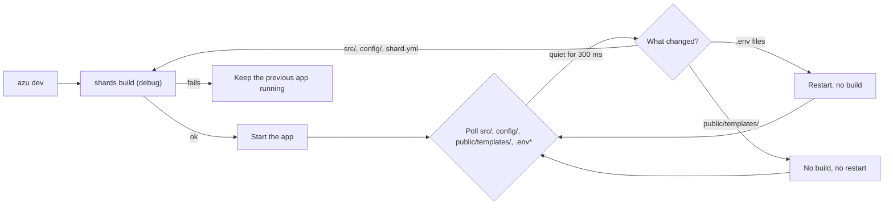
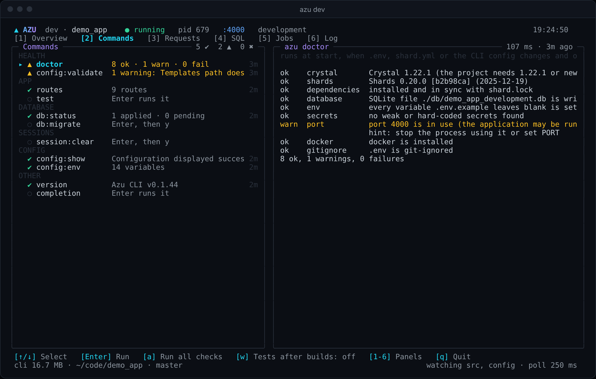
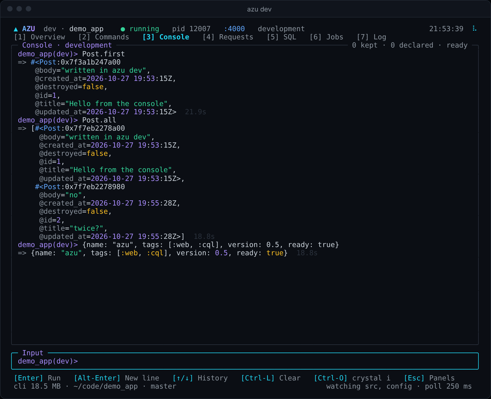

# azu dev

## Mission-control preview

`azu dev --ui mission` enables the new workspace rail, Ctrl-P navigation palette,
SQL/log syntax highlighting and responsive list/detail panes. Press `b` to collapse
the rail, `/` to filter, `c` for the existing console, and Esc to return from it.
The default remains `--ui rich`. Auth and schema views require application adapters;
see the [architecture and integration plan](../architecture/mission-control.md).

### Run commands inside the HUD

In `azu dev --ui mission`, press **g** to compose a generator command or **:**
to enter a supported Azu command. For example:

```text
generate scaffold Product name:string price_cents:int32 active:bool --spark
```

Press **Enter** to review the exact arguments and working directory, then **y**
to run, **n** to edit, or **Esc** to cancel. Results and exit status appear in
the same panel; PageUp/PageDown scroll output. Esc closes the panel; `:` reopens
it while a command runs. Closing the panel does not cancel its process.

Commands execute locally, using the dev session's environment and configured
services. A local database command can still affect a remote database if your
project's connection string points there. The review step identifies the local
directory; it does not prove your service URLs point to development.

Generators accept normal arguments, including `--spark`. Other commands use the
exact arguments listed in **? Commands** (for example `version`, `test`,
`db:status`, or `db:rollback --force`). This is an argv composer, not a shell:
pipes, redirects, command substitution and nested terminal commands are rejected.
Runs are serialized with existing checks, pause during builds/console compilation,
and capture at most 512 KiB of output while draining the remainder. The panel
retains the last 500 lines of that captured prefix. Commands are not persisted in
history, and generator conflicts retain their usual behavior; `--force` is never
silently added to a generator command. Quit requests termination of the active
local process tree; applications that trap SIGTERM may still require operator cleanup.

For production use [azu connect](azu-connect.md), which has no command runner,
console, local app boot or rebuild capability.

## Overview & visual demo

`azu dev` builds the app with `shards build` (a debug build, not a release), runs it, and keeps it current: source and config changes rebuild and restart it, a failed build keeps the previous app running, and template changes need no build at all. On a terminal it draws a dashboard with the build, the app, the CLI's own commands (doctor, routes, db:status, tests, ...) re-run as you work, a console that runs Crystal with your app loaded, requests, SQL, jobs and the log. The concise version is [azu dev](../command-reference/azu-dev.md).

<figure><figcaption><p>The dashboard of a running app. The Requests and SQL panels come from the app, so they need <code>require "azu/dev"</code> and <code>PERFORMANCE_MONITORING=true</code>.</p></figcaption></figure>



## Quickstart & command syntax

```bash
azu dev
azu dev --port 3000
azu dev --port 3000 --env test --ui plain
```

| Option | Meaning | Default |
| --- | --- | --- |
| `--port PORT` | `PORT` for the app | your environment or `.env`, else the app's 4000 |
| `--host HOST` | `HOST` for the app | your environment or `.env`, else the app's own |
| `--env NAME` | `CRYSTAL_ENV` for the app | your environment or `.env`, else `development` |
| `--debounce MS` | Quiet time before a change is acted on | `300` |
| `--interval MS` | How often the files are polled | `250` |
| `--ui MODE` | `rich` (classic dashboard), `mission` (workspace HUD), or `plain` (lines) | the classic dashboard on a terminal of at least 60x16 |
| `--help` | Show the help | |

What a change does:

| Changed | Action |
| --- | --- |
| `src/**`, `config/**`, `shard.yml`, `shard.lock` | Build, then restart. A failed build prints the compiler's output and keeps the previous app running. Save a fix to build again |
| `public/templates/**` | No build and no restart. The running app reloads templates when template hot reload is on (the default in `development`) |
| `.env`, `.env.local`, `.env.<env>` | Restart without a build, since the app reads them at boot |
| Anything else (`public/assets/**`, `spec/**`, `lib/**`, `bin/**`, editor swap files) | Ignored |

Changes are collected until the files have been quiet for the debounce time, so saving several files or switching branches costs one rebuild. Ctrl-C or SIGTERM stops the app (SIGTERM, then SIGKILL after 5 seconds) and then `azu dev`.

Exit codes: `0` stopped by Ctrl-C or SIGTERM, `1` no `shard.yml` in the current directory, `2` invalid usage.

## Realistic output


```text
[hh:mm:ss] [INFO ] azu dev: watching src/, config/, shard.yml and .env* (polling every 250 ms)
[hh:mm:ss] [INFO ] Source and config changes: build demo_app (not a release build) and restart. Template changes (public/templates): no rebuild, the app reloads them itself when template hot reload is on (the default in development; TEMPLATE_HOT_RELOAD=false turns it off, then restart with Ctrl-C and 'azu dev'). Changes to .env files restart without a build.
[hh:mm:ss] [INFO ] App on port 4000. Ctrl-C stops.
[hh:mm:ss] [INFO ] Building demo_app...
[hh:mm:ss] [INFO ] Built in 11.9s
[hh:mm:ss] [INFO ] App started (pid 1195)
```


*The startup lines; `hh:mm:ss` is the time, and the pid and build time differ on every run.*


```text
[hh:mm:ss] [INFO ] Changed: src/demo_app.cr
[hh:mm:ss] [INFO ] Building demo_app...
ERROR: Build failed after 5.5s. The previous build keeps running (pid 1195); save a fix to build again.
```


*The compiler output is printed above the error line, and the app on port 4000 keeps running.*


```text
▲ AZU  dev · demo_app   ✖ build failed · serving the previous build   pid 1195  :4000  develo…  16:04:33
[1] Overview   [2] Commands   [3] Console   [4] Requests   [5] SQL   [6] Jobs   [7] Log   [8] Config
Build failed · the app keeps running the previous build (pid 1195)                         5.5s
✖ src/demo_app.cr:79:6

  79 | puts undefined_thing_xyz
            ^------------------
Error: undefined local variable or method 'undefined_thing_xyz' for top-level

▸ Save a fix and azu dev builds again; this card closes on the next good build.
[Esc] Back to the dashboard   [r] Retry build   [q] Quit
cli 16.5 MB · ~/code/demo_app · master                        watching src, config · poll 250 ms
```


*The dashboard's failed-build card, transcribed from a real run; the app keeps serving the previous build.*

## Do's and don'ts


**Pro tip:** `--ui plain` gives you scrollback and lines you can grep. The dashboard takes the whole screen and needs a terminal of at least 60x16.



Use `azu dev` while you develop. Each change is a debug build, and a broken save keeps the last good app running while you fix it.



Template edits do not rebuild, but the page refreshes only when template hot reload is on. It is on by default in `development`. `TEMPLATE_HOT_RELOAD=false` turns it off, and then you restart `azu dev`.



Console snippets run against the database `DATABASE_URL` points at, like `rails console`. A snippet that writes (`Post.create!`) writes for real; the console just never runs it twice.



Don't stop `azu dev` with SIGKILL. It cannot stop the app then, and the app keeps the port until you end it. Stop it with Ctrl-C.


<details>

<summary>Dashboard panels and keys</summary>

| Panel | Shows |
| --- | --- |
| Overview | Build and App cards, a one-line summary of the commands, requests, SQL, jobs and the log |
| Commands | The CLI's own commands, re-run when what they read changes (below) |
| Console | Crystal with the app loaded, like `rails console` (below) |
| Build | The compiler's stage while it builds, the build time, the last builds and the changed files |
| App | pid, uptime, restarts, crashes, resident memory and its trend, the GC heap |
| Requests | Rate, p50 and p95, 4xx and 5xx counts, and the last requests (from the app) |
| SQL | Live statements, duration and origin; pool checkouts, latency histogram and N+1 warnings |
| Errors | Recent exceptions, route, redacted parameters, stack trace and normalized RFC 7807 details |
| Jobs | Pending, busy and failed jobs per queue in `config/jobs.yml`, read from `REDIS_URL` (default `redis://localhost:6379`) |
| Log | The app's stdout and stderr |
| Config | What the app runs with, as `azu config` last read it: server, TLS, templates, database, limits, uploads, WebSocket, i18n, assets; secrets only as set or not set |

Keys: `1` to `9` switch panels, `r` rebuilds now, `l` shows the log, `c` clears it, `q` or Ctrl-C quits. Quitting prints a one-line summary of the session.

SQL and Errors use a master/detail viewport: Tab switches panes, arrows select or scroll, and PgUp/PgDn and Home/End navigate longer content. Block scrollbars mark overflow; selected IDs remain stable across refreshes.

The Log, Requests and Config panels scroll: `↑`/`↓` (or `k`/`j`) a line, PgUp/PgDn a page, Home/End (or `g`/`G`) to either end. The card's badge says which rows it shows (`21-40 of 80`). A Log scrolled back stays where it is as lines arrive; End follows the newest line again.

The Config panel shows the last run of `azu config`, which the Commands panel repeats after each successful build and whenever `.env*`, `shard.yml` or `shard.lock` changes. Enter (or `u`) reads it again. Values are colored by what they say: a setting that is not set in amber, on and set in green, off in muted, numbers and durations in cyan, URLs and addresses in blue. When the app does not load, the panel shows the error instead.

</details>

<details>

<summary>Requests, SQL and errors come from the app</summary>

`azu dev` listens on a Unix socket (mode 0600) and passes its path to the app in `AZU_TELEMETRY_SOCKET`. An app that requires `azu/dev` and runs in development writes a JSON snapshot per second. Requests are recorded only with `PERFORMANCE_MONITORING=true`, which `.env.development` sets in a generated project. Projects generated now pin azu 0.10.1 or newer, which has the telemetry. The expanded SQL stream and Errors tab require the companion Azu telemetry changes (`codex/dev-hud-telemetry`) until included in a published Azu release. Older producers retain slow-query display and show a waiting notice for errors. Load `azu/cql` and attach the application schema through `Azu::CQL` to capture native async-engine query telemetry and pool snapshots. Exception reports come from the existing server rescuer instrumentation. Problem details are normalized from the captured report, not a copy of arbitrary application problem extensions. SQL parameters are not transmitted. The socket reader bounds messages to 1 MiB and rejects incompatible object shapes.

</details>

<details>

<summary>What is watched</summary>

The watcher polls the modification time and size of the files under `src/`, `config/` and `public/templates/`, and of `shard.yml`, `shard.lock` and the `.env*` files at the root. It runs every `--interval` milliseconds. Symlinked directories are not followed. There is no file system event watcher, so a very large tree costs CPU; raise `--interval` if that matters.

</details>

<details>

<summary>Commands panel: the CLI's commands, kept current</summary>

<figure><figcaption><p>Each command's mark, outcome and age, and the selected command's output.</p></figcaption></figure>

Each command runs as `azu <command>` with plain output, one at a time, never while the app builds or the console compiles.

| Command | Runs |
| --- | --- |
| `doctor`, `version` | at start (`doctor` again when `.env*`, `shard.yml` or `shard.lock` changes) |
| `routes` | after each successful build |
| `config` | after each successful build, and when `.env*`, `shard.yml` or `shard.lock` changes |
| `db:status` | at start, when `src/db/migrations` changes, and after any command that changes the database |
| `db:validate`, `db:migrations:verify --no-rollback` | on Enter, and with `a` |
| `test`, `openapi:export` | on Enter; `w` also runs the tests after each build |
| `db:migrate`, `db:rollback`, `db:seed`, `db:data:migrate`, `db:create`, `db:setup`, `db:schema:load`, `db:reset`, `db:drop` | on Enter, then `y`: they change the database |
| `jobs:status`, `jobs:retry --all`, `jobs:clear --failed` | in a JoobQ project (`config/jobs.yml`); retry and clear after `y` |
| `session:clear` | on Enter, then `y`: it changes the session store |
| `completion <shell>` | on Enter, for the shell in `SHELL` (bash when it is another) |

Commands that ask "are you sure?" on their own (`db:rollback`, `db:reset`, `db:drop`, `jobs:clear`, `session:clear`) run with `--force`: the panel has no terminal to answer them, and its `y` is the answer. `db:migrations:verify` runs with `--no-rollback`, so it reads the migrations without rolling the newest one back and applying it again. Left out are the commands that need names, files or choices typed with them (`new`, `init`, `generate`, `undo`, `session:setup`, `openapi:generate`) and the ones that keep running or take the terminal (`serve`, `dev`, `console`, `jobs:worker`, `jobs:ui`).

Keys: `↑`/`↓` select (the list scrolls to keep the selection in view), Enter runs, PgUp/PgDn scroll the selected command's output, `a` runs every check again (the commands that only read: not the tests, not the commands that change things), `w` toggles the tests after builds. Run from the dashboard, `doctor` counts the port the app holds as expected.

</details>

<details>

<summary>Console panel: Crystal with your app loaded</summary>

<figure><figcaption><p>Values come back pretty-printed and colored, like irb.</p></figcaption></figure>


```text
demo_app(dev)> post = Post.last
=> #<Post:0x7f62
    @id=2,
    @title="Hello", ...>
▸ post kept for the next snippets
demo_app(dev)> post.try(&.title)
=> "Hello"  11.0s
demo_app(dev)> def titles(n = 3)
          ...>   Post.all.first(n).map(&.title)
          ...> end
✔ declared: kept for the next snippets
demo_app(dev)> titles(5)
=> ["Hello", "World"]
```


*A session against a generated SQLite app; the times differ on every run.*

- Enter runs finished code; an open `def`, `do`, bracket or string gets a new line (and `end` dedents itself). Alt-Enter adds a line, `↑`/`↓` walk the history (kept per project), Ctrl-L clears, Esc cancels a run or gives the keyboard back to the panels.
- An expression answers `=> value`, pretty-printed at the console's width. Declarations (`def`, `class`, `module`, ...) and local assignments carry over to later snippets; an assignment that would write if run again (`create`, `save`, `update`, `delete`, `destroy`, a `!` method) is not replayed. `locals`, `declarations`, `forget`, `help` and `exit` do what they say.
- Each run compiles the snippets with the app (`.azu_console.cr` in the project, removed after the run). After the app's first build the console compiles the app once (`warming up`, then `ready`). Snippets typed while one compiles wait and go together into the next compile, each with its own value. Expect 10 to 20 s a run for a mid-size app: Crystal compiles the whole program every time.
- Ctrl-O hands the terminal to `crystal i` with the app loaded, when the compiler has the interpreter. Crystal 1.22.1's interpreter cannot load an Azu app yet: it stops with compiler bugs in Crinja (azu's templates) and in CQL's PostgreSQL session.

</details>

