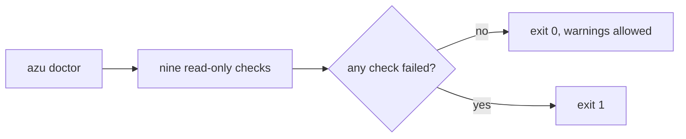

# azu doctor

`azu doctor` runs nine checks on the project and the machine it runs on and reports each one as ok, a warning or a failure. It changes nothing, and it never prints a variable's value or the password in a URL.

## Overview & visual demo

Run `azu doctor` when a project will not build or start. It checks the local setup and reports actionable findings without modifying your application.

<figure><figcaption><p><code>azu doctor</code> on a color terminal: one mark per check, the hint under any warning, and the counts in the corner.</p></figcaption></figure>



## Quickstart & command syntax

```bash
azu doctor
azu doctor --json
azu doctor --json | jq '.checks[] | select(.status != "ok")'
azu doctor --ui plain
```

| Option       | Meaning                                                                 | Default                                  |
| ------------ | ----------------------------------------------------------------------- | ---------------------------------------- |
| `--json`     | Print `{"checks": [...], "summary": {...}}` instead of the text         | off                                      |
| `--ui MODE`  | `rich` (a card) or `plain` (text)                                       | `rich` on a color terminal outside CI    |
| `--help`     | Print the checks and the exit codes                                     | off                                      |

An unknown option is refused with exit code `2`.

The checks, in the order they run:

| Check          | What it verifies                                                                                                  |
| -------------- | ----------------------------------------------------------------------------------------------------------------- |
| `crystal`      | Crystal is installed and not older than the lower bound of `crystal:` in `shard.yml`. Older is a failure.         |
| `shards`       | `shards --version` runs.                                                                                          |
| `dependencies` | `shards check` passes. A mismatch with `shard.yml` or `shard.lock` fails; a missing `shard.lock` warns.           |
| `database`     | `DATABASE_URL` (or `AZU_DATABASE_URL`). A SQLite file must be writable. A PostgreSQL or MySQL host must accept a TCP connection within 3 s. Credentials are never tried. Unset warns when the project uses CQL. |
| `env`          | Every variable `.env.example` leaves blank is set. Names only. `SESSION_SECRET` counts only when `src/initializers/session.cr` exists. |
| `secrets`      | `CSRF_SECRET` and `SESSION_SECRET`, when set, are at least 32 characters and not a placeholder. No `secret = "..."` literal in `src/`. |
| `port`         | `PORT` (default `4000`) is a valid port and free. In use, or below 1024 and not bindable, warns.                 |
| `docker`       | Docker is installed. Only a warning when the project has a `Dockerfile`.                                          |
| `gitignore`    | `.env`, if present, is git-ignored. A tracked `.env` fails.                                                       |

With `CRYSTAL_ENV=production`, the `env` and `secrets` problems become failures instead of warnings.

## Realistic output


```text
ok    crystal       Crystal 1.22.1 (the project needs 1.22.1 or newer)
ok    shards        Shards 0.20.0 [b2b98ca] (2025-12-19)
ok    dependencies  installed and in sync with shard.lock
ok    database      SQLite file ./db/demo_app_development.db is writable
ok    env           every variable .env.example leaves blank is set
ok    secrets       no weak or hard-coded secrets found
ok    port          port 4000 is free
ok    docker        docker is installed
ok    gitignore     .env is git-ignored

9 ok, 0 warnings, 0 failures
```


*The plain text of the card above. Pipes, CI and `NO_COLOR` get this form.*


```text
warn  database      SQLite file ./db/blog_development.db does not exist yet
                    hint: run 'azu db:setup'
```


*A warning prints its hint on the next line. The exit code stays `0`. The column width depends on the longest check name in the run.*

The text summary says warnings and failures; `--json` gives the counts as `ok`, `warn` and `fail`. Each check has `id`, `status` (`ok`, `warn` or `fail`), `message` and `hint` (`null` for `ok`).

## Do's and don'ts


**Pro tip:** `azu doctor --json | jq '.checks[] | select(.status != "ok")'` lists only the checks that need attention.



Run it in CI before the test step. Exit `1` fails the job, and warnings do not.



Write `crystal:` in `shard.yml` as a quoted string (`'>= 1.22.1'`). An unquoted `1.10` is read by YAML as the number `1.1`, and the check then compares against `1.1`.



If `DATABASE_URL` has an `@` after a `?` or `#`, or a `:` that is not followed by a port, the database check warns and does not connect. Percent-encode `@ ? # / :` in the user and password (`%40`, `%3F`, `%23`, `%2F`, `%3A`).



Don't read a clean run as proof the app works. Doctor checks the environment, not your code. Run `azu test` and boot the app as well.

