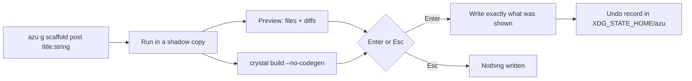

# azu generate

`azu generate` (alias `azu g`) renders templates into your project in the Azu contract style. On a terminal it runs in a
scratch copy first, shows every file it would create or change, type-checks the result, and writes only when you press Enter.

## Overview & visual demo

<figure><figcaption><p><code>azu g scaffold comment</code>: 28 new files, 1 changed. The right pane shows the diff of <code>src/db/schema.cr</code>, and the bottom line says the project type-checks with these files.</p></figcaption></figure>



## Quickstart & command syntax

```bash
azu g scaffold post title:string body:text published:bool
azu g model user name:string email:string:unique age:int32
azu g endpoint posts index show
azu g migration add_slug_to_posts slug:string:index
azu g job send_welcome user_id:int64
```



```bash
azu g scaffold post title:string      # on a terminal: the file browser
```



```bash
azu g scaffold post title:string --dry-run   # list files and diffs, write nothing
```



```bash
azu g scaffold post title:string --check     # type-check with the new files, write nothing
```



```bash
azu undo --list       # the records
azu undo --dry-run    # what it would do
azu undo
```



Generator types: `scaffold`, `model`, `endpoint`, `request`, `page`, `service`, `migration`, `data:migration`,
`middleware`, `component`, `validator`, `channel`, `mailer`, `job`, `joobq`, `auth`, `api_resource`, `seed`.

| Option         | Meaning                                                                    | Default            |
| -------------- | -------------------------------------------------------------------------- | ------------------ |
| `--force`      | Overwrite existing files without asking                                    | off                |
| `--dry-run`    | List files and diffs, write nothing                                        | off                |
| `--check`      | Type-check with the generated files; write nothing if it doesn't compile   | off                |
| `--yes`        | Write without asking (the plan is still printed on a terminal)             | off                |
| `--skip-tests` | `model`: don't generate the migration                                      | off                |
| `--ui MODE`    | `rich` (the preview) or `plain`                                            | rich on a terminal |

Attributes are `name:type[:modifier]`.

| Part       | Values                                                         |
| ---------- | -------------------------------------------------------------- |
| Types      | `string`, `text`, `int32`, `int64`, `float64`, `bool`, `time`, `uuid` |
| Modifiers  | `unique`, `index`, `required`                                  |
| References | `user_id:int64:ref:users` makes a foreign key                  |

## Realistic output

<figure><figcaption><p><code>azu g</code> with no arguments: pick a generator, then a name and fields, then the preview.</p></figcaption></figure>

<figure><figcaption><p>After Enter: each file with its line count, <code>~ src/db/schema.cr changed</code>, and a reminder that <code>azu undo</code> reverts these files.</p></figcaption></figure>

<figure><figcaption><p><code>azu undo</code>: created files are deleted, changed files restored. A file you edited since is left alone and listed.</p></figcaption></figure>

Names follow `Blog::<Plural>::<Action><Layer>` and files follow `src/<layer>s/<plural>/<action>_<layer>.cr`:



```crystal title="src/models/post.cr"
require "cql"

class Post
  include CQL::ActiveRecord::Model(Int64)
  db_context BlogDB, :posts

  property title : String
  property body : String
  property created_at : Time?
  property updated_at : Time?

  def initialize(@title : String, @body : String)
  end
end
```



```crystal title="src/db/migrations/<version>_create_posts.cr"
class CreatePosts < CQL::Migration(20261023111721)
  def up
    schema.table :posts do
      primary :id, Int64, auto_increment: true
      text :title
      text :body
      timestamps
    end
    schema.posts.create!
  end

  def down
    schema.posts.drop!
  end
end
```



```crystal title="src/endpoints/posts/create_endpoint.cr"
module Blog
  struct Posts::CreateEndpoint
    include Azu::Endpoint(Posts::CreateRequest, Azu::Response::Empty)

    post "/posts"

    def call : Azu::Response::Empty
      record = Posts::CreateService.new.call(create_request)
      redirect to: "/posts/#{record.id}", status: 303
    end
  end
end
```



*The endpoint is shown as the web scaffold renders it (12 lines, as in the preview), with the type names abbreviated to what the
template fills in. One endpoint has one response type: a redirect returns `Azu::Response::Empty`, never a union.*

In a pipe or in CI, without `--dry-run` or `--check`, `azu generate` writes directly with no preview.

## Do's and don'ts


**Pro tip:** undo records live in `$XDG_STATE_HOME/azu` (default `~/.local/state/azu`), outside your project, so they never end up in git.



Run `--check` before committing a big scaffold, or in CI. Nothing is written if the project wouldn't compile.



The generator refuses names that would become invalid Crystal or collide with reserved resource names, and it won't overwrite
files it didn't write. A second `create_*` migration whose class already exists is refused.



`--force` overwrites without asking. `azu undo` restores files, but one you edited since is left alone and listed.


<details>

<summary>Full reference</summary>

Every generator in depth: [commands/generate.md](../commands/generate.md) and the [Generators](../generators/README.md) section.

</details>
