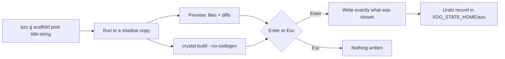

# azu generate

Generate models, endpoints, services, pages and whole CRUD resources, after previewing exactly what will be written.

## Overview

`azu generate` (alias `azu g`) renders ECR templates into your project following the Azu contract style. On a terminal it
first runs in a scratch copy, shows every file it would create or change, type-checks the result, and writes only when you
press Enter. Every write can be reversed with `azu undo`.

<figure><figcaption><p><code>azu generate</code> with no arguments opens a menu: generator, name and fields, then the preview.</p></figcaption></figure>



## Quickstart

```bash
azu g scaffold post title:string body:text published:bool
azu g model user name:string email:string:unique age:int32
azu g endpoint posts index show
azu g migration add_slug_to_posts slug:string:index
azu g job send_welcome user_id:int64
azu g scaffold post title:string --dry-run     # list files and diffs, write nothing
azu g scaffold post title:string --check       # type-check with the new files, write nothing
azu undo --list
```

Generator types: `scaffold`, `model`, `endpoint`, `request`, `page`, `service`, `migration`, `data:migration`, `middleware`,
`component`, `validator`, `channel`, `mailer`, `job`, `joobq`, `auth`, `api_resource`, `seed`.

| Option        | Meaning                                                        | Default            |
| ------------- | -------------------------------------------------------------- | ------------------ |
| `--force`     | Overwrite existing files without asking                        | off                |
| `--dry-run`   | List files and diffs, write nothing                            | off                |
| `--check`     | Type-check with the generated files; write nothing if it does not compile | off     |
| `--yes`       | Write without asking (the plan is still printed on a terminal) | off                |
| `--skip-tests`| `model`: do not generate the migration                         | off                |
| `--ui MODE`   | `rich` (the preview) or `plain`                                | rich on a terminal |

Attributes are `name:type[:modifier]`. Types: `string`, `text`, `int32`, `int64`, `float64`, `bool`, `time`, `uuid`.
Modifiers: `unique`, `index`, `required`. A foreign key is `user_id:int64:ref:users`.

## Output

<figure><figcaption><p>28 new files, 1 changed (<code>src/db/schema.cr</code> gets the new table), and a green type-check.</p></figcaption></figure>

<figure><figcaption><p>After Enter: the files written.</p></figcaption></figure>

Files follow `src/<layer>s/<plural>/<action>_<layer>.cr`, classes follow `Blog::<Plural>::<Action><Layer>`:

```text
src/models/post.cr
src/endpoints/posts/create_endpoint.cr     # Blog::Posts::CreateEndpoint
src/requests/posts/create_request.cr
src/pages/posts/show_page.cr
src/services/posts/create_service.cr
src/db/migrations/<version>_create_posts.cr
public/templates/blog/posts/show_page.jinja
```

In a pipe or CI, without `--dry-run` or `--check`, it writes directly, with no preview.

## Do's and don'ts


Run `--check` in CI or before committing a big scaffold: nothing is written if the project would not compile.



A redirecting action returns `Azu::Response::Empty` (a `303`); a rendering one returns its page. One endpoint, one
response type, never a union.



The generator refuses names that would become invalid Crystal or collide with reserved resource names, and refuses to
overwrite files it did not write. A second `create_*` migration whose class already exists is refused.



`--force` overwrites without asking. `azu undo` puts files back, but a file you edited since is left alone and listed.


<details>

<summary>Full reference</summary>

Every generator in depth: [commands/generate.md](../commands/generate.md) and the [Generators](../generators/README.md)
section. Undo records live in `$XDG_STATE_HOME/azu` (default `~/.local/state/azu`).

</details>
