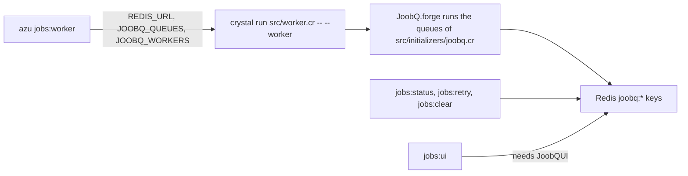

# Background jobs commands

The `jobs:*` commands drive a JoobQ project: they start the worker process and read or change the queues kept in Redis. The jobs themselves, and the queues they go to, are defined in your project's code; these commands only operate on them.


The legacy `jobs:status`, `jobs:clear`, and `jobs:retry` commands currently assume Redis keys that do not match the supported JoobQ store. Do not use their counts or success messages as operational evidence, or use their mutations in production. Use [`azu joobq`](azu-joobq.md) for runtime-backed queue inspection and atomic DLQ replay where the installed JoobQ version supports it. Migrating these legacy commands to that adapter remains a release blocker.


## Overview & visual demo

Start `jobs:worker` next to the app, check `jobs:status` when a queue grows, and use `jobs:retry` and `jobs:clear` on failed work. The commands connect to Redis with `REDIS_URL`, which defaults to `redis://localhost:6379`.

<figure><figcaption><p>The Workers panel of <code>azu dev</code> shows what JoobQ sees. Here Redis is unreachable at the default URL, so the queues cannot be read.</p></figcaption></figure>



## Quickstart & command syntax

```bash
azu jobs:worker
azu jobs:status
azu jobs:retry --all
azu jobs:clear --failed --force
azu jobs:ui --port 5000
```

Before you start, the project needs JoobQ (`azu generate joobq`, or the default of `azu new`), a running Redis, and `REDIS_URL` if the default is not your Redis. The generated `src/worker.cr` is the entry point the worker runs.

### azu jobs:worker

```bash
azu jobs:worker
azu jobs:worker --verbose
```

| Option            | Short | Meaning                                                                 | Default   |
| ----------------- | ----- | ----------------------------------------------------------------------- | --------- |
| `--workers N`     | `-w`  | Passed to the worker as `JOOBQ_WORKERS`. One process is started either way | `1`    |
| `--queues LIST`   | `-q`  | Passed to the worker as `JOOBQ_QUEUES` (comma-separated). See the warning below | `default` |
| `--daemon`        | `-d`  | Rejected; use an external process supervisor    | off       |
| `--verbose`       | `-v`  | Accepted for compatibility; child output is always visible                       | off       |

It runs `crystal run src/worker.cr -- --worker` with the Redis URL in `REDIS_URL`, and waits for it. The generated initializer turns `REDIS_URL` into the host, port and password that JoobQ's store reads. The generated worker runs the queues configured in `src/initializers/joobq.cr`. Stop it with Ctrl+C.

### azu jobs:status

```bash
azu jobs:status
```

No options. It prints the Redis URL and the default queue, then one row per queue: pending jobs, jobs being processed, and failed jobs, with a `Total` row. The counts come from the `joobq:queue:*`, `joobq:processing:*` and `joobq:failed:*` keys. With no queues in Redis it prints `No queues found`. If Redis cannot be reached it exits with `1`.

### azu jobs:retry

```bash
azu jobs:retry
azu jobs:retry --all
azu jobs:retry --limit 10 --queue critical
```

| Option          | Short | Meaning                                                                | Default   |
| --------------- | ----- | ---------------------------------------------------------------------- | --------- |
| `--all`         |       | Retry every failed job of the queue                                    | off       |
| `--limit N`     | `-l`  | Retry at most `N` failed jobs. Wins over `--all`                       | `1`       |
| `--queue NAME`  | `-q`  | The queue whose failed jobs are retried                                | `default` |
| `--verbose`     | `-v`  | Accepted; it changes nothing                                           | off       |

A retried job is moved from the queue's failed list back onto its pending list, with its stored data unchanged.

### azu jobs:clear

```bash
azu jobs:clear
azu jobs:clear --queue mailers
azu jobs:clear --failed
azu jobs:clear --all --force
```

| Option          | Short | Meaning                                                                 | Default   |
| --------------- | ----- | ----------------------------------------------------------------------- | --------- |
| `--queue NAME`  | `-q`  | The queue to clear. Deletes its pending and processing jobs             | `default` |
| `--all`         |       | Delete the pending jobs of every queue                                  | off       |
| `--failed`      |       | Delete the failed jobs of every queue. `--queue` is ignored             | off       |
| `--force`       | `-f`  | Do not ask first                                                        | off       |

Without `--force` it asks `Are you sure you want to clear queue '<name>'? [y/N]:` (or the same question for all queues or all failed jobs). The answer must start with `y`.

### azu jobs:ui

```bash
azu jobs:ui
azu jobs:ui --port 5000 --host 0.0.0.0
```

| Option         | Short | Meaning                                              | Default     |
| -------------- | ----- | ---------------------------------------------------- | ----------- |
| `--port PORT`  | `-p`  | The port of the UI                                   | `4000`      |
| `--host HOST`  | `-h`  | The host of the UI. Here `-h` is the host, not help  | `localhost` |
| `--verbose`    | `-v`  | Accepted; child output is always visible                     | off         |

The web interface is JoobQUI, a separate shard. The command looks for it in `lib/joobqui` or `../joobqui`, and runs that checkout’s `src/joobqui.cr` with `REDIS_URL`, `JOOBQUI_PORT` and `JOOBQUI_HOST` set. Without it, the command prints a warning with the `shard.yml` lines to add, starts nothing, and returns an error.

<details>

<summary>Environment variables read by the jobs:* commands</summary>

| Variable          | Used for                                                       | Default                    |
| ----------------- | -------------------------------------------------------------- | -------------------------- |
| `REDIS_URL`       | The Redis connection of every command                          | `redis://localhost:6379`   |
| `JOOBQ_REDIS_URL` | Used when `REDIS_URL` is not set                               | the default above          |
| `JOOBQ_QUEUE`     | The default queue of the commands that take `--queue`          | `default`                  |

`JOOBQ_QUEUES` and `JOOBQ_WORKERS` are set by `jobs:worker` for the process it starts. The CLI does not read them, and the generated project does not either.

</details>

## Realistic output


```text
Queue                |    Pending |   Processing |     Failed
================================================================================
<queue>              |  <pending> | <processing> |   <failed>
...
================================================================================
Total                |  <pending> | <processing> |   <failed>
```


*The column layout is exact. The numbers depend on Redis, so they are shown as placeholders. The log lines above the table carry a timestamp in plain mode.*


```text
Are you sure you want to clear queue 'default'? [y/N]: 
```


*The question waits on the same line. Anything that does not start with `y` cancels.*


```text
WARNING: JoobQUI not found in dependencies
```


*The warning is followed by the `shard.yml` lines to add. The command then exits with an error without starting a server.*

## Do's and don'ts


**Pro tip:** while workers run, `watch -n 2 azu jobs:status` in a spare pane shows the queues drain, or stall.



In production, run `azu jobs:worker` under a process manager such as systemd, Foreman or a container's restart policy. The command runs in the foreground and does not restart a worker that exits.



`--workers` and `--queues` do not change the generated worker. It runs one process, and its queues come from `src/initializers/joobq.cr`. Set the worker count and queues there, or run more processes yourself.



`jobs:worker` and `jobs:ui` propagate unsuccessful child exits as command failures. Child stdout and stderr remain visible, so compiler errors can be diagnosed and busy workers cannot block on unread output pipes.



`jobs:clear --failed` ignores `--queue`: `azu jobs:clear --queue mailers --failed` clears the failed jobs of every queue. `jobs:clear --all` leaves the failed and processing lists alone, so check each one you care about.



Redis URL passwords are redacted in command configuration output. Application logs can still contain application data; review them before sharing.

