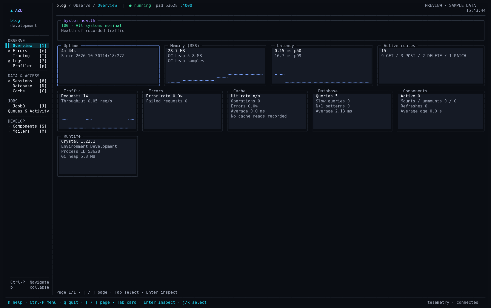
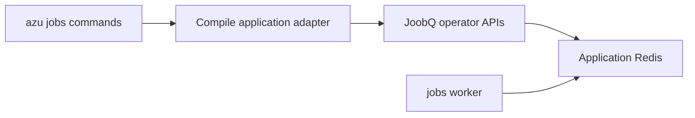

# Background jobs commands

Generated applications target Azu `~> 1.0.4`, CQL `~> 1.0.1` and JoobQ `~> 0.5.0`.
The jobs commands compile a temporary adapter against **your application's JoobQ**.
This preserves its queue types, DLQ replay rules and Redis configuration. It takes
longer than a direct Redis lookup; use `azu dev` for continuous queue metrics.
These commands manage the Queue/Worker API, not the separate Delivery ledger.

## Overview

<figure><figcaption><p>The workspace queue panel; preview values are illustrative.</p></figcaption></figure>




Use `azu dev` for a continuously refreshed dashboard. Operator commands compile
against the project's installed shard so mutations use the same job semantics.


## Quickstart

```sh
azu generate joobq --queue default --workers 3
azu jobs:status --json
azu jobs:worker --queues default --workers 4
```

`generate joobq` writes environment-specific YAML, a registered `ExampleJob`, an
initializer and a standalone worker. Existing files require `--force`. With
`--no-example`, configuration has no queues until you register a real job; it does
not emit references to nonexistent `YourJob`, `TestJob` or `MailerJob` classes.
The generated initializer preserves the complete `REDIS_URL`, including its
Redis database and TLS scheme. Credentials belong in the environment, not the
`--redis` generator option, which writes the URL to source control.

For an existing application, update the dependencies in `shard.yml` and run
`shards update`. The empty-worker compilation and typed `queue ...` discovery
fixes require [JoobQ PR #21](https://github.com/azutoolkit/joobq/pull/21); until it is
released, register classes with `QueueFactory.register_job_type` and populate
`queue_configs` before running the worker. See the
[local HUD setup](azu-dev.md#display-local-joobq-jobs).

## Shared options

| Option | Behavior |
| --- | --- |
| `--boot FILE` | App boot file; defaults to `src/initializers/joobq.cr`. It must configure JoobQ without starting workers or an HTTP server. Use `--boot src/<app>.cr` when jobs need models/services from the full application. |
| `--redis URL` | Redis connection override. Prefer environment variables for secrets. Otherwise preserve the app's `REDIS_URL` or `REDIS_HOST`/`REDIS_PORT`/`REDIS_PASS`. `JOOBQ_REDIS_URL` remains a CLI fallback. |
| `--env NAME` | Select `CRYSTAL_ENV` and `JOOBQ_ENV`. |
| `--queue NAME`, `-q NAME` | Select a configured queue; default `JOOBQ_QUEUE` or `default`. Worker uses `--queues` instead. |
| `--json` | Emit JSON results for inspection and management commands. |
| `--verbose`, `-v` | Include Crystal's compilation error trace. |
| `--help` | Show flags without compiling or connecting. |

Unknown flags, missing values and invalid numeric ranges fail with exit code 2.
Compilation, connection and worker failures return a nonzero exit status. Worker
output is inherited so full pipes cannot stall a busy process. The adapter is
removed when the command exits; connection URLs and job payloads are not printed.

## Workers

```sh
azu jobs:worker --queues mailers,reports --workers 6 --release --shutdown-timeout 30
```

One process runs the selected queues. Without `--queues`, all configured queues
run; without `--workers`, their configured concurrency is preserved. `--workers`
sets local concurrency per selected queue (1–1000); it does not persist a cluster
resize. Existing distributed concurrency overrides may subsequently take effect.
`--release` builds an optimized executable. `--shutdown-timeout` sets the drain
budget in seconds (1–3600, default 25). Ctrl-C/SIGTERM reaches JoobQ's shutdown
handler, and the CLI waits for its result.

The management API is disabled unless `--api` is specified. That flag requires
JoobQ's management tokens, for example `JOOBQ_API_READER_TOKEN`. The HUD does not
need this API. `--daemon` is rejected explicitly: run the foreground command
under a service supervisor. These commands boot through `--boot`, not custom
code in `src/worker.cr`; run that entry point directly when you need its custom
startup behavior.

## Inspection

```sh
azu jobs:status --json
azu jobs:status --queue mailers
azu jobs:dlq --queue mailers --limit 50 --offset 0 --json
```

Status lists configured queues (or the selected queue), waiting/processing counts,
cumulative completions, current DLQ counts, pause state and worker-registry data.
It does not scan arbitrary Redis keys. DLQ output is paginated, bounded to 1000
entries, and includes IDs, queue names, timestamps and redrive eligibility rather
than raw arguments or exception payloads. Worker heartbeats can be stale until
JoobQ expires them. Status uses JoobQ's DLQ count API, which may rebuild an older
missing count index.

## Mutations

```sh
azu jobs:retry --queue mailers --limit 10 --dry-run
azu jobs:retry --queue mailers --limit 10 --force
azu jobs:clear --queue mailers --dry-run
azu jobs:clear --queue mailers --force
azu jobs:clear --all --failed --force
azu jobs:pause --queue mailers --force
azu jobs:resume --queue mailers --force
```

Mutations prompt on an interactive terminal. In automation, explicitly supply
`--force`; `--dry-run` previews without changing jobs or pause state; native DLQ counts may
reconcile an older count index as described above. The HUD's Commands tab asks for
confirmation and supplies that flag itself.

Retry uses `DeadLetterQueue.redrive`, preserving atomic ownership and count-index
updates. The default limit is 1. `--all` retries the selected queue's DLQ only and
refuses more than 1000 entries; use repeated bounded batches for larger queues.
Missing, unredrivable or concurrently changed entries are reported and produce a
nonzero result. A preview is a point-in-time view; the actual retry rereads the
current queue. Replayed jobs may execute external effects again, so handlers still
need idempotency.

Clear removes **waiting jobs only**. `--failed` purges DLQ entries instead;
`--all` applies to all configured queues. Active processing lists, delayed jobs,
completion counters and unrelated Redis keys remain intact. Pause/resume changes
claiming state through JoobQ's shared store; running jobs continue.

## JoobQUI web application

```sh
azu jobs:ui --path /path/to/joobqui --host 127.0.0.1 --port 5000
```

The checkout must have dependencies installed and its database, sessions and
secrets configured. The command builds and runs **`src/app.cr`**, from the JoobQUI
root so assets/configuration resolve correctly; its startup performs JoobQUI's
normal boot checks and migrations. Missing dependencies, build errors and server
failures are reported. For the terminal dashboard, use `azu joobq` instead.

## Realistic output

`azu jobs:status --json` on an idle, configured queue can return:

```json
{"queues":[{"name":"default","pending":0,"processing":0,"completed":3,"dlq":0,"paused":false}],"workers":[]}
```

## Do's and don'ts

- Use the same Redis database for the application, workers and dashboard.
- Preview destructive changes with `--dry-run` before supplying `--force`.
- Keep boot files free of server startup calls and use a supervisor for workers.
- Do not infer worker liveness from a Redis connection or replay non-idempotent effects blindly.


Clear and DLQ purge delete work. They preserve active processing lists, but deleted
waiting jobs cannot be recovered by the CLI. Prefer pause when stopping intake.

