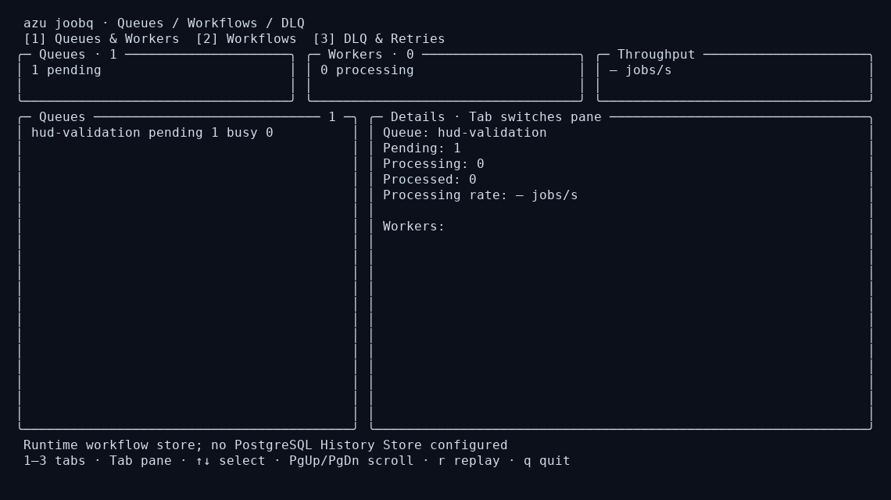
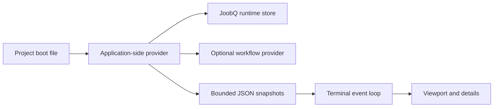

# azu joobq

## Overview & visual demo

Inspect workers, workflow executions, and dead letters through JoobQ's application adapter. The same components appear under Jobs → JoobQ in `azu dev`; replay requires explicit confirmation.

<figure><figcaption><p>A live queue snapshot in the terminal; list and detail panes share the bounded screen.</p></figcaption></figure>



## Quickstart & command syntax

```bash
azu joobq
azu joobq --boot src/dashboard_boot.cr
```

| Option/key | Effect |
| --- | --- |
| `--boot PATH` | Configure the application's stores and job classes; default `src/initializers/joobq.cr` |
| `1`, `2`, `3` | Select queues, workflows or dead letters in standalone `azu joobq` |
| `[` / `]` | Previous / next JoobQ view; use these inside `azu dev`, where numbers select sidebar sections |
| Tab / left / right | Switch list and detail panes |
| Up / down, PgUp / PgDn, Home / End | Navigate within the focused viewport |
| `r`, then `y` | Replay the selected dead letter; any other key cancels |
| `q`, Ctrl-C | Restore the terminal and stop the helper |

The boot file must configure stores without starting workers or a web server. The CLI compiles a helper using the application's installed shards before entering the alternate screen. Snapshots refresh once per second; operations have a five-second response deadline. A timeout closes the helper and requires restarting the dashboard.

### Supported stores

The bundled provider uses `JoobQ.store` on JoobQ 0.4.2, and selects `JoobQ::Runtime.store` when that namespace exists. Queue metrics, worker heartbeats and atomic dead-letter replay are discovered from the installed engine API. The published 0.4.2 release has no atomic DLQ API; its replay action is disabled. Atomic replay and worker registry support are verified on JoobQ commit `b38961d62ef1d70237a6f701b9af8ff34c9dbe8b`. Unsupported metrics remain empty or null; the worker card says unavailable when there is no registry API. Workers must publish their registry heartbeats to appear.

When the boot file loads JoobQ Pro workflows, the provider reads active executions from `JoobQPro::Workflows::Runtime.store?`, including step state and attempts. The step tree includes dependencies from the stored workflow definition.

**PostgreSQL History Store integration is not implemented:** the available JoobQ repositories do not expose the requested API. An application-specific adapter can implement `AzuJoobQDashboard::Provider` and assign `AzuJoobQDashboard.provider` from the boot file. The CLI embeds this interface before loading the boot file:

```crystal
abstract class AzuJoobQDashboard::Provider
  abstract def snapshot : JSON::Any
  abstract def replay(id : String) : JSON::Any
end
```

Snapshots contain arrays `queues`, `workers`, `workflows`, `dlq`, and `retries`, plus `replay_supported` and a `history` status string. See `src/azu_cli/integrations/joobq_agent.cr` for the default fields. Custom providers must bound and redact their payloads and implement replay through the engine's atomic operator API.

## Realistic output

```text
Usage: azu joobq [--boot PATH]
The boot file configures JoobQ and optional workflow/history adapters without starting workers.
1–3 tabs; Tab switches pane; arrows/PgUp/PgDn scroll; r then y replays a selected dead letter.
```

*Output of `azu joobq --help`. In the dashboard, dense lists and traces stay within their cards and show a block scrollbar.*

## Do's and don'ts


Use an interactive terminal. At narrow widths, Tab switches between the full-width list and details. The screen becomes stale after five seconds without a snapshot.



Replay changes the configured queue. The confirmation freezes the selected job ID even if a snapshot arrives. An operation with an unknown outcome is never automatically retried; inspect the queue before trying again.



The default adapter redacts common credential keys in job payloads and never writes Redis keys or SQL directly for replay. Keep application-specific sensitive fields out of payloads, or redact them in a custom provider.

