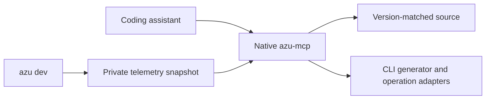

# azu mcp

## Overview

`azu mcp` launches the separately installed `azu-mcp` binary or prints client configuration. It supports Azu, Azu CLI, CQL, JoobQ, JoobQ Pro, Authly, Session and Schema. The existing Crystal editor extension remains responsible for normal editor language-server integration.


Install the coordinated MCP preview first. Set `AZU_MCP_BINARY` to its absolute path if it is not on PATH. No repository or dependency is downloaded automatically.




## Quickstart

Create a user-owned configuration outside your project:

```yaml
workspaces:
  store:
    root: /absolute/path/to/store
    trusted: true
    snapshot: /absolute/private/path/store/snapshot.json
```

```sh
azu mcp setup /absolute/path/to/config.yml
azu mcp check --config /absolute/path/to/config.yml
azu mcp serve --config /absolute/path/to/config.yml
```

`setup` prints a JSON snippet; it does not overwrite editor settings. `serve` reserves stdout for MCP protocol messages. For VS Code use its `servers` configuration; clients expecting `mcpServers` can use the printed snippet. Full examples are maintained in the [MCP repository](https://github.com/azutoolkit/mcp).

Share existing HUD telemetry without competing for the socket:

```sh
azu dev --snapshot /absolute/private/path/store/snapshot.json
```

The snapshot's directory must be private (`0700`). The file is replaced atomically with mode `0600`; plain-mode development is supported too.

## Realistic output

The setup command prints the native server command and configuration path. Generator tools return an expiring plan with exact files and hashes. Builds and tests return operation IDs, whose status must be checked before reporting success.

<figure><figcaption><p>The existing monitoring HUD stays read-only. MCP operational execution uses a separate explicitly configured runner.</p></figcaption></figure>

Review a generator or local operational plan in your terminal:

```sh
azu mcp approve PLAN_ID --config /absolute/path/to/config.yml
```

## Do's and don'ts

Trust only projects whose macros and initializers you are willing to execute. Inspect generator conflicts and stale-file failures. Do not use the MCP server as an unrestricted shell, and never treat a queued operation as completed.


Production changes require a named target and separate terminal approval. Migration execution requires CQL's reviewed-migration API; selected-job replay requires JoobQ's reviewed-redrive API. Older versions fail closed. Do not bypass these checks by translating selected jobs into queue-wide retries.


The `bridge` subcommand is a versioned internal JSON interface used by the native server. It is not a substitute for the MCP authorization policy, nor a sandbox against arbitrary code running as your OS account.
