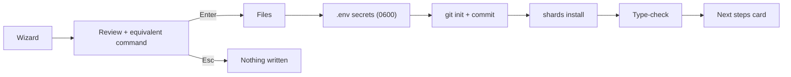

# azu new

`azu new <name>` writes a project, generates its `.env` secrets, initializes git, installs shards and type-checks the
result. On a terminal it asks a few questions first; with `--yes` it takes the defaults.

## Overview & visual demo

<figure><figcaption><p>The review screen: your choices on the left, what will happen on the right, the tools it found, and the same thing as one <code>azu new ... --yes</code> line.</p></figcaption></figure>



## Quickstart & command syntax

```bash
azu new blog                                    # wizard
azu new blog --yes                              # defaults
azu new shop --docker --db postgresql --yes
```

| Option                           | Meaning                                      | Default          |
| -------------------------------- | -------------------------------------------- | ---------------- |
| `--type web\|api\|cli`           | Project type                                 | `web`            |
| `--api`                          | Shorthand for `--type api`                   |                  |
| `--db sqlite\|postgresql\|mysql` | Database (ignored for `cli`)                 | `sqlite`         |
| `--test spec\|minitest`          | Test framework                               | `spec`           |
| `--docker`                       | `Dockerfile` and `.dockerignore` (web, api)  | off              |
| `--ci "GitHub Actions"`, `--no-ci` | CI workflow                                | GitHub Actions   |
| `--git`, `--no-git`              | Initialize a repository                      | on               |
| `--example`, `--no-example`      | Include example code                         | on               |
| `--joobq`, `--no-joobq`          | Include JoobQ                                | on               |
| `--name`, `--module`, `--author`, `--email`, `--license` | Project metadata     |                  |
| `--yes`                          | Non-interactive                              |                  |
| `--ui rich\|plain\|json`         | Output mode                                  | auto             |



```bash
azu new blog --yes
```

```text
src/        blog.cr  server.cr  endpoints/ requests/ pages/ services/ models/
            jobs/ channels/ middleware/ initializers/ db/{migrations,schema.cr,seed.cr}
public/templates/    # Jinja templates, never served as static files
spec/  config/  .env  .env.example  .env.development  .env.test  shard.yml
```




```bash
azu new tracker --api --db postgresql --yes
```
JSON endpoints and request/response contracts. No HTML templates or static assets. Entry point is `src/api.cr`.



```bash
azu new tool --type cli --yes
```
An `OptionParser` program with `--help` and `--version`. No server, database, jobs or `.env`; no dependencies in
`shard.yml`. `shards build` produces `bin/tool`.



## Realistic output

<figure><figcaption><p>Each wizard step is one flag. Here: <code>--type</code>, with a one-line explanation of the highlighted choice.</p></figcaption></figure>

<figure><figcaption><p>Mid-run: a spinner and live timer on <code>shards install</code>, with the last line it printed.</p></figcaption></figure>


```text
✔ Files       63 written into ./blog
✔ Secrets     .env (0600) · CSRF_SECRET
✔ Git         init + 1 commit
✔ Shards      15 installed
✔ Type-check  src/server.cr
```


*One line per step. Exit code 0 means every step passed.*

## Do's and don'ts


**Pro tip:** answer the wizard once, then copy the command line from the review screen into your CI or onboarding docs.



Start on SQLite. It needs no server, and `--db postgresql` or `--db mysql` is a flag away when you do.



`--docker` is refused for `--type cli` (nothing to containerize). `azu new` never overwrites an existing directory.



Don't commit `.env`. It's git-ignored and holds random secrets. Commit `.env.example` (secrets blank) instead.


<details>

<summary>Full reference</summary>

Project types in depth, database notes, Docker and CI details: [commands/new.md](../commands/new.md). To add Azu to an
existing project, see [azu init](../commands/init.md).

</details>
