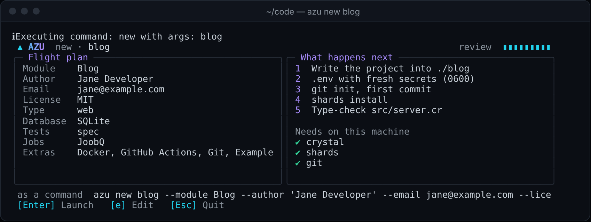
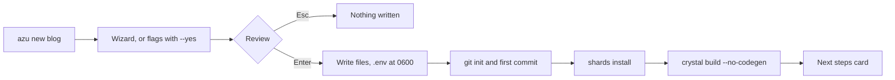

# azu new

## Overview & visual demo

`azu new` creates a project from scratch: on a terminal it opens a wizard that shows a flight plan and writes nothing until you press Enter, and `--yes` takes the defaults instead. The defaults are a web app on SQLite, which runs without a database server.

<figure><figcaption><p>The review screen. Enter writes the project and Esc quits without writing anything. The "as a command" line is the same choice written as flags.</p></figcaption></figure>



## Quickstart & command syntax

```bash
azu new blog                 # the wizard on a terminal
azu new blog --yes           # no prompts: the defaults
azu new shop --type api --db postgresql --yes
azu new file_tool --type cli --yes
```

For a web or API app, the next steps are:

```bash
cd blog
azu db:setup                 # creates the SQLite file and runs the migrations
azu serve                    # then open http://localhost:4000
```

Project types:



A full-stack app: Jinja pages, static files, a welcome page and a `/health` endpoint.

```bash
azu new blog --type web
```



JSON endpoints. The main file is `src/api.cr`; `--api` is shorthand for `--type api`.

```bash
azu new shop --api --yes
```



An `OptionParser` program with `--help` and `--version`. No server, database, jobs, `.env` or assets, so `--db` is ignored and `--docker` is refused.

```bash
azu new file_tool --type cli --yes
cd file_tool && shards build && ./bin/file_tool --help
```



Databases:



`--db sqlite` (or `sqlite3`). The database is a file under `db/`, so there is no server to start. `.env.development` points `DATABASE_URL` at `sqlite3://./db/<name>_development.db`.



`--db postgresql` (`postgres` and `pg` work too). Start the server before `azu db:setup`.

```bash
azu new shop --db postgresql --yes
```



`--db mysql`. Start the server before `azu db:setup`.

```bash
azu new shop --db mysql --yes
```



| Option | Meaning | Default |
| --- | --- | --- |
| `--type TYPE` | `web`, `api` or `cli` | `web` |
| `--api` | Shorthand for `--type api` | off |
| `--db DATABASE` | `sqlite`, `postgresql` or `mysql` | `sqlite` |
| `--test TEST` | `spec` or `minitest` | `spec` |
| `--docker`, `--no-docker` | `Dockerfile` and `.dockerignore` (web and api only) | off |
| `--ci CI`, `--no-ci` | `"GitHub Actions"` or `"None"` | `GitHub Actions` |
| `--git`, `--no-git` | `git init` and a first commit | on |
| `--example`, `--no-example` | Example code (for web and api it only changes the `tasks` target in `shard.yml`) | on |
| `--joobq`, `--no-joobq` | JoobQ background jobs (web and api only) | on |
| `--name NAME` | Project name; the positional argument works too | none |
| `--module MODULE` | Module name | from the name: `my_app` becomes `MyApp` |
| `--author`, `--email` | Written to `shard.yml` and `LICENSE` | your git config |
| `--license LICENSE` | License name | `MIT` |
| `--yes` | No prompts: take the defaults and the flags | off |
| `--ui MODE` | `rich` (wizard and cards), `plain` (lines) or `json` (NDJSON events) | `rich` on a terminal |

Names must start with a letter and contain only letters, digits, `_` and `-`. They cannot start or end with `-` or `_`, cannot be a Crystal keyword, and must give a valid module name. An existing directory is never overwritten.

## Realistic output


```text
ERROR: Directory 'blog' already exists. Choose a different name.
```


*Checked before anything is written; the exit code is 1.*


```text
Compilation Progress
  ✔ Files        63 written into ./blog        69 ms
  ✔ Secrets      .env (0600) · CSRF_SECRET      0 ms
  ✔ Git          init + 1 commit               76 ms
  ✔ Shards       15 installed                  10.0s
  ✔ Type-check   src/server.cr                  8.2s
```


*The card from the run in the screenshot above, with its text as it reads on screen.*


```text
blog is ready

  $ cd blog
  $ azu db:setup
  $ azu serve
  Visit: http://localhost:4000
  Start background workers: azu jobs:worker

JoobQ  config/jobs.yml · src/initializers/joobq.cr · src/worker.cr
       azu generate job <name> [params]

▸ Try  azu g scaffold post title:string body:text  then watch azu dev rebuild
Docs https://azutoolkit.org · Support https://github.com/azutoolkit/azu
```


*The last card of a successful run with JoobQ on; the border is left out here.*

## Do's and don'ts


**Pro tip:** `--yes` takes the author and email from your git config, or falls back to `Your Name` and `your.email@example.com`. Set `git config --global user.name` and `user.email` once and every new project gets them.



Start on SQLite. There is no server to run, and `azu db:setup` creates the file. Move to PostgreSQL or MySQL when you need a server.



`--docker` is for web and api projects. A cli project has no server to run in a container, so `--type cli --docker` is refused. With `--db postgresql` or `--db mysql`, start the database server before `azu db:setup`.



Don't commit `.env`. It holds the generated `CSRF_SECRET`, it is git-ignored and it is written with mode 0600. Commit `.env.example`, which lists the same variables with the secrets blank.


<details>

<summary>The wizard</summary>

The wizard asks for the module, author, email, license, type, database, test framework, jobs and extras (Docker, GitHub Actions, git, example code). Steps that do not apply are skipped: a cli project has no database or jobs step. The review screen checks that `crystal`, `shards` and `git` are on the `PATH`, and prints the same choices as one `azu new … --yes` line.

Keys: arrows (or `j` and `k`) move, Space toggles, Enter goes on, Shift-Tab goes back, Esc cancels. Esc writes nothing.

Without a keyboard and screen (`--ui plain`, a pipe, `AZU_UI=plain`) the command asks line by line instead. `--yes` skips both.

</details>

<details>

<summary>Generated files (web and api)</summary>

```text
blog/
├── shard.yml, README.md, LICENSE, .gitignore, .editorconfig, .tool-versions
├── .env (0600, git-ignored), .env.development, .env.test, .env.example
├── config/           jobs.yml (JoobQ), mailer.yml, openapi.yml, api.yml
├── public/           assets/, templates/ (layout.jinja, helpers/_nav.jinja, <app>/welcome/index_page.jinja)
├── spec/             spec_helper.cr, blog_spec.cr
└── src/
    ├── blog.cr       the module: configure, the handler stack, requires
    ├── server.cr     starts the server (the build target of a web app)
    ├── api.cr        starts the server (the build target of an api app)
    ├── db/           schema.cr, seed.cr, seeds/
    ├── initializers/ cql_config.cr, logger.cr, mailer.cr, joobq.cr (JoobQ)
    ├── endpoints/ pages/ requests/ responses/   the welcome and health examples
    ├── models/ services/ validators/ components/ middleware/ channels/ jobs/ tasks/
    ├── tasks.cr      the tasks target (with --example)
    └── worker.cr     the JoobQ worker (with JoobQ)
```

The CI workflow is `.github/workflows/ci.yml` unless `--no-ci`. `Dockerfile` and `.dockerignore` appear only with `--docker`. A cli project gets only the program, its spec, the shard file and the project files.

The `shard.yml` pins are the ones the generator uses (excerpt):


```yaml
crystal: '>= 1.22.1'

targets:
  blog:
    main: src/server.cr

dependencies:
  azu:
    github: azutoolkit/azu
    commit: 69163988a48e28b809ad09929f5d7f9bfb1079ee # Azu 1.0.2 + telemetry redaction; awaiting release
  cql:
    github: azutoolkit/cql
    version: 1.0.0          # exact on purpose
  session:
    github: azutoolkit/session
    version: ~> 1.1
  # with JoobQ: joobq ~> 0.4.2 and redis
  topia:
    github: azutoolkit/topia
  sqlite3:                    # pg ~> 0.31.0 or mysql ~> 0.18.0 for the other databases
    github: crystal-lang/crystal-sqlite3
    version: ~> 0.24.0
```


</details>

<details>

<summary>Environment files</summary>

- `.env` is git-ignored and mode 0600. It has a random `CSRF_SECRET`, `PORT=4000`, the log settings and the template path. `azu generate auth` and `azu session:setup` add a `SESSION_SECRET` to it later.
- `.env.development` and `.env.test` are committed and hold no secrets: `DATABASE_URL` for that environment, and `PERFORMANCE_MONITORING=true` in development, which feeds the `/dev-dashboard` request list.
- `.env.example` is committed and lists every variable the app reads, with the secrets blank.
- `.env.local` (git-ignored) is yours for machine-specific values.

Precedence, highest first: variables already in the environment, `.env.local`, `.env.<CRYSTAL_ENV>`, `.env`. The app and every `azu` command except `new`, `init`, `help`, `version` and `completion` load them.

</details>

<details>

<summary>Docker and CI</summary>

`--docker` writes a multi-stage `Dockerfile`:

- the build stage is `crystallang/crystal:1.22.1`, installs the packages the CI job installs, runs `shards install` and `crystal build --release --no-debug` on the main file;
- the runtime stage is `ubuntu:26.04` with only the shared libraries the binary needs, runs as a non-root user (`app`, uid 10001), sets `CRYSTAL_ENV=production`, `HOST=0.0.0.0` and `PORT=4000`, and has a `HEALTHCHECK` on `/health`;
- on SQLite it adds a `/data` volume and `DATABASE_URL=sqlite3:///data/<name>.db`. The image does not run migrations.

Secrets are not baked into the image. A web container refuses to boot in production without `CSRF_SECRET`:

```bash
docker build -t blog .
docker run -p 4000:4000 -e CSRF_SECRET=$(openssl rand -hex 32) blog
```

`--ci "GitHub Actions"` (the default) writes `.github/workflows/ci.yml`. It runs in a `crystallang/crystal:1.22.1` container, installs the system packages and the shards, checks formatting with `crystal tool format --check src spec`, runs the specs (`crystal spec`, or `crystal run spec/test_helper.cr` for minitest) and builds the main file. `--no-ci` and `--ci None` skip it. GitLab CI is not supported.

</details>

<details>

<summary>JoobQ</summary>

With JoobQ on (the default for web and api), the project has `config/jobs.yml`, `src/initializers/joobq.cr` and `src/worker.cr`. Start a worker with `azu jobs:worker`, and create jobs with `azu generate job <name> [param:type]`. `--no-joobq` removes those files and the `joobq` and `redis` dependencies.

</details>
