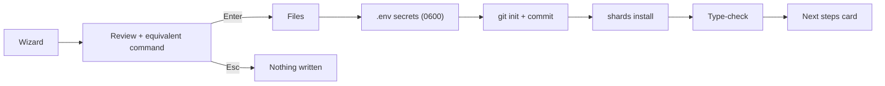

# azu new

Create a project: files, `.env` secrets, git, shards and a type-check, in one reviewed step.

## Overview

`azu new <name>` writes a web, api or cli project. On a terminal it asks a few questions, shows a flight plan, then
draws a live card while it works. Without a terminal, or with `--yes`, it takes the defaults and prints one line per step.

<figure><figcaption><p>The extras step: Space toggles, Enter continues, Shift-Tab goes back.</p></figcaption></figure>



## Quickstart

```bash
azu new blog                                   # wizard
azu new blog --yes                             # defaults: web, SQLite, spec, JoobQ, GitHub Actions, git, example
azu new api_only --api --db postgresql --yes
azu new tool --type cli --yes
azu new shop --docker --yes                    # adds Dockerfile and .dockerignore
```

| Option                      | Meaning                                         | Default        |
| --------------------------- | ----------------------------------------------- | -------------- |
| `--type web\|api\|cli`      | Project type                                    | `web`          |
| `--api`                     | Shorthand for `--type api`                      |                |
| `--db sqlite\|postgresql\|mysql` | Database adapter (ignored for `cli`)       | `sqlite`       |
| `--test spec\|minitest`     | Test framework                                  | `spec`         |
| `--docker`                  | `Dockerfile` and `.dockerignore` (web, api)     | off            |
| `--ci "GitHub Actions"`, `--no-ci` | CI workflow                              | GitHub Actions |
| `--git`, `--no-git`         | Initialize a repository                         | on             |
| `--example`, `--no-example` | Include example code                            | on             |
| `--joobq`, `--no-joobq`     | Include JoobQ                                   | on             |
| `--name`, `--module`, `--author`, `--email`, `--license` | Project metadata   |                |
| `--yes`                     | Non-interactive                                 |                |
| `--ui rich\|plain\|json`    | Output mode                                     | auto           |

## Output

<figure><figcaption><p>Files, secrets, git, shards and type-check, each with a count and a time.</p></figcaption></figure>

```text
✔ Files       63 written into ./blog
✔ Secrets     .env (0600) · CSRF_SECRET
✔ Git         init + 1 commit
✔ Shards      15 installed
✔ Type-check  src/server.cr
```

What a web project contains:

```text
blog/
├── src/
│   ├── blog.cr  server.cr
│   ├── endpoints/  requests/  pages/  services/  models/
│   ├── jobs/  channels/  middleware/  initializers/
│   └── db/ (migrations/, schema.cr, seed.cr)
├── public/templates/        # Jinja templates, never served as static files
├── spec/  config/
└── .env  .env.example  .env.development  .env.test  shard.yml
```

## Do's and don'ts


Copy the command line the review screen prints. It reproduces the exact project in CI or on another machine.



The default database is SQLite, so the project runs without a server. Pick `--db postgresql` or `--db mysql` when you
want one.



`--docker` is refused for `--type cli` (no server to containerize). `azu new` never overwrites an existing directory.



Never commit `.env`. It is git-ignored and holds random secrets. `.env.example` (secrets blank) is the file to commit.


<details>

<summary>Full reference</summary>

Project types in depth, database notes, Docker and CI details: [commands/new.md](../commands/new.md). Related:
[azu init](../commands/init.md) for adding Azu to an existing project.

</details>
