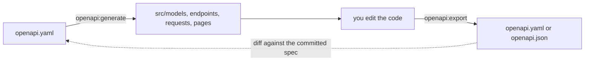

# OpenAPI commands

`azu openapi:generate` writes models, endpoints, requests and pages from an OpenAPI document. `azu openapi:export` goes the other way: it builds the document from the endpoints your app really declares.

## Overview & visual demo

Export an API description from the application's declared endpoints and request types. Review the generated document before using it for client generation or publishing it to API consumers.

<figure><figcaption><p>Not an OpenAPI command's output. This is the preview <code>azu g</code> shows before it writes. <code>openapi:generate</code> writes its files without a preview.</p></figcaption></figure>



## Quickstart & command syntax

### azu openapi:generate

```bash
azu openapi:generate openapi.yaml
azu openapi:generate openapi.yaml --models-only
azu openapi:generate openapi.yaml --force
```

| Option               | Meaning                                                   | Default |
| -------------------- | --------------------------------------------------------- | ------- |
| `<spec_path>`        | The OpenAPI file, YAML or JSON. Put it first             | required |
| `--spec PATH`        | The same, as an option                                    | none    |
| `--force`            | Overwrite files that already exist                        | off     |
| `--models-only`      | Only the models from the component schemas                | off     |
| `--endpoints-only`   | Only the endpoints, requests and pages from the paths     | off     |

It writes `src/models/` (from schemas), and `src/endpoints/<resource>/`, `src/requests/<resource>/` and `src/pages/<resource>/` (from paths and bodies). The resource is the first path segment that is not `api`, a version like `v1`, or a parameter. An existing file is skipped with a warning unless you pass `--force`. Exit `0` on success, `1` when the spec is missing or generation fails.

Generated models are JSON data-transfer structs. Required constructor arguments precede optional arguments even when the schema lists them in a different order. JSON field names such as `displayName` remain unchanged on the wire while Crystal accessors use `display_name`. Responses have typed constructors; array responses accept a `data` array and render it directly. The generator resolves the 200 response first, then another documented 2xx response such as 201.

Path placeholders such as `/invoices/{id}` become Azu routes such as `/invoices/:id`. Endpoint methods return HTTP 501 until you connect an application service and construct the required response. The specification defines contracts; your service supplies business behavior and persistence. This keeps transport contracts separate from application logic.

The web/API generator CI matrix compiles object and array responses, required-after-optional schema properties, request bodies and parameterized routes from `spec/fixtures/generators/openapi.yaml`.

### azu openapi:export

```bash
azu openapi:export
azu openapi:export --output docs/openapi.json
azu openapi:export --project "Blog API" --version 2.0.0
```

| Option              | Meaning                                                        | Default                                |
| ------------------- | -------------------------------------------------------------- | -------------------------------------- |
| `--output PATH`     | Where to write the document                                    | `openapi.yaml`                         |
| `--format FORMAT`   | `yaml` or `json`                                               | from the extension of `--output`, else `yaml` |
| `--project NAME`    | `info.title`                                                   | the `name` in `shard.yml`              |
| `--version VERSION` | `info.version`                                                 | `1.0.0`                                |
| `--help`, `-h`      | Print the usage and exit `0`                                   | off                                    |

It reads `./src/<project>.cr` and fails with exit `1` if that file is not there, so run it from the project root. The document covers every `Azu::Endpoint`, including scopes and mounted apps, with the path parameters, query parameters, request bodies and response schemas. Exit `0` when the file is written, `1` when the app does not compile or load, `2` for invalid usage.

## Realistic output


```text
OpenAPI document written to openapi.yaml
```


*The only line the export prints on success. Compiler errors appear before it, and nothing is written when the app fails to build.*


```text
WARNING: Model file already exists: <path> (use --force to overwrite)
```


*The generator skips the file and carries on. `<path>` is the file it did not write. The other progress lines are log lines with a timestamp in plain mode.*

## Do's and don'ts


**Pro tip:** keep the spec in version control and run `azu openapi:export` in CI. Diff the result against the committed file to catch an endpoint that drifted from the spec.



Put the spec path first: `azu openapi:generate openapi.yaml --force`. The command takes the first argument as the path, so `--force openapi.yaml` looks for a file called `--force`.



`openapi:generate` skips existing files, and `--force` overwrites them, including any edits you made. Commit before you regenerate.



`openapi:export` loads your app, so its top-level code runs (initializers, `.env` loading, database connections). Don't point it at a production database. It needs azu 0.5.72 or newer.



Don't read a missing file after a failed export as a bug in the spec. A compile error stops the export and writes nothing; the compiler's last lines show where the app breaks.

