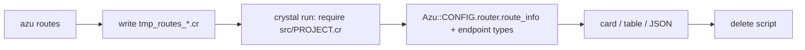

# azu routes

`azu routes` compiles your project, loads it without starting the server, and prints Azu's route table plus the
`Azu::Endpoint(Request, Response)` types it finds.

## Overview & visual demo

<figure><figcaption><p>Nine routes: verbs are colored (GET green, POST cyan, PATCH amber, DELETE red), and the namespace every endpoint shares is named under the table.</p></figcaption></figure>



## Quickstart & command syntax

```bash
azu routes
azu routes --method POST
azu routes --path posts
azu routes --format json | jq '.[].path'
```

| Option            | Meaning                                  | Default |
| ----------------- | ---------------------------------------- | ------- |
| `--format FORMAT` | `table` or `json`                        | `table` |
| `--method METHOD` | Only this HTTP method (any case)         | all     |
| `--path TEXT`     | Only paths containing `TEXT`             | all     |
| `--ui MODE`       | `rich` card or `plain` table             | auto    |

## Realistic output



```text title="terminal: azu routes --ui plain"
METHOD  PATH             ENDPOINT                        REQUEST                        RESPONSE                  HELPERS
GET     /posts           Blog::Posts::IndexEndpoint      Blog::Posts::IndexRequest      Blog::Posts::IndexPage    link_to_get_posts_index
POST    /posts           Blog::Posts::CreateEndpoint     Blog::Posts::CreateRequest     Azu::Response::Empty      link_to_post_posts_create, form_for_post_posts_create
DELETE  /posts/:id       Blog::Posts::DestroyEndpoint    Blog::Posts::DestroyRequest    Azu::Response::Empty      link_to_delete_posts_destroy, ...
```



```json title="terminal: azu routes --format json"
[
  {
    "method": "POST",
    "path": "/posts",
    "endpoint": "Blog::Posts::CreateEndpoint",
    "request": "Blog::Posts::CreateRequest",
    "response": "Azu::Response::Empty"
  }
]
```



*With `--format json`, stdout is only the array (the CLI adds no log lines). `POST` and `DELETE` answer with
`Azu::Response::Empty`, a redirect. Exit codes: `0` success, `1` the app couldn't be loaded or this isn't a project, `2` invalid usage.*

## Do's and don'ts


**Pro tip:** `HEAD` and `OPTIONS` routes that Azu adds for you are hidden unless you ask for them with `--method`.



Run it after every `azu g scaffold` to confirm the routes and the response types match what you meant.



The first run takes about as long as a build, because it compiles the app.



It runs your project's top-level code (initializers, `.env` loading, database connections); only the server start is skipped.
Don't run it against production.


<details>

<summary>Leftover scratch files</summary>

The scratch script has a random name, is deleted on exit (also on Ctrl-C and SIGTERM) and is git-ignored in generated
projects. After a crash or SIGKILL, delete `tmp_routes_*.cr`. In an older project add `/tmp_routes_*.cr` and
`/.azu_console_*.cr` to `.gitignore`. More: [commands/routes.md](../commands/routes.md).

</details>
