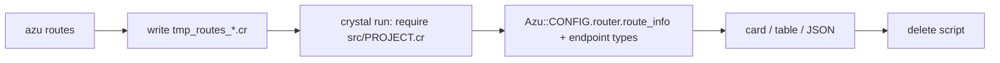

# azu routes

List every route of your app with the request and response types behind it.

## Overview

`azu routes` compiles your project, loads it without starting the server and prints Azu's route table plus the
`Azu::Endpoint(Request, Response)` types it finds. Use it to check what a generator added or to feed a script.

<figure><figcaption><p>Verbs are colored; the namespace every endpoint shares is named under the table.</p></figcaption></figure>



## Quickstart

```bash
azu routes
azu routes --method POST
azu routes --path posts
azu routes --format json | jq '.[].path'
```

| Option            | Meaning                                                     | Default            |
| ----------------- | ----------------------------------------------------------- | ------------------ |
| `--format FORMAT` | `table` or `json`                                           | `table`            |
| `--method METHOD` | Only this HTTP method (any case)                            | all                |
| `--path TEXT`     | Only paths containing `TEXT`                                | all                |
| `--ui MODE`       | `rich` card or `plain` table                                | auto               |

## Output

```text
METHOD  PATH             ENDPOINT                        REQUEST                        RESPONSE                  HELPERS
GET     /posts           Blog::Posts::IndexEndpoint      Blog::Posts::IndexRequest      Blog::Posts::IndexPage    link_to_get_posts_index
POST    /posts           Blog::Posts::CreateEndpoint     Blog::Posts::CreateRequest     Azu::Response::Empty      link_to_post_posts_create, form_for_post_posts_create
DELETE  /posts/:id       Blog::Posts::DestroyEndpoint    Blog::Posts::DestroyRequest    Azu::Response::Empty      link_to_delete_posts_destroy, ...
```

`--format json` prints only a JSON array of `method`, `path`, `endpoint`, `request`, `response`. Exit codes: `0`
success, `1` the app could not be loaded or this is not a project, `2` invalid usage.

## Do's and don'ts


`HEAD` and `OPTIONS` routes that Azu adds for you are hidden unless you ask for that method with `--method`.



The first run takes about as long as a build, because it compiles the app.



It runs your project's top-level code (initializers, `.env` loading, database connections). Only the server start is
skipped. Do not run it against production.


<details>

<summary>Leftover scratch files</summary>

The scratch script is created with a random name, deleted on exit (also on Ctrl-C and SIGTERM) and git-ignored in
generated projects. After a crash or SIGKILL delete `tmp_routes_*.cr`. In an older project add `/tmp_routes_*.cr` and
`/.azu_console_*.cr` to `.gitignore`. More: [commands/routes.md](../commands/routes.md).

</details>
