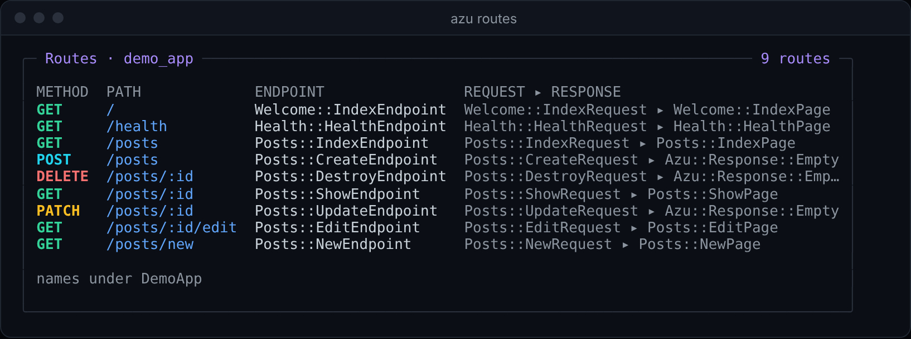
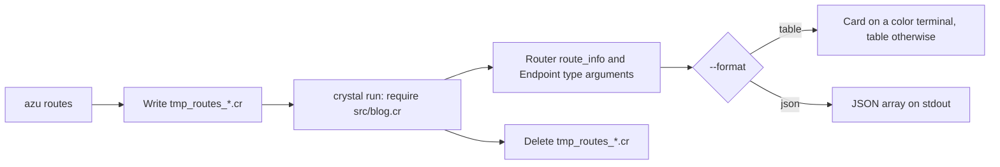

# azu routes

## Overview & visual demo

`azu routes` compiles your project, loads it without starting the server, and prints Azu's route table together with the `Azu::Endpoint(Request, Response)` types it finds. Use it after `azu g scaffold` to check that the routes and their response types are what you meant. The concise version is [azu routes](../command-reference/azu-routes.md).

<figure><figcaption><p>The card on a color terminal: verbs are colored, and the namespace every endpoint shares is named under the table instead of repeated on each row.</p></figcaption></figure>



## Quickstart & command syntax

```bash
azu routes
azu routes --method POST
azu routes --path posts --format json
azu routes --format json | jq '.[] | select(.method == "POST")'
```

| Option | Meaning | Default |
| --- | --- | --- |
| `--format FORMAT` | `table` or `json` | `table` |
| `--method METHOD` | Only this HTTP method, any case. The `HEAD` and `OPTIONS` routes Azu adds are hidden unless you ask for one of them | all, without `HEAD` and `OPTIONS` |
| `--path TEXT` | Only routes whose path contains `TEXT` | all |
| `--ui MODE` | `rich` (the card) or `plain` (the table) | `rich` on a color terminal |
| `--help` | Show the help | |

Exit codes: `0` success, `1` the app could not be loaded (the compiler's last lines are shown) or this is not a project, `2` invalid usage.

## Realistic output


```text
METHOD  PATH        ENDPOINT                      REQUEST                      RESPONSE                  HELPERS
GET     /           Blog::Welcome::IndexEndpoint  Blog::Welcome::IndexRequest  Blog::Welcome::IndexPage  link_to_get_welcome_index
GET     /posts      Blog::Posts::IndexEndpoint    Blog::Posts::IndexRequest    Blog::Posts::IndexPage    link_to_get_posts_index
POST    /posts      Blog::Posts::CreateEndpoint   Blog::Posts::CreateRequest   Azu::Response::Empty      link_to_post_posts_create, form_for_post_posts_create
DELETE  /posts/:id  Blog::Posts::DestroyEndpoint  Blog::Posts::DestroyRequest  Azu::Response::Empty      link_to_delete_posts_destroy, form_for_delete_posts_destroy, button_to_delete_posts_destroy

4 routes
```


*The plain table, sorted by path and then method; a pipe, `NO_COLOR` and CI print this table too.*


```json
[
  {
    "method": "POST",
    "path": "/posts",
    "endpoint": "Blog::Posts::CreateEndpoint",
    "request": "Blog::Posts::CreateRequest",
    "response": "Azu::Response::Empty"
  }
]
```


*With `--format json`, stdout holds only the array, so the output goes straight into a parser.*


```text
ERROR: Unknown HTTP method 'FETCH': use one of CONNECT, DELETE, GET, HEAD, OPTIONS, PATCH, POST, PUT, TRACE, WEBSOCKET
```


*A method Azu does not know is refused before the app is compiled; the exit code is 2.*

## Do's and don'ts


**Pro tip:** `--format json` pipes well. `azu routes --format json | jq '.[].path'` lists the paths, and a test can compare the array with the routes it expects.



Run `azu routes` after `azu g scaffold` to confirm that the routes and their response types match what you meant.



Every run compiles the app, so it takes about as long as a build, even when you only filter the output.



It runs your project's top-level code: initializers, `.env` loading and database connections. Only the server start is skipped. Don't run it against production.


<details>

<summary>Helper names</summary>

The `HELPERS` column lists the template helpers Azu registers for an endpoint. Each name is built from the last two segments of the endpoint class, the same way Azu's `Endpoint` macro builds it:

- `link_to_<verb>_<resource>` for every route
- `form_for_<verb>_<resource>` for every route except GET
- `button_to_delete_<resource>` for DELETE

The HEAD and OPTIONS routes Azu adds get no helpers. Routes that are not endpoints, such as WebSocket channels and plain handlers, show `-` for the request, response and helpers.

</details>

<details>

<summary>Scratch file and .gitignore</summary>

The command writes a small script named `tmp_routes_<random>.cr` into the project, runs it with `crystal run`, and deletes it when it ends, also on Ctrl-C or SIGTERM. After a crash or SIGKILL it can remain; delete it. Generated projects git-ignore it. In an older project add `/tmp_routes_*.cr` and `/.azu_console_*.cr` to `.gitignore`.

The script requires `src/<project>.cr`, which every generated web and api project has.

</details>
