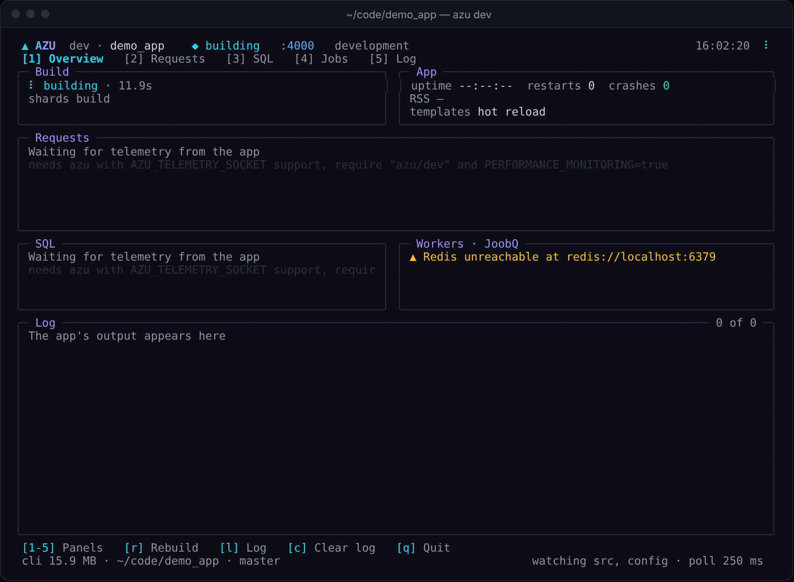
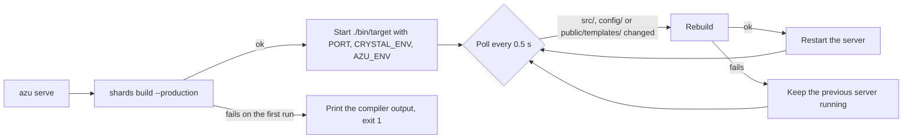

# azu serve

## Overview & visual demo

Run the application with the serve command's supported reload behavior. For the interactive dashboard, source rebuilds, and integrated inspectors, use `azu dev`.

<figure><figcaption><p>The build card of <code>azu dev</code>. <code>azu serve</code> does the same build and prints it as plain lines, shown under Realistic output.</p></figcaption></figure>



## Quickstart & command syntax

```bash
azu serve
azu serve --port 8080 --host 0.0.0.0
azu serve --env test --no-watch
azu s -p 4000
```

| Option | Meaning | Default |
| --- | --- | --- |
| `--port PORT`, `-p` | Port the app listens on (`PORT`) | `PORT` from the environment or `.env`, else 4000 |
| `--host HOST`, `-h` | Host the app binds to (`HOST`), passed only when you give it | the app's choice: `127.0.0.1` in development, `0.0.0.0` elsewhere |
| `--env ENV`, `-e` | Environment (`CRYSTAL_ENV` and `AZU_ENV`) | `CRYSTAL_ENV` from the environment, else `development` |
| `--no-watch` | Compile and run once, without watching files | watching |
| `--verbose`, `-v` | Show the app's output and every changed file | off |

`-h` means `--host` here, not help. `azu serve` has no help screen of its own; this page is the reference.

Stop it with Ctrl+C. Exit codes: `0` when it stops normally, `1` when the first compile fails or the server cannot be run.

## Realistic output


```text
[hh:mm:ss] [INFO ] Starting Azu development server...
[hh:mm:ss] [INFO ] Environment: development
[hh:mm:ss] [INFO ] Server: http://127.0.0.1:4000
[hh:mm:ss] [INFO ] Hot reloading: enabled
[hh:mm:ss] [INFO ] Compiling application...
[hh:mm:ss] [INFO ] Compilation successful! (n.ns)
[hh:mm:ss] [INFO ] Server started (PID: n)
[hh:mm:ss] [INFO ] Watching for file changes...
[hh:mm:ss] [INFO ] Press Ctrl+C to stop the server
```


*Startup lines outside a terminal; `n` stands for the build time and the process id, and the emoji are left out.*


```text
[hh:mm:ss] [INFO ] File changed: src/endpoints/posts/index_endpoint.cr
[hh:mm:ss] [INFO ] Compiling application...
ERROR: Compilation failed!
============================================================
COMPILATION ERROR DETAILS:
============================================================
<the output of shards build>
============================================================
WARNING: Keeping previous version running due to compilation errors
```


*The compiler output sits between the rules, and the server that was running keeps running; the emoji are left out.*

## Do's and don'ts


**Pro tip:** `--no-watch` compiles and runs the app once. Use it to check that the app boots before you go on.



Use [azu dev](azu-dev.md) while you develop. It also watches `shard.yml`, `shard.lock` and the `.env` files, and it draws the dashboard.



`azu serve` does not watch `.env` files. After you change one, restart the command. `azu dev` restarts for `.env` changes without a build.



`--host 0.0.0.0` listens on every interface, so other machines on your network can reach the app. The banner says so. Use it only when you mean it.


<details>

<summary>What it watches and how it differs from azu dev</summary>

`azu serve` polls the modification time of `src/**/*.cr`, `config/**/*.cr`, `public/templates/**/*.jinja` and `public/templates/**/*.html` every 0.5 seconds. A change that shows up within 0.5 seconds of the previous reload is skipped, and it is not picked up later unless that file changes again. Save once more to be sure the server has the change.

| | `azu serve` | `azu dev` |
| --- | --- | --- |
| Build | `shards build --production` | `shards build <target>` |
| Template changes | Rebuild and restart | Reload in the running app, no build |
| `.env` and `shard.yml` | Not watched | Watched; `.env` restarts without a build |
| Dashboard | No | Yes |
| Failed build | Keeps the previous server | Keeps the previous app |

The child process gets `PORT`, `CRYSTAL_ENV` and `AZU_ENV`, and `HOST` only when you pass `--host` or set it in the environment. The binary it runs is the first target in `shard.yml`.

</details>

<details>

<summary>Environment</summary>

The defaults for `--port`, `--host` and `--env` come from the environment, which already holds the values of the project's `.env` files when the command starts. The flags win over them. Azu reads `CRYSTAL_ENV` only. In `development` the generated app mounts the development dashboard and the performance monitor; in other environments it does not.

For a production run, build the binary yourself or use the generated `Dockerfile` (`azu new --docker`). `azu serve` is for development.

</details>
