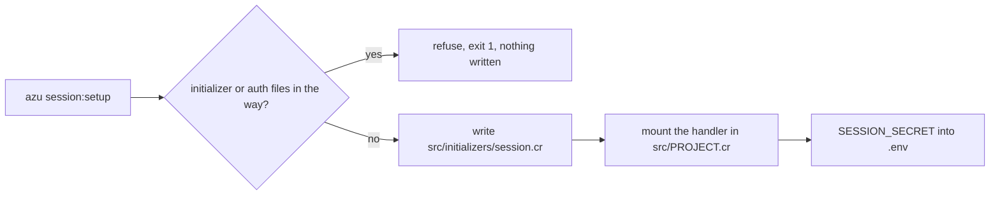

# Session commands

`azu session:setup` gives a web project sessions in one command: a typed `UserSession`, its store, the session handler, and a random `SESSION_SECRET` in your git-ignored `.env`. `azu session:clear` deletes the sessions kept in Redis. For sign-in, use `azu generate auth`: it sets up the same session and the sign-in pages with it.

## Overview & visual demo

Pick the backend once: cookie sessions for most apps, Redis when several instances must share sessions, memory only for development. The setup refuses to overwrite an existing initializer unless you pass `--force`, and it never touches the files that authentication owns.

<figure><figcaption><p>Not <code>session:setup</code>'s output. This is the file list <code>azu g</code> prints after it writes, with a changed file marked <code>~</code>. <code>session:setup</code> prints plain lines and the next steps.</p></figcaption></figure>



## Quickstart & command syntax

```bash
azu session:setup                    # encrypted cookie sessions (default)
azu session:setup --backend redis    # sessions in Redis, REDIS_URL or redis://localhost:6379
azu session:setup --backend memory   # in process, one instance only (development)

azu session:clear                    # Redis only: asks first
azu session:clear --backend redis --force
```

### azu session:setup

| Option             | Short | Meaning                                                              | Default  |
| ------------------ | ----- | -------------------------------------------------------------------- | -------- |
| `--backend TYPE`   | `-b`  | `cookie`, `redis` or `memory`                                        | `cookie` |
| `--force`          | `-f`  | Replace an existing `src/initializers/session.cr`                    | off      |

What it writes: `src/initializers/session.cr` (`UserSession < Session::Base`, the store, a 24-hour timeout, and `config.secret = Azu::Env.secret("SESSION_SECRET")`), the handler line `Session::SessionHandler(UserSession).new(Session.session),` after `Azu::Handler::RequestId.new,` in `src/<project>.cr`, and `SESSION_SECRET=<random>` in `.env` (mode `0600`) unless it is already there.

It refuses with exit code `1` and writes nothing when:

- `src/initializers/session.cr` exists. Run again with `--force` to replace it; what you added to `UserSession` is lost.
- Authentication is generated. Its files, or the initializer `azu generate auth` writes, are in the project. `--force` does not override this. To change the store, edit `config.store` in the initializer.
- `src/<project>.cr` is missing, or it has no `Azu::Handler::RequestId.new,` line to put the handler after. Add the handler line yourself and run it again.

### azu session:clear

| Option             | Short | Meaning                                                              | Default                     |
| ------------------ | ----- | -------------------------------------------------------------------- | --------------------------- |
| `--backend TYPE`   | `-b`  | `cookie`, `redis` or `memory`                                        | from the initializer, see below |
| `--force`          | `-f`  | Do not ask before deleting                                           | off                         |

Without `--backend`, the backend comes from `src/initializers/session.cr` when that file is one the generators wrote, unchanged. With no initializer, `SESSION_BACKEND` is used. Anything else refuses with exit code `1`, because the command deletes data and does not guess what edited code does.

- **Redis:** deletes every `session:*` key in the database of `REDIS_URL` (default `redis://localhost:6379`), a `SCAN` page at a time. It prints the target as `redis://host:port/database` (never the user or password), then asks.
- **Cookie:** refuses (exit `1`). Cookie sessions live in the browsers. Changing `SESSION_SECRET` and restarting ends them all.
- **Memory:** refuses (exit `1`). Memory sessions live in the app process. Restart the app to end them.

### Signing a user in

After a sign-in, set the user on the session and call `regenerate_id`. The new id means an id planted before sign-in is worth nothing (session fixation). This is what the generated authentication does:


```crystal
Session.session.current_session.user_id = user.id
Session.session.regenerate_id
```


Do not combine `session:setup` with `azu generate auth`. Both write `src/initializers/session.cr`, and each one refuses once the other has run.

## Realistic output


```text
Usage: azu session:setup [--backend cookie|redis|memory] [--force]

Writes src/initializers/session.cr (a typed UserSession and its store), mounts the session handler
after Azu::Handler::RequestId in src/<project>.cr and puts a random SESSION_SECRET in .env.

Options:
  -b, --backend <type>  cookie (default), redis or memory
  -f, --force           Replace an existing src/initializers/session.cr (never one that looks like
                        azu generate auth's, nor when auth's endpoints or throttle exist)
  -h, --help            Show this help

Exit codes: 0 done, 1 refused (the initializer exists, authentication is generated, no place for the
handler), 2 invalid usage.
```


*The help as the command prints it. `--help` changes nothing.*

## Environment variables

| Variable         | Used for                                                                 |
| ---------------- | ------------------------------------------------------------------------ |
| `SESSION_SECRET` | Encrypts and signs sessions. Required in production; a random value in development, kept in `.env` |
| `REDIS_URL`      | The Redis backend, and the database `session:clear --backend redis` empties |
| `SESSION_BACKEND`| `session:clear` only, and only when there is no session initializer     |

## Do's and don'ts


**Pro tip:** `azu session:setup --help` lists the exit codes. Exit `1` is a refusal with nothing written, and exit `2` is invalid usage, so a script can tell a bad flag from a refused setup.



In production, set `SESSION_SECRET` in the environment of the process. The `.env` value is for development.



`session:clear --backend redis` deletes every `session:*` key in that Redis database. Other apps that share the database lose their sessions too. The command prints this before it asks.



Don't use `session:clear` to log everyone out of cookie sessions. It refuses. Changing `SESSION_SECRET` and restarting does the same job, and it logs out every user of the app.

