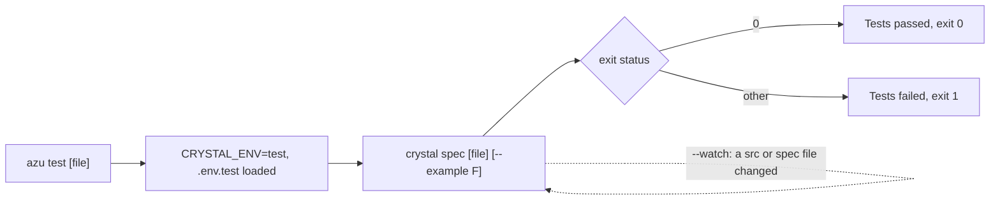

# azu test

`azu test` (alias `azu t`) runs `crystal spec` for your project with `CRYSTAL_ENV=test`, so the `.env.test` file is the one that applies. It adds a watch mode that reruns the suite when a file under `src/` or `spec/` changes, and a `--filter` that picks examples by name.

## Overview & visual demo

Use it for the whole suite before a commit, or `--watch` while you work on one area. Its output is plain Logger lines and whatever `crystal spec` prints, so the terminal shows no card.

<figure><figcaption><p>Not <code>azu test</code>'s output. This is the progress card <code>azu new</code> draws. <code>azu test</code> prints plain lines and the <code>crystal spec</code> output.</p></figcaption></figure>



## Quickstart & command syntax

```bash
azu test
azu test spec/models/user_spec.cr
azu test --filter "validates email"
azu test --watch
azu t -v
```

| Option                 | Short | Meaning                                                                          | Default  |
| ---------------------- | ----- | -------------------------------------------------------------------------------- | -------- |
| `[file]`               |       | A spec file, passed to `crystal spec` after `spec`                               | the whole suite |
| `--watch`              | `-w`  | Rerun the suite when a `.cr` file under `src/` or `spec/` changes (Ctrl+C stops) | off      |
| `--filter PATTERN`     | `-f`  | Run only the examples whose description matches (`crystal spec --example`)       | all      |
| `--verbose`            | `-v`  | Pass `--verbose` to `crystal spec`                                               | off      |
| `--parallel`           | `-p`  | Pass `--parallel` to `crystal spec`. The CLI does no sharding itself             | off      |
| `--coverage`           | `-c`  | Prints a warning. No coverage is collected                                       | off      |

Watch mode runs the suite once at start, then polls every 0.5 s. Each change reruns the same selection, so `--filter` and a file argument apply to every run.

Tests run as `test` whatever `CRYSTAL_ENV` says. To prepare the test database, use the same environment flag as the rest of the database commands:

```bash
azu db:setup --env test
azu test
```

<details>

<summary>What the test command does not do</summary>

- It does not collect coverage. `--coverage` only prints a warning that coverage needs extra setup.
- It does not run specs in parallel of its own. `--parallel` only adds a flag to `crystal spec`.
- It does not pick up only the changed specs in watch mode. Each change reruns the selection.
- It does not stop the watch loop on a failing run. The loop keeps watching and reruns on the next change.

</details>

## Realistic output


```text
warning: DATABASE_URL is set in your environment and wins over .env.test: the specs will use it
```


*Printed on stderr before the run. `azu test` still runs; the specs use the shell's database.*


```text
WARNING: Coverage reporting requires additional setup
```


*The only effect of `--coverage`. The run goes on without a report.*


```text
Finished in <duration>
<examples> examples, <failures> failures
```


*The last lines come from `crystal spec`, so the wording is Crystal's. Angle brackets stand for the counts of your run.*

## Do's and don'ts


**Pro tip:** run `azu test --watch --filter "User"` in one terminal while `azu dev` runs in another. The watch reruns only the examples you are working on.



Set up the test database once with `azu db:setup --env test`, then run `azu test`. The test database stays apart from development.



`--coverage` does not produce a report. Use a coverage tool that wraps `crystal spec` if you need one.



Watch mode reruns the whole selection, not just the spec that changed. Narrow it with a file argument or `--filter` when the suite is slow.



Don't export `DATABASE_URL` in your shell for the tests. It wins over `.env.test`, and the specs then run against whatever database it names.

