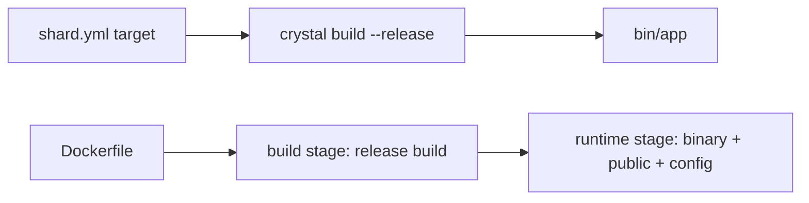

# Production builds


There is no `azu build` command. A production build is a plain Crystal release build, or the Docker image that
`azu new --docker` writes for you.


Your `shard.yml` declares a build target. Build it in release mode, or let the generated multi-stage `Dockerfile` do it and
ship a small, non-root image.

## Overview & visual demo

<figure><figcaption><p>Before you ship: <code>azu doctor</code>. It checks the secrets aren't weak or hard-coded, <code>.env</code> is git-ignored, Docker is installed and the port is free.</p></figcaption></figure>



## Quickstart & command syntax



```bash
shards install --production
shards build --production --release     # the target from shard.yml, output in bin/
CRYSTAL_ENV=production CSRF_SECRET=... ./bin/blog
```



```bash
azu new shop --docker --yes
cd shop
docker build -t shop .
docker run -p 4000:4000 \
  -e CSRF_SECRET="$(openssl rand -hex 32)" \
  -e SESSION_SECRET="$(openssl rand -hex 32)" \
  -v shop-data:/data shop
```



| Setting          | Value in production                                              |
| ---------------- | ---------------------------------------------------------------- |
| `CRYSTAL_ENV`    | `production` (the image sets it)                                 |
| `HOST`, `PORT`   | `0.0.0.0` and `4000` in the image                                |
| `CSRF_SECRET`    | Required. The app refuses to boot without it                     |
| `SESSION_SECRET` | Required once you generate authentication                        |
| `DATABASE_URL`   | In the image: `sqlite3:///data/<project>.db`, on a volume        |

## Realistic output

```dockerfile title="Dockerfile (generated, abridged)"
FROM crystallang/crystal:1.22.1 AS build
...
RUN mkdir -p bin && crystal build --release --no-debug src/server.cr -o bin/shop

FROM ubuntu:26.04
...
USER app
ENV CRYSTAL_ENV=production HOST=0.0.0.0 PORT=4000 TZ=UTC
HEALTHCHECK --interval=10s --timeout=3s --start-period=5s --retries=3 \
  CMD curl -fsS "http://127.0.0.1:${PORT}/health" || exit 1
CMD ["./shop"]
```

*Two stages: a release build, then a runtime image with only the binary, `public/` and `config/`, running as user `app`
(uid 10001). A SQLite project also gets a `/data` volume.*

```text title="terminal: container started without CSRF_SECRET"
the app exits with an error naming the missing CSRF_SECRET
```

*That's the guard working. Generated apps refuse to boot in production without it.*

## Do's and don'ts


**Pro tip:** `scripts/e2e_docker.sh` builds the image, runs it, and checks `/health`, the production guards, the non-root
user and the volume. It needs a Docker daemon, so CI doesn't run it.



Pass secrets with `docker run -e` or your platform's secret store. Real environment variables win over any `.env` file.



The image doesn't run migrations. Run `azu db:migrate` against the database before the first start.



Don't bake `.env*` into an image (`.dockerignore` keeps them out), and don't put secrets in `shard.yml` or source.


<details>

<summary>Notes</summary>

- `azu serve` builds with `--production` and runs the app. It's the older development server, not a deploy tool.
- Some bugs only show in an optimized build; the Docker image is a `--release` build, which is why the e2e script uses it.
- `azu doctor` fails weak or placeholder secrets and warns about a `Dockerfile` when Docker isn't installed.

</details>
