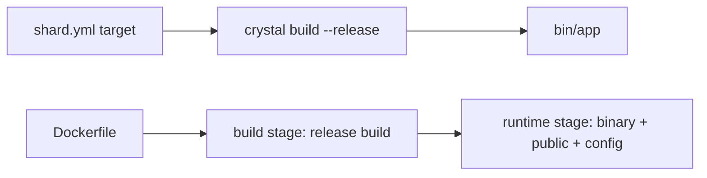

# Production builds

Compile and package an Azu app for deployment.


There is no `azu build` command. A production build is a plain Crystal release build, or the Docker image `azu new
--docker` writes for you.


## Overview

Your project's `shard.yml` declares a build target. Build it in release mode, or let the generated multi-stage
`Dockerfile` do it and ship a small non-root image.



## Quickstart



```bash
shards install --production
shards build --production --release     # target from shard.yml, output in bin/
CRYSTAL_ENV=production CSRF_SECRET=... ./bin/blog
```



```bash
azu new shop --docker --yes             # or add a Dockerfile when creating the project
docker build -t shop .
docker run -p 4000:4000 \
  -e CSRF_SECRET="$(openssl rand -hex 32)" \
  -e SESSION_SECRET="$(openssl rand -hex 32)" \
  -v shop-data:/data shop
```



| Setting                | Value in production                                               |
| ---------------------- | ----------------------------------------------------------------- |
| `CRYSTAL_ENV`          | `production` (the image sets it)                                  |
| `HOST`, `PORT`         | `0.0.0.0`, `4000` in the image                                    |
| `CSRF_SECRET`          | Required; the app refuses to boot without it                      |
| `SESSION_SECRET`       | Required once you generate authentication                         |
| `DATABASE_URL`         | SQLite in the image: `sqlite3:///data/<project>.db` on a volume   |

## Output

The image's checks, from the generated `Dockerfile`:

```text
build stage   crystallang/crystal:1.22.1  ->  crystal build --release --no-debug
runtime       ubuntu, user "app" (uid 10001), VOLUME /data (SQLite)
HEALTHCHECK   curl http://127.0.0.1:$PORT/health every 10s
```

Missing secret in production:

```text
the app exits with an error naming the missing CSRF_SECRET
```

## Do's and don'ts


Pass secrets with `docker run -e` or your platform's secret store. Real environment variables win over any `.env` file.



The image does not run migrations. Run `azu db:migrate` against the database before the first start.



Do not bake `.env*` into an image (`.dockerignore` keeps them out) and do not put secrets in `shard.yml` or source.


<details>

<summary>Notes</summary>

- `azu serve` builds with `--production` and runs the app; it is the older development server, not a deploy tool.
- A `--release` build is the only place an optimizer-only bug can show up. `scripts/e2e_docker.sh` builds the image,
  runs it and checks `/health`, the production guards, the non-root user and the volume. It needs a Docker daemon.
- `azu doctor` warns about a `Dockerfile` when docker is not installed, and fails weak or placeholder secrets.

</details>
