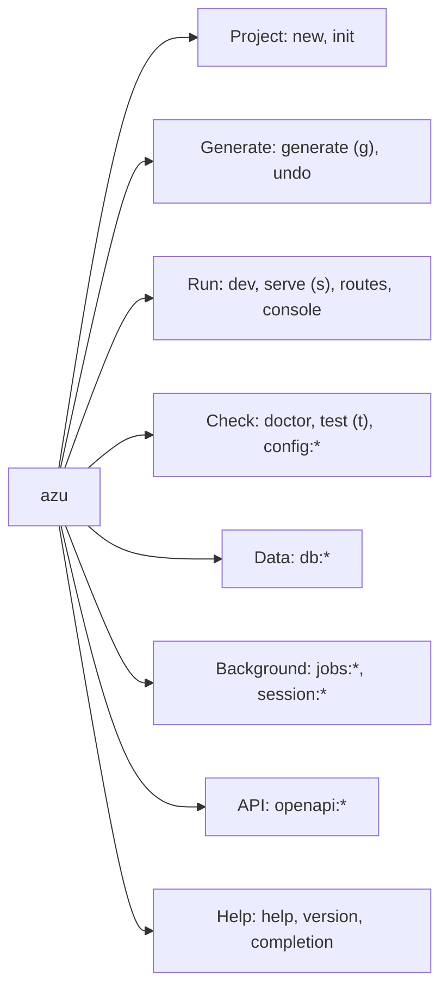

# Command Reference

## Overview & visual demo

Azu CLI is one binary, `azu`, with a command per task: create a project, generate code, run the app, manage the database and the background jobs. This index lists every registered command and the page that covers it. The pages for `new`, `generate`, `dev` and `routes` are the full references; their concise versions are in [command-reference](../command-reference/azu-new.md).

<figure><figcaption><p>The end of <code>azu new blog</code>: the next steps the CLI prints, which are the commands this index covers.</p></figcaption></figure>



## Quickstart & command syntax

```bash
azu <command> [arguments] [options]

azu new blog
cd blog
azu db:setup
azu serve
```

| Command | What it does | Page |
| --- | --- | --- |
| `azu new <name>` | Create a project (web, api or cli) | [new](new.md) |
| `azu init` | Prepare an existing Crystal project | [init](init.md) |
| `azu generate <type> <name>` (`g`) | Generate models, endpoints, pages, migrations, scaffolds | [generate](generate.md) |
| `azu undo` | Revert the files of the last `azu generate` | [generate](generate.md) |
| `azu dev` | Run the app, rebuilding and restarting it on change | [dev](dev.md) |
| `azu serve` (`server`, `s`) | Compile and run the app, restarting on change | [serve](serve.md) |
| `azu routes` | List the routes and their request and response types | [routes](routes.md) |
| `azu console` | Open Crystal's interpreter with the app loaded | [console](console.md) |
| `azu doctor` | Check the toolchain, dependencies, database, environment and port | [doctor](doctor.md) |
| `azu test` (`t`) | Run the application's tests | [test](test.md) |
| `azu config:show`, `config:validate`, `config:env` | Show, validate and manage the configuration | [config](config.md) |
| `azu db:*` | Create, migrate, roll back, seed and inspect the database | [database](database.md) |
| `azu jobs:worker`, `jobs:status`, `jobs:clear`, `jobs:retry`, `jobs:ui` | Run and manage JoobQ background jobs | [jobs](jobs.md) |
| `azu session:setup`, `azu session:clear` | Configure sessions and clear them | [session](session.md) |
| `azu openapi:generate`, `azu openapi:export` | Generate code from, or export, an OpenAPI document | [openapi](openapi.md) |
| `azu completion` | Print a shell completion script for bash, zsh or fish | [completion](completion.md) |
| `azu help`, `azu version` | Show the help, or the version | [help](help.md), [version](version.md) |

Global behaviour, from the environment:

| Setting | Effect |
| --- | --- |
| `--ui MODE` or `AZU_UI` | Output mode: `rich` draws cards on a color terminal, `plain` prints lines, `json` prints one JSON event per line where a command reports progress |
| `NO_COLOR` | Turns color off. `FORCE_COLOR` keeps it on in a pipe |
| `CI` | Turns the cards off: the commands print plain lines |
| `CRYSTAL_ENV` | The environment. Azu reads this variable only |
| `.env` files | Loaded before every command except `new`, `init`, `help`, `version` and `completion`. Highest first: the environment, `.env.local`, `.env.<CRYSTAL_ENV>`, `.env` |

## Realistic output


```text
ERROR: Unknown command: deploy
[hh:mm:ss] [INFO ] Run 'azu help' to see available commands
```


*The error goes to stderr and the hint to stdout; the exit code is 1.*

## Do's and don'ts


**Pro tip:** `azu completion bash`, `zsh` or `fish` prints a completion script. Source it from your shell's startup file, for example `eval "$(azu completion bash)"` in `~/.bashrc`.



Use `--ui json` or `azu routes --format json` in scripts. Those modes keep stdout for data and send the rest elsewhere.



Most commands work from the project root. `init`, `routes`, `console` and `dev` look for `shard.yml` or `src/<project>.cr` in the current directory.



`db:drop`, `db:reset` and `session:clear` change data in the environment they target. Check `CRYSTAL_ENV` and the `.env` files first.


<details>

<summary>Exit codes</summary>

| Code | Meaning |
| --- | --- |
| `0` | Success |
| `1` | Error: a failed command, an unknown command or a project that could not be loaded |
| `2` | Invalid usage, such as an unknown option or a bad value. `azu console` also uses 2 when the Crystal has no interpreter |

</details>
