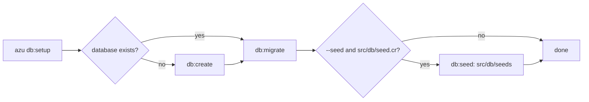

# Database commands

The `db:*` commands manage the database of a CQL project: create it, run and roll back migrations, reset it, seed it and show migration status. They take the connection from `DATABASE_URL` or the `AZU_DB_*` variables, and the environment from `AZU_ENV` or `CRYSTAL_ENV`.

## Overview & visual demo

Run `db:migrate` after you add a migration, `db:status` to see what is pending, and `db:rollback` to undo a step. Destructive commands ask first; `--force` skips the question, so use it on purpose.

<figure><figcaption><p><code>azu db:migrate</code> on a color terminal: the card names the database, the migration it applied and the time. A warning from the app prints below the card.</p></figcaption></figure>



## Quickstart & command syntax

```bash
azu db:create
azu db:migrate
azu db:status
azu db:rollback --steps 2
azu db:reset --force --seed
azu db:seed
```

### Connection settings

The first of these that is set wins:

| Source                                                       | Used for                                            |
| ------------------------------------------------------------ | --------------------------------------------------- |
| `DATABASE_URL`                                               | The whole connection. Its path is the database name |
| `AZU_DATABASE_URL`                                           | The same, when `DATABASE_URL` is not set            |
| `AZU_DB_HOST`, `AZU_DB_PORT`, `AZU_DB_USER`, `AZU_DB_PASSWORD`, `AZU_DB_NAME` | The parts, when no URL is set. `DATABASE_NAME`, `DATABASE_USER` and `DATABASE_PASSWORD` are read as fallbacks |
| `AZU_DB_ADAPTER`                                             | The adapter. Without it, the driver in `shard.yml` decides (`pg`, then `sqlite3` or `mysql`) |
| `AZU_DB_POOL_SIZE`, `AZU_DB_POOL_TIMEOUT`, `AZU_DB_CHECKOUT_TIMEOUT` | Pool size (10) and timeouts in seconds (5)   |

Without a name, the database is `<project>_<environment>`, from the name of the current directory. The environment is `AZU_ENV`, then `CRYSTAL_ENV`, then `development`. Before the command starts, the CLI loads the project's `.env` files for that environment; see [environment files](../configuration/environment.md). A variable already set in the shell wins over them.

### azu db:create

```bash
azu db:create
azu db:create --database blog_test
azu db:create --force                 # drop an existing database first
```

| Option                  | Short | Meaning                                                  | Default   |
| ----------------------- | ----- | -------------------------------------------------------- | --------- |
| `--database NAME`       | `-d`  | Create this database instead of the configured one       | configured name |
| `--force`               | `-f`  | Drop the database first when it exists                   | off       |
| `--env ENV`             | `-e`  | Load `.env.ENV` and use that environment's name          | environment |

Without `--force`, an existing database is an error (exit `1`). On PostgreSQL and MySQL it runs `CREATE DATABASE`. On SQLite it creates the file and its directory.

### azu db:drop

```bash
azu db:drop
azu db:drop --force
```

| Option            | Short | Meaning                                  | Default |
| ----------------- | ----- | ---------------------------------------- | ------- |
| `--database NAME` | `-d`  | Drop this database instead               | configured name |
| `--force`         | `-f`  | Do not ask first                         | off     |
| `--env ENV`       | `-e`  | As for `db:create`                       | environment |

It asks `Are you sure you want to drop database '<name>'? [y/N]:` unless `--force` is set. On PostgreSQL it ends the other connections first. On SQLite it deletes the file.

### azu db:migrate

```bash
azu db:migrate
azu db:migrate --steps 1
azu db:migrate --version 20261023111721
azu db:migrate --dry-run
```

| Option              | Short | Meaning                                                              | Default     |
| ------------------- | ----- | -------------------------------------------------------------------- | ----------- |
| `--steps N`         | `-s`  | Apply the next `N` pending migrations                                | all pending |
| `--version N`       | `-v`  | Migrate up to version `N` (CQL's `up_to`)                            | all pending |
| `--dry-run`         |       | List what would run. Writes nothing, creates no SQLite file          | off         |
| `--test-rollback`   |       | Test the rollback of the latest applied migration, instead of migrating | off      |
| `--skip-validation` |       | Skip the migration checks that run first                             | off         |
| `--verbose`         |       | Show the database details                                            | off         |
| `--env ENV`         | `-e`  | As for `db:create`                                                   | environment |

Before it runs anything, it validates the migration files; an error stops the run unless `--skip-validation` is set. For SQLite, a missing file is created. For PostgreSQL or MySQL the database must exist. The migrations are the `.cr` files in `src/db/migrations/`. CQL's migrator keeps `src/db/schema.cr` up to date.

### azu db:rollback

```bash
azu db:rollback
azu db:rollback --steps 3
azu db:rollback --version 20261023111721
azu db:rollback --dry-run
```

| Option        | Short | Meaning                                                              | Default |
| ------------- | ----- | -------------------------------------------------------------------- | ------- |
| `--steps N`   | `-s`  | Roll back the last `N` applied migrations                            | `1`     |
| `--version N` | `-v`  | Roll back every applied migration at or after version `N`            | off     |
| `--dry-run`   |       | List what would be rolled back. Writes nothing                       | off     |
| `--force`     | `-f`  | Skip the warning and the question                                    | off     |
| `--verbose`   |       | Show the database details                                            | off     |
| `--env ENV`   | `-e`  | As for `db:create`                                                   | environment |

Without `--force` it lists the migrations, warns about data loss, and asks `Are you sure you want to continue? [y/N]:`.

### azu db:reset

```bash
azu db:reset
azu db:reset --force --seed
```

| Option      | Short | Meaning                                                            | Default |
| ----------- | ----- | ------------------------------------------------------------------ | ------- |
| `--force`   | `-f`  | Do not ask first                                                   | off     |
| `--seed`    |       | Seed after the migrations, when `src/db/seed.cr` exists            | on      |
| `--no-seed` |       | Do not seed                                                        | off     |
| `--env ENV` | `-e`  | As for `db:create`                                                 | environment |

It drops the database if it exists, creates it, runs every migration and then seeds it, unless `--no-seed` is given or there is no `src/db/seed.cr`.

### azu db:setup

```bash
azu db:setup
azu db:setup --seed
```

| Option      | Meaning                                                                  | Default |
| ----------- | ------------------------------------------------------------------------ | ------- |
| `--seed`    | Seed after the migrations                                                | off     |
| `--no-seed` | Do not seed                                                              | off     |
| `--env ENV` | As for `db:create`                                                       | environment |

It creates the database when it is missing, then migrates. With `--seed` it runs `db:seed`, but only when `src/db/seed.cr` exists. A seed failure does not fail the setup.

### azu db:seed

```bash
azu db:seed
azu db:seed --list
azu db:seed --status
azu db:seed --file src/db/seeds/development/001_users.cr
azu db:seed --only users,posts
```

| Option          | Short | Meaning                                                              | Default |
| --------------- | ----- | -------------------------------------------------------------------- | ------- |
| `--file PATH`   | `-f`  | Run one seed file, which must be inside the project                  | off     |
| `--only A,B`    |       | Run the named seeds from the seed directories                        | off     |
| `--list`        |       | List the seed files for the environment                              | off     |
| `--status`      |       | Show which seeds have run                                            | off     |
| `--force`       |       | With `--file`, run it even when it has run before                    | off     |
| `--verbose`     |       | Show the database details                                            | off     |
| `--env ENV`     | `-e`  | As for `db:create`                                                   | environment |

Without options it runs `src/db/seeds/<environment>/*.cr`, then `src/db/seeds/shared/*.cr`, each in name order. Each seed is recorded when it runs, and a recorded seed is skipped the next time.

### azu db:status

```bash
azu db:status
```

Lists every migration with its version, name and applied time, or `pending`. On a color terminal it draws a card with the database in the title. Elsewhere it prints a plain table with the same columns and a `Total:` line. It takes only `--env`.

<details>

<summary>Other db:* commands</summary>

| Command                    | Does                                                    | Options                                                                  |
| -------------------------- | ------------------------------------------------------- | ------------------------------------------------------------------------ |
| `azu db:schema:load`       | Load schema from file                                   | `--file PATH` (`-f`), `--force`, `--env` (`-e`)                          |
| `azu db:data:migrate`      | Run pending data migrations                             | `--version N` (`-v`), `--steps N` (`-s`), `--verbose`, `--dry-run`, `--env` (`-e`) |
| `azu db:migrations:verify` | Verify all migrations can be applied and rolled back    | `--no-rollback`, `--verbose`, `--env` (`-e`)                             |
| `azu db:validate`          | Validate database configuration and connectivity        | `--no-connection`, `--no-permissions`, `--no-migrations`, `--env` (`-e`) |

</details>

To write a migration, use [`azu generate migration`](../generators/migration.md). For the connection settings in full, see [database configuration](../configuration/database-config.md).

## Realistic output


```text
Are you sure you want to drop database 'blog_development'? [y/N]: 
```


*The question waits on the same line. An answer that starts with `y` goes ahead; anything else cancels. The name is the one the command resolved.*


```text
Are you sure you want to continue? [y/N]: 
```


*Printed after the list of migrations to be rolled back and a data-loss warning.*


```text
Are you sure you want to reset database 'blog_development'? All data will be lost. [y/N]: 
```


*The reset drops the database before it recreates it, so answer `N` if you are not sure which database this is.*

## Do's and don'ts


**Pro tip:** `azu db:rollback --dry-run` lists the migrations it would roll back. Read the list before you confirm the real run.



Run `azu db:status` after `azu db:migrate` in a deploy script. It shows which migrations applied and which are still pending.



On PostgreSQL and MySQL, `db:migrate` does not create the database. Run `azu db:create` first, or use `azu db:setup`. SQLite creates its file on first use.



`--env test` loads `.env.test`, but it does not replace a `DATABASE_URL` that is already set in your shell. Unset the variable or use `--env` on a clean shell.



`--database` exists only on `db:create` and `db:drop`. The other commands use `DATABASE_URL`, the `AZU_DB_*` variables, or the inferred name.



Don't run `azu db:reset --force` against a database with data you need. It drops the database, and `--force` skips the question that would have stopped you.

