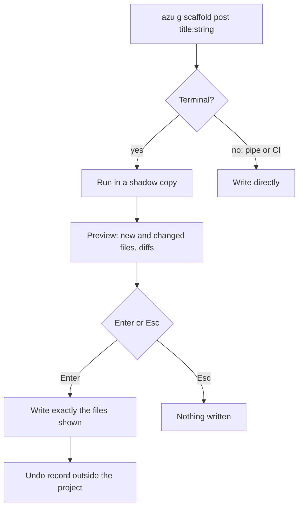

# azu generate

## Overview & visual demo

`azu generate` (alias `azu g`) renders templates into your project in the Azu contract style. On a terminal it runs in a scratch copy first, lists every file it would create or change with its diff, type-checks the result, and writes only when you press Enter. Every write keeps an undo record, so `azu undo` can revert it (the details are in the preview section below). The concise version is [azu generate](../command-reference/azu-generate.md).

<figure><figcaption><p><code>azu g scaffold comment</code>: 28 new files and 1 changed. The right pane is the diff of <code>src/db/schema.cr</code>, and the footer says the project type-checks with these files.</p></figcaption></figure>



## Quickstart & command syntax

```bash
azu g model User name:string email:string:unique age:int32?
azu g endpoint posts index show create
azu g scaffold Post title:string body:text published:bool
azu g migration add_slug_to_posts slug:string:index
azu g job send_welcome user_id:int64
```



On a terminal, the default. The file list and diffs appear before anything is written.

```bash
azu g scaffold post title:string
```



Lists the files and diffs and writes nothing, on a terminal or in CI.

```bash
azu g scaffold post title:string --dry-run
```



Writes the files, type-checks the project, and writes nothing if it does not compile.

```bash
azu g scaffold post title:string --check
```



```bash
azu undo --list      # the undo records, newest first
azu undo --dry-run   # what the last generate would revert
azu undo             # revert it
```



Options, for every generator:

| Option | Meaning | Default |
| --- | --- | --- |
| `--force` | Overwrite existing files | off |
| `--dry-run` | List the files and diffs, write nothing | off |
| `--check` | Type-check with the generated files; write nothing if it does not compile | off |
| `--yes` | Write without asking (on a terminal the preview still shows) | off |
| `--ui MODE` | `rich` (the preview) or `plain` | `rich` on a terminal |
| `--skip-tests` | `model`: do not generate the migration | off |
| `--skip COMPONENTS` | `scaffold`: comma-separated components to leave out (`model`, `endpoint`, `request`, `response`, `template`, `migration`, `page`, `service`) | none |
| `--api-only`, `--web-only` | Generate API components (JSON responses) or web components (HTML pages) | detected from the project |
| `--type TYPE` | Generator-specific: `middleware` type, `validator` kind | none |
| `--record RECORD` | `validator`: the model the validator is for | none |
| `--strategy STRATEGY` | `auth`: the authentication strategy (`session` is the one listed) | none |
| `--help` | Show the generator help | |

The generator type is the first argument. Attributes follow the name as `name:type`. Arguments without a colon are actions for endpoints, services and requests.

### Generator types

| Type | Arguments | Writes |
| --- | --- | --- |
| `model` | `<name> [attr:type]` | `src/models/<singular>.cr`, and a migration unless `--skip-tests` |
| `endpoint` | `<name> [actions]` | `src/endpoints/<plural>/<action>_endpoint.cr`. Actions: `index show new create edit update destroy`; the default is `index show create update destroy` |
| `request` | `<name> [action] [attr:type]` | `src/requests/<plural>/<action>_request.cr` |
| `page` | `<name> [attr:type]` | `src/pages/<plural>/<action>_page.cr` for `index show new edit` |
| `template` | `<name> [attr:type]` | `public/templates/<app>/<plural>/<action>_page.jinja` |
| `service` | `<name> [actions]` | `src/services/<plural>/<action>_service.cr` for `create update destroy` |
| `response` | `<name> [attr:type]` | `src/responses/` (API responses) |
| `scaffold` | `<name> [attr:type]` | all of the above and the migration, for web or API |
| `migration` | `<name> [attr:type]` | `src/db/migrations/<version>_<name>.cr` |
| `data:migration` | `<name>` | `src/db/data_migrations/` |
| `seed` | `<name>` | `src/db/seeds/<environment>/` |
| `component` | `<name> [attr:type]` | `src/components/` |
| `validator` | `<name> [--record MODEL]` | `src/validators/` |
| `middleware` | `<name> [--type TYPE]` | `src/middleware/` |
| `job` | `<name> [param:type]` | `src/jobs/` |
| `channel` | `<name>` | `src/channels/<name>_channel.cr`, a WebSocket served at `/<name>` |
| `mailer` | `<name> [methods]` | a mailer class |
| `auth` | none | sign up, sign in, sign out and a protected page (web, session cookie) |
| `api_resource` | `<name> [attr:type]` | a REST resource for an API project |
| `joobq` | none | the JoobQ setup |
| `validate` | none | checks the Jinja template syntax of the project |

`contract` still runs but warns that it is deprecated: use `request`.

## Realistic output


```text
  + public/templates/demo_app/comments/edit_page.jinja    10 lines
  + public/templates/demo_app/comments/index_page.jinja   31 lines
  + public/templates/demo_app/comments/new_page.jinja      9 lines
  + public/templates/demo_app/comments/show_page.jinja    24 lines
  + src/db/migrations/20261027160519_create_comments.cr   20 lines
  ~ src/db/schema.cr  changed
  + src/endpoints/comments/create_endpoint.cr             12 lines
  + src/endpoints/comments/destroy_endpoint.cr            13 lines
  + src/models/comment.cr                                 14 lines
  + src/pages/comments/index_page.cr                      13 lines
  + src/requests/comments/create_request.cr               10 lines
  + src/services/comments/update_service.cr               10 lines

  ▸ azu undo reverts these files (those you have not edited since)
```


*The end of the file list for a scaffold, as the card shows it. Files are listed with their line counts; the changed `src/db/schema.cr` is listed with `changed`.*


```text
Undid: azu generate scaffold comment body:text post_id:int64        2026-10-27T16:05:35Z
  ✔ delete   public/templates/demo_app/comments/_form.jinja
  ✔ delete   public/templates/demo_app/comments/edit_page.jinja
  ✔ delete   src/db/migrations/20261027160519_create_comments.cr
  ✔ restore  src/db/schema.cr
  ✔ delete   src/endpoints/comments/create_endpoint.cr
  ✔ delete   src/models/comment.cr
  ✔ delete   src/services/comments/update_service.cr
```


*Created files are deleted and the changed file is restored. The list is cut short here; the card shows every file. A file you edited since the generate is left alone and listed.*

## Do's and don'ts


**Pro tip:** `--dry-run` writes nothing and prints the files and diffs. Use it to review a scaffold before a PR, or to see what a generator would touch in a project you do not know.



Run `--check` before you commit a large scaffold, or in CI. Nothing is written when the project would not compile.



Through a pipe or in CI, `azu generate` writes directly with no preview. Add `--dry-run` or `--check` there if you want to see the plan first.



`--force` overwrites existing files without asking. `azu undo` restores what the generator changed, but a file you edited since is left alone and listed.


<details>

<summary>Attributes and field types</summary>

Format: `name[?][:type][:modifier...]`, where `?` after the name or type makes the column nullable.

| Part | Accepted |
| --- | --- |
| Field names | Lowercase letters, digits and underscores, not starting with a digit. Crystal keywords and model methods are refused. `id`, `created_at` and `updated_at` are provided by the model, so the generator leaves them out with a warning |
| Types (scaffold checks these) | `string`, `text`, `int32`, `int64`, `float32`, `float64`, `bool`, `time`, `date`, `json`, `uuid`; the aliases `integer`, `float`, `boolean`, `datetime`, `email`, `url`, `references`, `belongs_to` |
| Nullable | `age:int32?` |
| Modifiers | `unique`, `index`, `required`. Columns are NOT NULL unless the type ends in `?`, so `required` is the default |
| References | `user_id:int64:ref:users` adds a foreign key; `user_id:references` takes the table name from the column (`users`) |

Other generators accept the same `name:type` syntax. The scaffold is the one that checks types against the list above before it writes anything.

</details>

<details>

<summary>Preview, menu and undo</summary>

On a terminal, `azu generate` shows what it is about to do before it does it:

1. The generator runs in a copy of the project in the temp directory. `lib/` is linked; `bin/`, `.git/`, `node_modules/`, `tmp/`, `log/`, `.crystal/`, `.shards/` and database files (`*.db`, `*.sqlite3`) are left out.
2. A file list shows every file it would create (`+`) and change (`~`), with the selected file or its diff on the right. Meanwhile the copy is type-checked with `crystal build --no-codegen`, and the result shows under the list.
3. Enter writes exactly the files shown, each through a temporary file and a rename. Esc writes nothing.

`azu generate` with no arguments opens a menu on a terminal (the generator, then its name and fields, then the same preview). Without a terminal it prints the help.

Every write through the preview keeps an undo record in `$XDG_STATE_HOME/azu` (default `~/.local/state/azu`), outside the project. `azu undo` reverts the most recent one: it deletes the files it created and puts back the files it changed. `azu undo --list` lists the records, `azu undo --dry-run` shows what it would do, and `azu undo --help` shows the options.

</details>

<details>

<summary>Naming and output layout</summary>

For a model `Post` in the project `blog`, the layers share one scheme:

- model: `class Post`, in `src/models/post.cr`
- web layers: `Blog::Posts::<Action><Layer>`, in `src/<layer>s/posts/<action>_<layer>.cr`
- templates: `public/templates/blog/posts/<action>_page.jinja`, where the page looks for them

Names must be valid Crystal identifiers. The generator refuses a resource name that is a reserved word or that clashes with a constant of Azu or CQL (`Status`, `Request`, `Response` and others), and it refuses a second `create_*` migration whose class already exists.

The generator detects an API project and switches to API components (JSON responses, no `new` or `edit`). `--web-only` overrides that.

</details>

<details>

<summary>Troubleshooting</summary>

- **`Unknown generator type: x`**: check the type against the table above. `azu g` with no arguments prints the help.
- **`Invalid field name`** or **`Duplicate field name`**: the attribute is wrong. Field names are lowercase, and each name appears once.
- **`Unsupported action`**: the endpoint, service, request or page does not have that action. The message lists the supported ones.
- **A file you want to replace**: `--force` overwrites it. `--dry-run` shows first whether the file would change (`~`).

</details>
