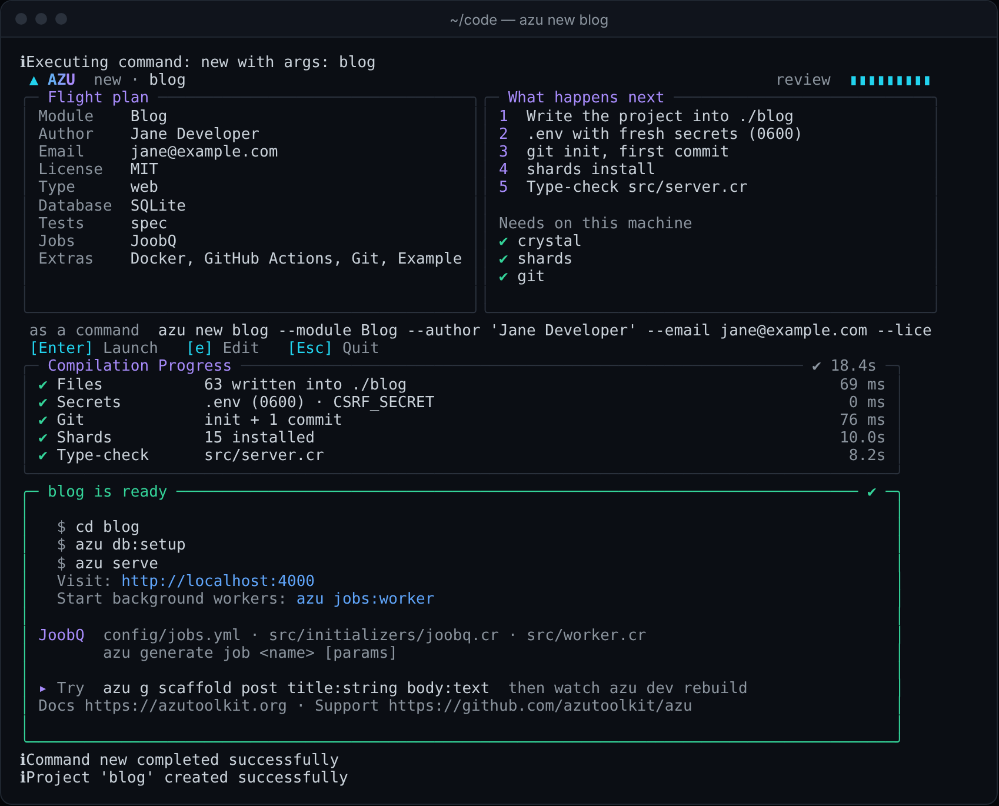
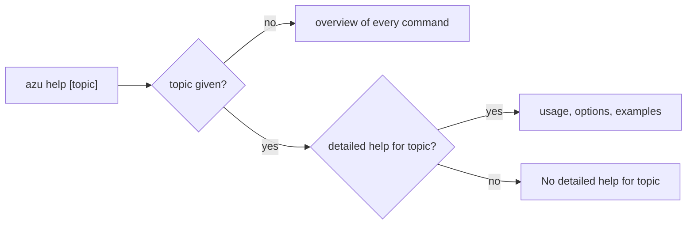

# azu help

`azu help` prints the list of commands. `azu help <topic>` prints the usage, options and examples for one command or group, and says so when a topic has no detailed help.

## Overview & visual demo

Use it to find a command you half remember, or the flags of one you do not. The output is plain text from the CLI itself, so it matches the build you have installed.

<figure><figcaption><p>Not <code>azu help</code>'s output. This is the ready card <code>azu new</code> ends with, listing the next commands. <code>azu help</code> prints plain text.</p></figcaption></figure>



## Quickstart & command syntax

```bash
azu help
azu help test
azu help db
azu help generate
```

| Argument    | Meaning                                                                                                      | Default  |
| ----------- | ------------------------------------------------------------------------------------------------------------ | -------- |
| `[command]` | A detailed-help topic: `new`, `generate` (or `g`), `db`, `dev`, `routes`, `console`, `doctor`, `serve` (or `s`), `test` (or `t`), `jobs`, `session` | the overview |

`azu` with no arguments prints the overview too. Any other topic prints `No detailed help for: <topic>` and points you back to `azu help`. That covers, for example, `openapi`, `config`, `completion` and `version`. For those, use the command's own `--help`, such as `azu config:show --help` or `azu openapi:export --help`.

## Realistic output


```text
Usage: azu test [files] [options]

Run application tests with Crystal spec.

Options:
  --watch, -w              Run tests in watch mode
  --coverage, -c           Enable coverage reporting
  --verbose, -v            Enable verbose output
  --parallel, -p           Run tests in parallel
  --filter, -f <pattern>   Run examples matching pattern

Examples:
  azu test
  azu test spec/models/
  azu test --watch
  azu test --filter User
```


*The detailed help for `test`, printed as written in the command. Its `--coverage` line describes a flag that only prints a warning; see [azu test](test.md).*


```text
Azu CLI - Crystal web framework command line tool
Version: 0.1.46

Usage: azu <command> [options] [arguments]

Project Commands:
  new <project-name>     Create a new Azu project
  init                   Initialize Azu in existing project
...
```


*The overview runs on through the database, development, job, session, OpenAPI, configuration and other groups.*

## Do's and don'ts


**Pro tip:** search the overview for a name instead of scrolling: `azu help | grep jobs:`.



Use the topic that matches the group, such as `azu help db` or `azu help jobs`. Each one lists the commands of its group and their main options on one screen.



Not every command has a topic. `azu help openapi` prints `No detailed help for: openapi`. The command's own `--help` is the reference: `azu openapi:export --help`.



`azu --help` and `azu --version` are not understood. They exit with `Unknown command` and code `1`. Use `azu help` and `azu version`.

