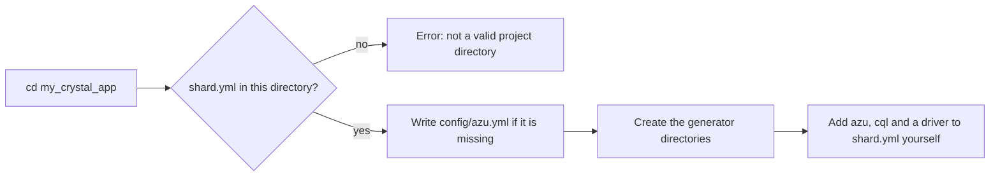

# azu init

## Overview & visual demo

`azu init` turns an existing Crystal project, one with a `shard.yml` in the current directory, into one the Azu CLI can work in. It writes `config/azu.yml` if it is missing and creates the directories the generators write to. It writes no application code and does not touch `shard.yml`. To start a project from scratch, use [azu new](new.md).

<figure><figcaption><p>The progress card of <code>azu new</code>. <code>azu init</code> has no card: it prints the plain lines shown under Realistic output.</p></figcaption></figure>



## Quickstart & command syntax

```bash
cd my_crystal_app
azu init
```

Then add the dependencies the generated code uses. `azu init` does not do this for you:


```yaml
dependencies:
  azu:
    github: azutoolkit/azu
    version: ~> 0.10.1
  cql:
    github: azutoolkit/cql
    version: 0.0.604
  sqlite3:
    github: crystal-lang/crystal-sqlite3
    version: ~> 0.24.0
```


`azu init` takes no options. It looks for `shard.yml` in the current directory only.

## Realistic output


```text
[hh:mm:ss] [INFO ] Initializing Azu in current project...
[hh:mm:ss] [INFO ] Creating Azu configuration...
[hh:mm:ss] [INFO ] Created config/azu.yml
[hh:mm:ss] [INFO ] Creating project structure...
[hh:mm:ss] [INFO ] Azu initialized successfully!
```


*Log lines as the logger writes them outside a terminal; `hh:mm:ss` is the time, and the emoji on the last line is left out.*


```text
ERROR: Not in a valid Crystal project directory. Run this command from your project root.
```


*Nothing is written without a `shard.yml`; the exit code is 1.*

## Do's and don'ts


**Pro tip:** run `azu init` from the project root, the directory that holds `shard.yml`. The command does not search upwards.



Commit `config/azu.yml`. `azu init` never overwrites an existing one, so your edits survive a second run.



`azu init` does not add `azu`, `cql` or a database driver to `shard.yml`. Add them yourself, or the generated code has nothing to build against.



Don't expect `azu init` to scaffold an app. It creates empty directories and a config file. Use [azu new](new.md) for a project that runs.


<details>

<summary>What it creates</summary>

`config/azu.yml`, unless it exists. The file holds the CLI settings: the project name and type, the database (the default adapter in the file is PostgreSQL, so edit it for your project), the server host and port (`localhost`, port 4000), the generator paths and a `plugins` map. The CLI reads it first from `./config/azu.yml`, then `./azu.yml`, `~/.config/azu/config.yml` and `~/.azu.yml`.

These directories, created if missing:

- `src/models`, `src/endpoints`, `src/services`, `src/pages`, `src/middleware`, `src/validators`, `src/channels`, `src/handlers`, `src/requests`, `src/responses`, `src/components`
- `src/db/migrations`
- `spec/models`, `spec/endpoints`, `spec/services`
- `public/templates`, `public/assets`

</details>
