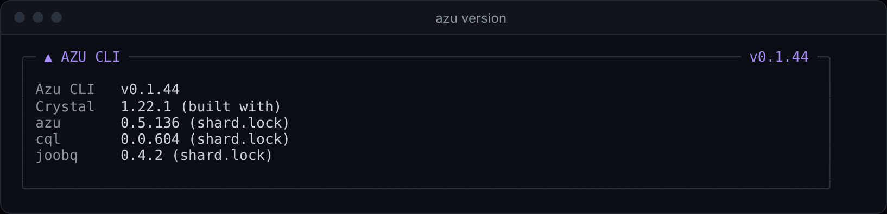
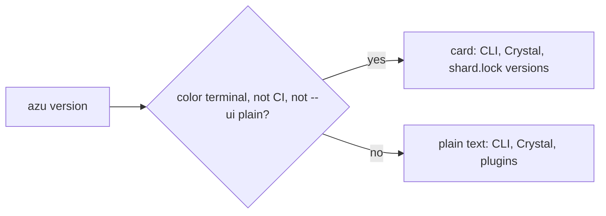

# azu version

`azu version` prints the version of the CLI, the Crystal the binary was built with and the built-in plugins. Inside a project it also reads `shard.lock` and shows the `azu`, `cql` and `joobq` versions the project uses.

## Overview & visual demo

Put its output in a bug report: the CLI version and the locked framework versions are the two things a maintainer asks for first. On a color terminal it draws a card; `--ui plain` gives the text.

<figure><figcaption><p><code>azu version</code> in a project, from an older build (v0.1.44). The three lines under the CLI and Crystal come from the project's <code>shard.lock</code>.</p></figcaption></figure>



## Quickstart & command syntax

```bash
azu version
azu version --ui plain
```

| Option      | Meaning                                    | Default                               |
| ----------- | ------------------------------------------ | ------------------------------------- |
| `--ui MODE` | `rich` (the card) or `plain` (the text)    | `rich` on a color terminal outside CI |

The command takes no other options. `azu --version` is not understood; it exits with `Unknown command`. The version of the CLI is the `version` in the `shard.yml` it was built from.

## Realistic output


```text
Azu CLI v0.1.46
Crystal 1.22.1
Topia CLI Framework

Plugins:
  - Generator Plugin v1.0.0
  - Database Plugin v1.0.0
  - Development Plugin v1.0.0
```


*The plain form. `Crystal` is the version the binary was built with (the repository pins 1.22.1). The plugin list is fixed text.*

## Do's and don'ts


**Pro tip:** `azu version --ui plain` is the form to paste into an issue or a CI log, because it has no box characters to clean up.



Quote the `azu`, `cql` and `joobq` lines when you report a problem. They are the versions the project's `shard.lock` resolves, which is what actually ran.



The locked versions come from `shard.lock` in the current directory. Run the command in the project root, or those lines are missing.



Don't read the plugin list as the set of installed extensions. The three plugins are the CLI's own internal hooks, and the list is fixed text.

