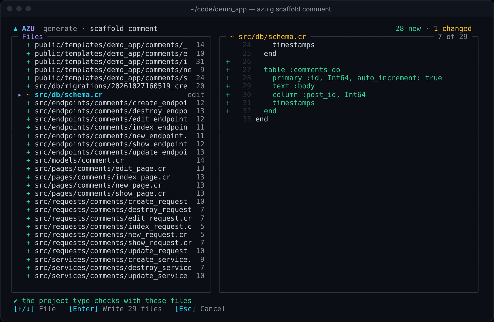
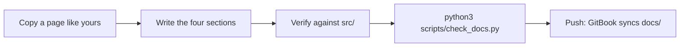
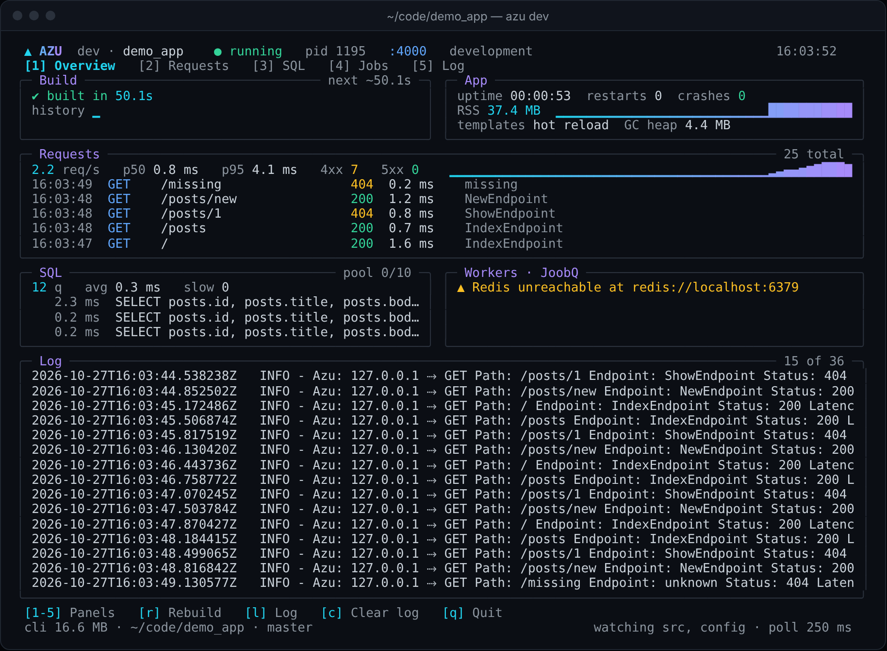

# Writing documentation

Every page in `docs/` follows one layout and one tone, and `scripts/check_docs.py` enforces what a script can enforce.
Read this once, copy a page that's close to yours, and run the checker before you push.

## Overview & visual demo

<figure><figcaption><p>Show the real tool. Screenshots in <code>docs/assets/terminal-ui</code> beat any description of them.</p></figcaption></figure>



**Tone:** an expert peer. Direct, concise, a little casual, no filler. Prefer a command, a table or a screenshot to a paragraph.

## Quickstart & command syntax

Run the checker, then preview in GitBook:

```bash
python3 scripts/check_docs.py                       # every page
python3 scripts/check_docs.py docs/commands/new.md  # one page
```

**The four sections**, in this order, as `##` headings:

| # | Heading                                  | Holds                                                                          |
| - | ---------------------------------------- | ------------------------------------------------------------------------------ |
| 1 | `Overview & visual demo`                 | 2-3 sentences, one screenshot from `docs/assets`, one Mermaid diagram          |
| 2 | `Quickstart & command syntax`            | Pasteable commands, then a table of flags, arguments and defaults              |
| 3 | `Realistic output`                       | Exact terminal output, with a one-line italic caption under each block         |
| 4 | `Do's and don'ts`                        | `hint` blocks: info, success, warning, danger                                  |

Start each page with front matter, then an H1:

```markdown
---
description: One sentence, shown under the title in GitBook and in search results.
---

# azu example
```

**GitBook blocks**, copy exactly:



```markdown

Pro tip or shortcut.

```

| Style     | Use it for                       |
| --------- | -------------------------------- |
| `info`    | Pro tips and shortcuts           |
| `success` | Recommended practice             |
| `warning` | Caveats and breaking changes     |
| `danger`  | Anti-patterns and failure modes  |



```markdown


Content.



Content.


```



````markdown

```crystal
class Post
end
```

````

Always give the fence a language: `bash`, `crystal`, `yaml`, `json`, `text`.



```markdown
<figure><figcaption><p>What to look at.</p></figcaption></figure>
```



```markdown
<details>

<summary>Troubleshooting</summary>

Deep-dive content.

</details>
```
GitBook has no `` block; the accordion is HTML `<details>`.



**Screenshots** available in `docs/assets/terminal-ui/` (paths are relative to the page):

| File                         | Shows                                                  | Use on                         |
| ---------------------------- | ------------------------------------------------------ | ------------------------------ |
| `01-new-wizard-type.png`     | Wizard, type step                                      | new, project types             |
| `02-new-wizard-extras.png`   | Wizard, extras toggles                                 | new, Docker, CI                |
| `03-new-review.png`          | Flight plan and the equivalent command                 | new                            |
| `04-new-progress.png`        | Progress card with a spinner                           | new, UI, lifecycle             |
| `05-new-done.png`            | Finished project and next steps                        | new, quickstart, landing       |
| `06-dev-building.png`        | `azu dev`, first build                                 | dev                            |
| `07-dev-dashboard.png`       | `azu dev` dashboard                                    | dev, jobs, logging             |
| `08-dev-sql.png`             | SQL panel                                              | dev, database                  |
| `09-dev-build-failed.png`    | Failed build card                                      | dev, troubleshooting           |
| `10-generate-menu.png`       | Generator menu                                         | any generator                  |
| `11-generate-preview.png`    | File list and diff                                     | any generator, scaffold        |
| `12-generate-written.png`    | Files written                                          | any generator                  |
| `13-undo.png`                | `azu undo`                                             | generators, troubleshooting    |
| `14-doctor.png`              | `azu doctor`                                           | doctor, config, production     |
| `15-routes.png`              | `azu routes`                                           | routes, endpoints              |
| `17-db-migrate.png`          | `azu db:migrate`                                       | database, migrations           |
| `18-version.png`             | `azu version`                                          | install, version               |
| `landing-page/*.png`         | The welcome page of a generated app                    | quickstart                     |

`16-db-status.png` is a blank frame; don't use it.

## Realistic output

A good output block has a title, the exact text and a caption:


```text
ok    crystal        Crystal 1.22.1 (the project needs 1.22.1 or newer)
warn  database       SQLite file ./db/blog_development.db does not exist yet
                     hint: run 'azu db:setup'
```


*A warning prints its hint on the next line. The exit code stays 0.*

If you can't run the command, don't invent its output. Quote the output from the source or an existing page, or leave the block out.

## Do's and don'ts


Check every flag, default and path against `src/` before you write it. `azu help` and `CLI_REFERENCE.md` list what exists.



**Pro tip:** the checker also fails a page that shows `azu <command>` for a command that isn't registered in `CLI#setup_commands`.



Relative links only (`../commands/new.md`), and every page must be listed in `SUMMARY.md`, or GitBook hides it.



Don't document a flag or command that isn't registered, don't invent terminal output, and don't paste secrets, tokens or real passwords.


<details>

<summary>Publishing to GitBook</summary>

The repository holds a `.gitbook.yaml` that points GitBook at `docs/`, with `README.md` as the landing page and
`SUMMARY.md` as the table of contents. Connect the space through GitBook's GitHub sync. Mermaid diagrams need GitBook's
Mermaid integration enabled in the space; without it they show as code.

Page order and nesting come only from `SUMMARY.md`.

</details>
