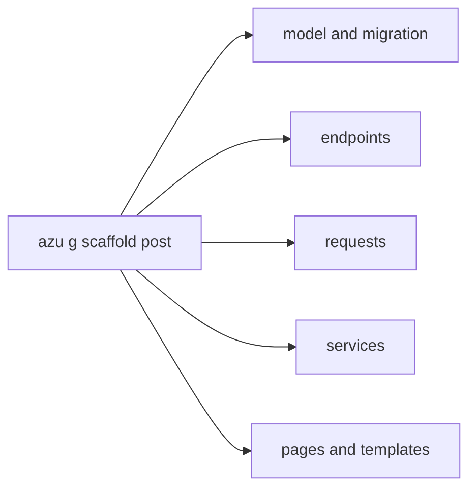

# Generators

`azu g` (or `azu generate`) writes the files for one layer of an Azu app: models and migrations, endpoints, requests, services, pages and middleware. Every file follows the Azu contract style, so the layers agree on names and types. Each generator has its own page below. This one shows how they fit together.

## Overview & visual demo

Generators create focused, editable building blocks for an Azu application. Start with a scaffold for a complete feature, or choose individual generators when you want tighter control over the structure.

<figure><figcaption><p><code>azu g</code> with no arguments opens this menu. Pick a generator, then give it a name and attributes. On a terminal you see the files before anything is written.</p></figcaption></figure>



## Quickstart & command syntax

Each generator takes a name, then `name:type[:modifier]` attributes where it needs columns.

```bash
azu g model post title:string body:text published:bool
azu g endpoint posts index show create update destroy
azu g request post create title:string body:text
azu g service post create update destroy title:string body:text
azu g page post index title:string body:text
azu g middleware Authentication
```



```bash
azu g model post title:string body:text published:bool   # the model, then its migration
azu g request post create title:string body:text          # one request contract
```



```bash
azu g scaffold post title:string body:text published:bool   # model, endpoints, requests, services, pages, templates
```



```bash
azu g scaffold post title:string body:text --dry-run         # the file list and diffs, nothing written
```



| Generator    | Writes                                                                  | Page                                 |
| ------------ | ----------------------------------------------------------------------- | ------------------------------------ |
| `model`      | A CQL model and its create-table migration                              | [model](model.md)                    |
| `endpoint`   | One `Azu::Endpoint` per action                                          | [endpoint](endpoint.md)              |
| `request`    | One `Azu::Request` per action                                           | [request](request.md)                |
| `service`    | One service class per write action                                      | [service](service.md)                |
| `page`       | A page class and its Jinja template, or a JSON response in API mode     | [page](page.md)                      |
| `middleware` | An `HTTP::Handler` skeleton                                             | [middleware](middleware.md)          |
| `scaffold`   | All of the above for one resource                                       | [scaffold](scaffold.md)              |
| `migration`  | A migration for a schema change                                         | [migration](migration.md)            |
| `component`, `validator`, `channel`, `mailer`, `joobq`, `auth`, `api_resource`, `data:migration` | See each page | [component](component.md), [custom validator](custom-validator.md), [channel](channel.md), [mailer](mailer.md), [JoobQ](joobq.md), [auth](auth.md), [API resource](api-resource.md), [data migration](data-migration.md) |

Flags every generator takes:

| Flag        | Meaning                                                                 | Default                         |
| ----------- | ----------------------------------------------------------------------- | ------------------------------- |
| `--dry-run` | List the files and diffs, write nothing                                 | off                             |
| `--check`   | Type-check with the new files; write nothing if it doesn't compile      | off                             |
| `--yes`     | Write without asking (the plan is still printed on a terminal)          | off                             |
| `--force`   | Overwrite existing files without asking                                 | off                             |
| `--api-only` / `--web-only` | Pick the API or web variant where a generator has one     | from the project type           |

Names are singular or plural (`post` and `posts` both work). Attribute types are `string`, `text`, `int32`, `int64`, `float64`, `bool`, `time`, `uuid` and a few more; the [model](model.md) page has the full list.

### Application boundaries and validation

Generated endpoints handle HTTP contracts, delegate writes to services, and render response/page objects. Services own use-case logic; CQL models own persistence mapping. Initializers compose handlers, stores and transport adapters. Mailers compose messages and background jobs schedule delivery. Keep business rules in the service layer so web and API endpoints can share them.

Web applications load both pages and API responses, allowing `api_resource` alongside HTML scaffolds. Seed files use the same rendering pipeline as other generators and accept `--env`; component date properties use Crystal's `Time` type.

`scripts/check_generators.sh web` and `scripts/check_generators.sh api` generate every public code-generator family in isolated SQLite projects, also import OpenAPI contracts, compile the server and worker, and execute mailer, delivery-job, validator and component contracts. The existing `scripts/e2e_generated_app.sh` covers boot, HTTP CRUD, authentication, WebSockets, migrations and optional Redis job execution. Hosted releases require both jobs and the CLI suite. These gates exercise supported examples; generated domain-specific method bodies still need application tests.

## Realistic output

Each generator writes to the same place for a resource. With `post` in a `blog` project, the files from the Quickstart are:


```text
src/models/post.cr
src/db/migrations/<version>_create_posts.cr
src/endpoints/posts/index_endpoint.cr
src/endpoints/posts/show_endpoint.cr
src/endpoints/posts/create_endpoint.cr
src/endpoints/posts/update_endpoint.cr
src/endpoints/posts/destroy_endpoint.cr
src/requests/posts/create_request.cr
src/services/posts/create_service.cr
src/services/posts/update_service.cr
src/services/posts/destroy_service.cr
src/pages/posts/index_page.cr
public/templates/blog/posts/index_page.jinja
src/middleware/authentication_middleware.cr
```


Names come from one scheme. A resource `Post` in `Blog` gives `Blog::Posts::<Action><Layer>`, and each file is `src/<layer>s/posts/<action>_<layer>.cr`. A write endpoint calls its service and redirects with 303:


```crystal
module Blog
  struct Posts::CreateEndpoint
    include Azu::Endpoint(Posts::CreateRequest, Azu::Response::Empty)

    post "/posts"

    def call : Azu::Response::Empty
      record = Posts::CreateService.new.call(create_request)
      redirect to: "/posts/#{record.id}", status: 303
    end
  end
end
```


*The request validates, the service saves, the endpoint redirects. Each piece lives in its own generator's output.*

## Do's and don'ts


**Pro tip:** on a terminal, `azu g` shows every file and its diff, and writes them only when you press Enter. `azu undo` reverts a run, as long as you haven't edited the files since.



Generate only the actions you use. Each endpoint refers to its request and its page, so when you remove an action, remove those with it.



Names must be valid Crystal identifiers, singular and plural must differ, and Azu's reserved names (such as `Status`, `Request` or `Response`) are refused. The generator says which rule a name breaks.



`--force` overwrites existing files without asking. Preview with `--dry-run` first, especially over code you have edited.

